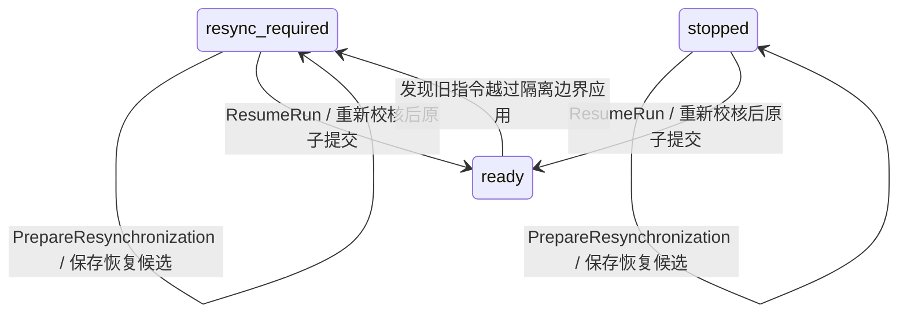

# 单微电网异常重新同步与显式恢复

本增量在既有软件执行闭环上增加两个本系统接口。D5000 或其他上游系统按公开契约提供规范化事实；项目不内置厂商协议、地址、点号或 D5000 通信实现。

维护负责人：仿真研究维护负责人；评审职责：优化调度维护负责人、设备控制维护负责人。

## 两步流程



准备成功返回 202 / pending，但会话仍然阻断或停止。只有独立调用 `ResumeRun`，且候选未过期、当前事实未变化、对账和校核再次通过，才提交新的确认状态并返回 ready。恢复本身不下发设备命令；下一周期仍须走准备、发送和执行反馈流程。

恢复确认的是新的实测边界。原初始化、原指令、失败及未知回执、历史证书均保留。失败周期不会被改成 confirmed，最后确认周期 ID 不因重新同步而虚增。

## 公开接口

请求使用既有 `single-microgrid-field-v0.1-draft` 消息信封。未知字段、无时区时间、非有限数值与非法枚举均拒绝。

| 操作 | POST 路径 | 请求模式 |
| --- | --- | --- |
| `PrepareResynchronization` | `/api/field/single-microgrid/resynchronizations/prepare` | `contracts/field_initialization/resynchronization.request.schema.json` |
| `ResumeRun` | `/api/field/single-microgrid/resume` | `contracts/field_initialization/resume-run.request.schema.json` |

响应使用 `ExecutionResponse`。200 为恢复提交成功，202 为候选准备完成，409 为业务拒绝，422/413/503 分别为报文无效、正文过大与存储不可用。相应响应模式由同一生成器导出，完整 HTTP 契约见 `contracts/openapi/simulation.openapi.json`。

`PrepareResynchronization.payload`：

| 字段 | 内容 |
| --- | --- |
| `context_id` | 当前受阻的上下文，必须与会话及输入快照关联一致 |
| `resynchronization_id` | 会话内不可变的恢复申请 ID |
| `pending_batch_id` | 查询得到的当前未决批次；没有则显式为 null |
| `snapshot` | 新的完整实测 `SubmittedSnapshot`，包括原采样时标、序号、设备 P/Q/E、负荷、风光可用量和 PCC |
| `planning_inputs` | 完整显式预测、费用与原储能任务；沿用 `PlanningInputs`，其 context_id 为 null |
| `authority` | 当前管理权限及控制代次，独立核验，不由客户端自报取得权限 |
| `quiescence` | 已声明发送批次的终结与隔离证据；未声明发送时为 null |
| `reason` | 操作原因及来源说明 |

成功数据包含 `resynchronization_id`、`proposed_context_id`、`recovery_status=prepared`、`recovery_expires_at` 和证据引用。原 `run_state`、确认状态和上下文保持不变。

`ResumeRun.payload` 只包含 `context_id`、`resynchronization_id`、`proposed_context_id` 和与候选完全相同的 `authority`。不提供 force、忽略安全检查、改任务或静默更换快照的选项。

## 未决动作如何核清

发送声明已经提交时，即使进程在实际发送前崩溃，也按可能在途处理。不能靠一张正常快照或一个 `settled=true` 标志解除阻断。

`quiescence` 包含：

- `command_batch_id`：原批次 ID。
- `previous_authority`：原批次绑定的完整控制权限。
- `fenced_at`：旧批次已被隔离、不再允许以后应用的边界。
- `settlements[]`：每条原命令恰好一项，包含 `command_id`、`resource_id`、`disposition`、`terminal_at`、`source_ref`。
- `source_ref`：可信管理方提供的整份终结及隔离证据引用。

终结结果为 `applied/rejected/cancelled/not_sent`；不接受 unknown。这里 cancelled 表示应用前已取消，not_sent 表示已核实未发送。已知采用或拒绝事实不能被矛盾的终结结果覆盖。曾采用的设定值与此刻实测输出分别记录。

新控制代次必须严格大于旧批次代次，所有终结时间不晚于隔离边界，新快照不早于该边界。未决历史必须与唯一未决指针一致，存在其他未核清批次时拒绝恢复。

本系统通过可注入 `RecoveryVerifier.verify_quiescence(microgrid_id, authority, evidence)` 核验证据来源和隔离效力。默认未配置核验器时，已声明发送的批次不能恢复。该端口是本系统的可信证据核验接口，不提供 D5000 通信；上游需按上述契约提供可核验的记录，部署方配置核验实现，不能使用无条件返回 true 的生产实现。

未声明发送的批次可由本系统在恢复事务内作废，无需伪造外部送达回执。部分设备采用、部分拒绝均逐条对账，不把整批虚构为执行成功或已物理回滚。

恢复后若又收到旧批次越过隔离边界应用的证据，或与终结事实矛盾的采用证据，会重新进入 resync_required；新确认状态不被旧回执覆盖。

## 模型、期限与实际状态

本阶段不开放网络、点表、运行方式、设备能力或权限模型修改。新权限可以更新控制代次与有效期，但 permission_revision 必须对应同一权限模型；更换控制方需要新的代次。

恢复使用原规划起点作为数值时钟锚点，保留原 PCC P/Q、误差带、响应绝对期限及储能任务全部字段。负荷与风光边界可以显式更新，但版本、生成时间、完整性和覆盖均须通过检查。不能复用同一资料版本改变内容，也不能用刷新预测顺延任务期限。

系统从新实测状态检查设备能力、PCC 一致性、AC 安全、安全续接及任务共同可达性。恢复期限后仍有效的目标时，新边界须满足相应跟踪要求，且新保证不缩短已有保证。已经到达请求 hold_until 的目标显式归档，响应通过 `recovery_expired_target_id` 标识，历史原目标不删除。

原储能任务尚未到期时重新校核剩余可达性。已经过期且没有已确认完成证据时返回 `TASK_DEADLINE_PASSED`，不以当前电量补造到期实绩。历史确认已证明 met 的任务保留原元数据和完成结果，后续数值规划不再重复执行已完成的任务；后续预测更新也继承该完成记录。

恢复使用精确瞬时量测、固定径向网络和一分钟网格。原 `software_synchronous_v1` 保持精确边界条件；新增 `bounded_monotone_v1` 可在采样后的允许准备窗口内恢复，并重新取得独立的异步续接证书，详见[有界时序接口](Field_Bounded_Timing.md)。候选有效期受该准备窗口限制。没有增加 SOC 转换、非零测量误差或硬实时保证。

## 作废、重启与事务

候选绑定当前输入、目标、确认状态、未决动作、观测及控制修订。新的停止请求即使内容相同，也会推进控制修订并作废旧候选；同消息重放保持原响应，不重复推进修订。

恢复提交前再次检查绑定、时效、权限、终结隔离和数学证据。新观测、执行事实或已生效资料使绑定改变时返回 `RECOVERY_STALE`；候选过期返回 `RECOVERY_EXPIRED`。准备和恢复的消息、恢复 ID、快照 ID、资料版本都具有冲突检查。历史成功响应不会重新激活候选；查询当前状态需使用新的消息 ID。

SQLite 增量增加 `recovery_attempts` 和 `recovery_heads`。候选证据不可变，消耗标记只在提交时改变。恢复上下文、目标证据、确认状态、观测指针、旧批次对账、阻断解除和响应在同一事务内提交；失败整体回滚。跨重启可重放已提交请求或显式恢复未消耗候选，但仍须满足新鲜度和当前事实检查。

旧程序不理解恢复头和消耗状态，禁止新旧版本并行写活动会话。回退前停止服务并备份数据库；不能依靠切换旧代码恢复未决动作。

## 装配与测试

```python
preparer, resumer = create_recovery_services(
    root, clock=clock, transport=transport, verifier=recovery_verifier,
)
```

类型从 `workflows.field_initialization.contracts` 导入；用例、`RecoveryVerifier` 从公共 `api` 导入。HTTP 装配使用 `create_app(..., field_transport=..., field_clock=..., field_recovery_verifier=...)`。影子恢复不授予写权限，默认服务不会创建真实通信连接。

```powershell
.\.venv\Scripts\python.exe -m pytest tests/workflows/test_field_recovery.py tests/integration/service/test_field_recovery_http.py -q
.\.venv\Scripts\python.exe tools/export_field_initialization_contracts.py --check
```

测试使用明确标识的解析网络、实测反馈测试替身和可信管理方测试替身，覆盖两步恢复、部分执行对账、期限保持、候选失效、并发、重启重放、过期、旧动作越界、影子权限及事务回滚。范围为软件验证，不是现场联调或现场保护验收。
