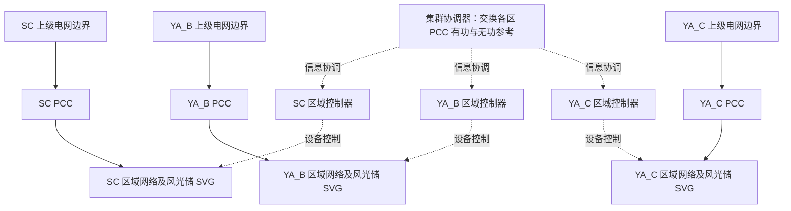
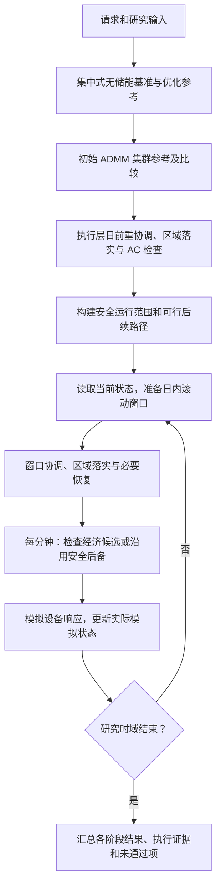

> 基于延安地区油田分散式风电，针对分散的多层级微电网（各个微电网分属不同区域电网），研究建立分层分级的分布式微电网集群控制模型，提出微电网集群优化控制算法，并开展对应的优化仿真分析。

## 1. 这套算法究竟在做什么

它协调多个区域微电网的购电、风光利用、储能和无功调节，使各区域满足自身设备与网络约束，同时满足设定的集群公共约束，并改善给定模型下的经济目标。

完整过程可以概括为：**各区域提出运行方案 → 集群协调各区的并网点功率 → 各区域落实设备计划 → 滚动使用模拟执行状态重算 → 每分钟通过安全检查后执行。**

需要区分三个对象：

| 对象 | 具体含义 | 后续还需要什么 |
| --- | --- | --- |
| 协调参考 | 每个区域在各时段应从上级电网受入多少有功、无功 | 区域网络和设备能否落实这条参考 |
| 区域计划 | 各台风机、光伏、储能、SVG 的计划出力及储能电量 | 动态响应和持续安全能否支持执行 |
| 模拟执行 | 每分钟真正被软件控制器采用的动作及模拟设备响应 | 进一步验证现场适用性；不能直接视为真实设备记录 |

因此，ADMM 是集群协调的重要算法，但不是全部控制算法。当前完整实现还包括区域物理优化、交流潮流校核、参考恢复、滚动反馈、安全监督和备用管理。

## 2. 电网对象与控制层级

### 2.1 当前研究算例包含三个区域

| 区域 | 研究对象 | 母线 / 支路数 | 风电 | 光伏 | 储能功率 / 总电量 |
| --- | --- | --- | --- | --- | --- |
| SC | 山城区域 | 10 / 9 | 10 MW | 4.2 MW | 2.5 MW / 5 MWh |
| YA_B | 参考延安化子坪构造的区域 | 7 / 6 | 5 MW | 3.2 MW | 2 MW / 4 MWh |
| YA_C | 参考延安榆树构造的区域 | 7 / 6 | 5 MW | 3.8 MW | 1.8 MW / 3.6 MWh |

这是当前统一研究台账的配置，不是对三地实际建设规模的完整确认。特别是延安两区的光伏、储能、SVG 等包含研究扩展配置。

每个区域拥有自己的网络和 PCC。PCC 是区域与上级电网连接的边界点；在当前模型中，正有功表示区域从上级电网受电。

### 2.2 物理网络与信息协调要分别理解



图中的三个上级电网框表示分别建模的边界，不表示代码已经建立三套完整上级电网模型。当前没有在三个区域之间设置可调度的电气联络线，也没有建立经过现场资料确认的共同上游支路。

各区主要通过总受电上限、聚合功率因数等公共约束协调。各区备用承诺还要接受联合网络和容量检查。**不能把集群协调理解成区域之间直接互送电。**

例如三个区域各自希望受电 8、10、9 MW，合计 27 MW，超过研究设置的 26 MW 上限，协调器需要调整区域参考。但调整量如何分配取决于各区的成本、资源和约束，不是固定平均分配，也不是把某一区的电沿一条已建模联络线送给另一区。

### 2.3 “多层级”在当前代码中的具体含义

| 层次 | 主要职责 |
| --- | --- |
| 集群协调层 | 协调各区域 PCC 的 P/Q 轨迹，处理公共容量、聚合功率因数、峰值和爬坡目标 |
| 区域优化层 | 将 PCC 参考落实为区域内设备计划，检查本区网络与储能等约束 |
| 设备执行与安全层 | 把计划转换成设备命令，模拟响应，检查分钟内及后续安全，反馈实际模拟状态 |

这是当前实现的控制分层；不能据此认定已经实现任意数量的“省网—地区网—变电站—场站”等递归层级。

区域网络采用固定运行方式下的径向、平衡正序准静态模型，PCC 根节点电压设为 1.0 pu。它研究功率、电压和能量随调度变化的情况，没有在这一集群流程中模拟任意环网切换、三相不平衡、孤岛频率或电磁暂态；变压器档位也不是当前联合调度的自由决策量。

## 3. 输入数据从哪里来

默认入口读取统一台账 `oilfield-unified-synthetic`，修订号为 `2026-09-21-v1`。本次读取的 SHA-256 为：

```text
ecb39787fca686e7206b5544ddac59ab42aa37a70e922f06e8efd11239d2740e
```

台账保存网络、设备、负荷规模和研究参数；程序据此生成时序。其输入既包含资料参考，也包含模拟假设，运行时不会自动从项目 Word、Excel 文件中抽取完整现场数据。

| 数据 | 内容与用途 |
| --- | --- |
| 网络与设备台账 | 母线、支路、阻抗、容量、风光位置、储能能量范围、SVG 能力等，决定可行空间 |
| 日前预测 | 形成全日参考及基准比较；原生为 96 个 15 分钟点 |
| 日内预测 | 滚动窗口读取的另一组模拟预测；原生同样为 96 个 15 分钟点 |
| 分钟模拟输入 | 1440 个一分钟负荷与风光可用量，作为模拟执行时的外部输入 |
| 价格与目标权重 | 购电、弃电、储能退化、网损、峰值等权重，影响方案选择 |
| 通信与物理事件 | 通信丢包、延迟、中断及预设物理事件，用于研究扰动影响 |
| 策略与容差 | 跟踪容差、安全扰动范围、备用要求、求解预算等，随结果记录 |

日前、日内和分钟输入由确定性规则及不同随机种子生成。日内预测不是算法在线训练得到的预测；每次滚动主要是重新读取窗口并反馈已执行状态，不是每 15 分钟自动产生一个新的现场预测版本。

若调用者显式传入 `input_case`，执行适配器会把它标记为“捕获算例持续性场景”：日内沿用原预测，分钟输入逐段保持。手工传入一个 `ProjectCase` 不等于已经连接真实遥测。

当前新增的现场初始化、预测更新、目标接纳、快照和单分钟准备接口，面向**单微电网影子运行**。它们与集群默认模拟入口不是同一条完整现场闭环。参见 [Field_Initialization.md](Field_Initialization.md) 和 [Field_Control_Cycles.md](Field_Control_Cycles.md)。

对应代码：[project_dataset.py](../../src/oilfield_energy/bootstrap/adapters/project_dataset.py)、[studies/domain.py](../../src/oilfield_energy/modules/studies/domain.py)、[studies/application.py](../../src/oilfield_energy/modules/studies/application.py)、[cluster_execution.py](../../src/oilfield_energy/bootstrap/adapters/cluster_execution.py) 的 `_execution_inputs()`。

## 4. 时间尺度与一次完整运行

| 时间尺度 | 当前通常设置 | 作用 |
| --- | --- | --- |
| 日前 | 24 小时；96 点时每点 15 分钟 | 制定全日参考和储能电量安排 |
| 日内滚动 | 每 15 分钟更新一次，通常向前看 240 分钟 | 根据已经执行的状态重算，只执行近期部分 |
| 设备执行 | 每 1 分钟一次 | 选择获证动作、模拟设备响应、更新能量和备用状态 |
| ADMM 迭代 | 数值计算轮次 | 求取一个规划窗口的协调参考，不代表物理时间推进 |

默认数据构造函数的 `steps` 表示 **24 小时被分成多少点**。例如 `steps=8` 是每点 3 小时，不是只运行 8 个 15 分钟时段。当前网页普通集群任务固定提交 96 点；CLI 的 `cluster` 命令默认也为 96 点，但直接构造 `SimulationRequest` 的默认值为 8 点，应显式设置。

滚动到研究末段时，常规窗口会缩短；若备用响应、支撑或恢复期限跨越研究终点，代码可能延长证明所用的预测尾段，并标记末值保持假设。滚动更新次数、执行分钟数和 ADMM 迭代次数必须分别查看。



图中展示常规流程；任何必要证据缺失、输入越域或执行错误都可能使运行提前结束，结果应保留已完成部分及原因。

## 5. 算法决定哪些量，又要遵守哪些约束

### 5.1 主要决策量

| 变量 | 含义 |
| --- | --- |
| 区域 PCC 有功 `P_grid` | 区域从上级电网受入的有功，单位 MW |
| 区域 PCC 无功 `Q_grid` | 区域与上级电网交换的无功，单位 Mvar |
| 风光实际利用功率 | 不超过可用出力，可因安全或网络约束弃风弃光 |
| 储能充电、放电功率 | 分别作为非负规划变量；净注入为“放电减充电” |
| 储能电量 `E` | 单位 MWh，连接不同时段，限制后续调节能力 |
| 各资源无功 | 按能力边界分配；默认光伏、储能无功为零，主要由风机和 SVG 调节 |
| 网络变量 | 母线电压、支路有功与无功、电流平方等，用于检查物理约束 |

区域有功平衡可以直观理解为：

```text
上级受电 + 风电利用 + 光伏利用 + 储能放电
    = 区域负荷 + 储能充电 + 网络损耗
```

规划中的储能电量递推为：

```text
E[t+1] = E[t] + η充 × P充[t] × Δt − P放[t] × Δt / η放
```

这里 `Δt` 用小时。分钟执行层则按实际模拟功率变化轨迹积分，不能直接用规划电量替代执行电量。

### 5.2 主要约束

| 约束 | 当前实现的作用 |
| --- | --- |
| 区域受电上下限 | 台账为 0.5～18 MW；实际规划下界还会取动态安全阈值与固定下界中的较大值 |
| 集群受电上限 | 三个区域 PCC 有功之和不超过 26 MW；执行参考还会预留跟踪误差余量 |
| 功率因数 | 区域规划默认目标 0.92，集群聚合目标 0.95；两者适用对象不同 |
| 风光与无功能力 | 可用功率、绝对 Q 上限、风机 Q/P 限制及视在容量；弃风也可能减少风机无功能力 |
| 储能 | 功率、电量、效率、期末电量、备用空间及动态可达性；物理计划还需确认充放电模式 |
| 网络 | 节点功率平衡、电压范围、线路两端容量、变比及并联无功等 |
| 动态响应 | 设备响应速度、爬坡、无功变化，以及从当前实际模拟状态到新计划的可达性 |

动态安全下界使用光伏渗透率、净负荷变化和估计倒送风险等研究特征。它不是现场保护定值，也不是已经由历史量测训练并校准的概率模型。

在三个区域各允许约 0.05 MW 跟踪偏差时，执行参考会从总容量中预留约 0.15 MW，加上数值余量，避免各区域都处于允许偏差上沿时共同超过总上限。预留余量改变的是参考可用空间，不改变物理容量 26 MW 的定义。

对应代码：[planning_security.py](../../src/oilfield_energy/planning_security.py)、[domain_security.py](../../src/oilfield_energy/modules/dispatch/domain_security.py)、[application_capacity.py](../../src/oilfield_energy/modules/dispatch/application_capacity.py)。

### 5.3 调度偏好不是一张固定优先级表

经济目标包含购电、弃电、储能退化等成本，并结合网损、电压偏差、峰值与爬坡等项。优化会综合权重和约束决定设备动作。

因此，“低价充电、高价放电”“优先消纳风光”是可能出现的合理结果，不是无条件执行的规则。为保证安全、备用、电量恢复或网络可行性，算法可以保留储能能力、减少新能源利用或偏离经济参考。

普通经济优化也不是始终“先调 SVG，再调风机”。安全终端构造中的有限无功分配策略，与区域经济优化的联合决策应分开理解。

### 5.4 优化目标与报告中的经济费用不是同一个数

当前经济核算将以下四类费用相加：

```text
经济费用 = 购电费用 + 弃风弃光代价 + 储能充放电退化代价 + 网损代价
```

| 项目 | 当前默认研究设置 |
| --- | --- |
| 购电价格 | 00:00～07:00 为 280 元/MWh，17:00～22:00 为 1180 元/MWh，其余为 720 元/MWh |
| 弃风弃光代价 | 520 元/MWh |
| 储能退化代价 | 充电量与放电量之和按 70 元/MWh 计 |
| 网损代价 | 650 元/MWh 的额外权重 |

购电功率本身已经反映供给网络损耗所需的电能；额外网损项体现模型对损耗的重视程度。因此上述“经济费用”是声明的加权运行费用，不能直接当作供电公司电费账单。

优化还可能加入电压偏差、峰值、爬坡、无功正则和参考跟踪等目标项。这些项影响求解，但不全部进入上面的四项经济核算。比较结果时应使用明确的 `economic_cost_cny`，不能把带有不同惩罚项的求解器目标值直接混比。

对应代码：[dispatch/application.py](../../src/oilfield_energy/modules/dispatch/application.py) 的 `evaluate_economics()`、[simulation_case.py](../../src/oilfield_energy/bootstrap/adapters/simulation_case.py) 的价格构造，以及 [data.py](../../src/oilfield_energy/data.py) 的 `ModelAssumptions`。

## 6. ADMM 如何协调各区域

### 6.1 它分解的是什么问题

每个区域保留自己的负荷、设备和网络模型，求解本区方案；协调器通过各区 PCC 的 P/Q 轨迹处理公共约束。

设 `x_r` 为区域 `r` 提交的 PCC 有功、无功轨迹，`z_r` 为协调器分配的轨迹，`u_r` 为累计协调偏差。一个有效协调更新可写成：

```text
区域求解：x_r ← 满足本区约束，并最小化
                    本区目标 + ρ/2 × ||x_r − z_r + u_r||²

集群投影：z ← 满足公共约束，并最小化
                    ρ/2 × Σ||z_r − (x_r + u_r)||²
                    + 集群峰值项 + 集群爬坡项

偏差更新：u_r ← u_r + x_r − z_r
```

这里的附加平方项推动区域方案和集群参考一致。它是求解协调问题的数值机制，不应直接解释成现场对某一区域收取的费用。

集群功率因数约束采用：

```text
|Σ Q_r| ≤ tan(arccos(0.95)) × Σ P_r − 无功安全余量
```

当前受电下界为正，因此该式对应正受电方向下的聚合功率因数。它不能替代每一个现场考核点各自的功率因数判断。

### 6.2 区域协调模型不是简单的负荷相减

正式服务显式选择 `branch-flow-socp-v1`，区域协调模型已包含网络、电压、损耗和设备 P/Q 能力。不能因为 `ADMMConfig` 类仍保留 `aggregate-v1` 默认值，就认定正式入口只使用总量模型。

但为了保持区域问题的凸性，这一层仍有松弛：储能充放电用凸包约束表示，支路电流与功率关系采用二阶锥不等式。它为协调提供网络感知能力，**没有替代后续的储能模式确认和独立 AC 物理检查**。

### 6.3 什么时候停止迭代

算法检查：

- 原始残差：区域方案与集群分配之间的差异 `||x−z||`。
- 对偶残差：集群分配变化的幅度 `ρ||z−z_previous||`。
- 残差是否同时低于按变量规模和数值大小计算的阈值，并持续达到指定次数。

默认 `ρ=120`、绝对与相对容差均为 `0.002`，要求连续 3 次有效协调更新满足条件；请求可改变计算预算。普通服务请求默认 ADMM 上限 220 轮，质量优先策略则有 360、720、1000 的分级预算。

通信时钟推进但没有收齐同一轮消息时，不算一次新的全局协调更新。结果中的 `iterations` 和 `coordination_updates` 因而可能不同。

### 6.4 分布式实现的边界

算法逻辑按区域分解，并通过消息语义交换协调信息；当前 ADMM 驱动仍在同一 Python 进程中组织各区域计算，通信由软件模拟。区域物理计划在日内滚动时可使用本机进程池并行，这也不等于多区域现场控制器已经独立联网部署。

正式流程还计算集中式基准，必要时进行联合物理恢复。因此更准确的说法是：**已实现分布式区域协调算法及其分层仿真执行流程，完整流程仍包含集中式计算环节。**

对应代码：[admm.py](../../src/oilfield_energy/admm.py)、[regional_control.py](../../src/oilfield_energy/regional_control.py)、[hierarchy_types.py](../../src/oilfield_energy/hierarchy_types.py)。

## 7. 区域如何把参考落实成能执行的计划

区域拿到 PCC 的 P/Q 目标后，需要重新求解含设备和网络的物理计划。默认规划跟踪容差为有功 0.05 MW、无功 0.05 Mvar；这些是研究容差，不是现场验收值。

主要检查包括：

1. **设备计划检查**：功率、电量、充放电状态、备用和设备能力等是否满足要求。
2. **独立 AC 检查**：将计划放回交流网络，检查电压、支路容量和功率一致性。
3. **P/Q 跟踪检查**：区域实际可实现的 PCC 轨迹是否落在参考允许范围内。
4. **采用条件检查**：所需质量、动态可达性和恢复证据是否齐备。

区域模型主要使用 MISOCP 支路潮流模型。实现可以先尝试储能整数变量松弛并认证其物理模式；不能认证时，转向保留整数模式的求解。交流一致性不足时，会按策略反馈损耗、电压边界或进入 AC 恢复。

### 7.1 原参考落实不了时如何处理

恢复围绕**同一规划窗口、同一初态**进行，不会为了让求解成功而偷偷推进设备或重置电量。

| 恢复方式 | 作用与边界 |
| --- | --- |
| 诊断与重协调 | 使用区域诊断信息更新协调依据及跟踪余量；有次数预算 |
| 完整轨迹候选组合 | 组合已取得的区域候选；保留整条轨迹，不把不同候选字段随意拼接或取平均 |
| 联合物理恢复 | 在限定预算内联合求解各区网络与设备，寻找可用的新参考 |
| AC 可行恢复 | 在原参考或模型条件下寻找经过物理校核的可行候选，并单独标记经济精度是否已证明 |

联合恢复优先减小对原 P/Q 参考的偏离，再在允许偏离范围内改善经济目标。即使它返回了可行计划，也不能将其解释成整个分层执行问题已经达到全局经济最优。

恢复得到的新参考仍须经过区域落实和联合采用检查。有限搜索未找到证据，表示当前方法或预算下未证明，不自动表示真实电网一定无解。

对应代码：[cluster_execution.py](../../src/oilfield_energy/bootstrap/adapters/cluster_execution.py) 的 `_solve_regional_plan()`、[misocp_model.py](../../src/oilfield_energy/misocp_model.py)、[ac_consistency.py](../../src/oilfield_energy/ac_consistency.py)、[cluster_recovery.py](../../src/oilfield_energy/bootstrap/adapters/cluster_recovery.py)、[recovery.py](../../src/oilfield_energy/workflows/cluster_execution/recovery.py)、[cluster_joint_recovery.py](../../src/oilfield_energy/bootstrap/adapters/cluster_joint_recovery.py)。

## 8. 日内滚动如何形成反馈闭环

以正常 15 分钟更新为例：

1. 到达窗口起点，读取已经模拟执行得到的储能电量、设备 P/Q 和备用任务状态。
2. 截取未来通常 4 小时的日内预测，并确定窗口末端电量目标。末端目标参考已经取得执行资格的日前电量安排，再结合备用等要求处理。
3. 从真实的当前模拟状态出发，加入储能可达性、无功响应和备用约束；风光规划还会使用声明的保证可用出力边界。
4. 运行窗口 ADMM、区域物理落实与必要恢复。
5. 新方案通过采用检查及安全续接检查后，才成为当前经济候选计划。
6. 逐分钟执行接下来的 15 分钟，使用每次响应后的状态推进电量、设备和备用任务。
7. 到达下一窗口，以这些反馈状态继续重算。

“滚动优化”意味着不断重算未来、只执行近期部分。不能将每个窗口的整条 4 小时计划直接拼接成一天实绩，因为后续窗口会替换尚未执行的部分。

若新经济计划没有通过，但已保留有效的安全后续路径，控制器可以继续沿该路径运行；若既没有合格计划，也没有可持续的后备证据，则停止并记录原因。

默认 v6 日前执行层会重新协调并可能恢复参考，所以服务层最初的 ADMM 曲线不一定就是后续日内执行所依据的最终日前参考。

对应代码：[rolling.py](../../src/oilfield_energy/workflows/cluster_execution/rolling.py) 的 `run_feedback_loop()`、[cluster_rolling.py](../../src/oilfield_energy/bootstrap/adapters/cluster_rolling.py) 的 `RollingClusterEngine`。

## 9. 每分钟到底执行哪一条指令

### 9.1 经济计划先作为候选

适配器读取当前计划中的设备目标，结合当前设备状态与响应模型反算、调整命令。随后安全控制器检查该候选是否既能安全执行这一分钟，又能保留一条可行的后续路径。

| 情况 | 选择的动作 | 如何理解 |
| --- | --- | --- |
| 经济候选及后续路径获证 | `economic` | 采用经济候选；实际响应仍由设备模型计算 |
| 经济候选未获证，但原后备路径仍有效 | `backup` | 沿已经保存的安全路径继续，可能偏离经济目标 |
| 已进入获证可持续终端状态 | `terminal` | 使用终端控制维持声明范围内的运行 |
| 已接纳备用调用 | `reserve` | 按备用调用控制，普通经济候选不能抢占 |
| 观察输入或状态离开原认证范围 | 停止推进并记录失败 | 原证据不再适用，不能继续声明安全 |

### 9.2 为什么检查“后续路径”

仅保证当前一分钟不越限还不够。例如这一步虽然能降低购电功率，却可能把储能用到无法恢复备用，或使后续负荷增加时没有调节空间。

安全监督因此要求：**这一分钟的动作安全，而且执行后仍有路可走。** 后续路径最终要能到达一个在声明条件下可持续保持的终端状态。经济候选不合格时，保留原路径，不重置储能状态或原有恢复期限。

这是一种带明确假设的安全构造，不是对所有可能现场变化的普遍保证。

### 9.3 它检查的不只是分钟端点

当前设备模型在一分钟内采用声明的 P/Q 变化轨迹；安全认证检查整个过渡区间，包括设备能力、储能能量、区域 AC 网络与集群约束。储能电量按功率轨迹积分，充放电跨零时分别应用效率。

因此，“一分钟开始和结束都不越限”不自动等价于整分钟安全。当前测试专门覆盖了端点看似安全、区间内部却可能出现问题的情形。

### 9.4 保证依赖哪些假设

默认运行域包括：母线负荷 P/Q 在预测值 ±2.5% 范围内；风电保证可用量为预测扣减额定有功的 5%，光伏为扣减 15%，负值截为零。正式模拟初态以可控资源 P/Q 为零、储能采用算例电量初始化。

同时假定外部输入分钟内保持、设备按声明响应模型变化、状态观察完整准确、研究终点后的边界按声明末值保持。扰动参数是研究设置，并不因为模拟曲线用了某个随机误差幅度，就自动证明所有模拟输入都会落在安全范围内。

终端和返回路径采用有限、保守的构造，返回搜索默认最多 90 分钟。未找到获证路径不等于不存在其他物理可行控制方式。

对应代码：[cluster_safety.py](../../src/oilfield_energy/bootstrap/adapters/cluster_safety.py)、[safety_controller.py](../../src/oilfield_energy/workflows/cluster_execution/safety_controller.py)、[safety_certificates.py](../../src/oilfield_energy/workflows/cluster_execution/safety_certificates.py)、[safety_network.py](../../src/oilfield_energy/workflows/cluster_execution/safety_network.py)、[application_cluster_tube.py](../../src/oilfield_energy/modules/control/application_cluster_tube.py)。

## 10. 备用究竟是什么，为什么需要调用

备用是预留的调节能力：当负荷、风光或外部功率要求发生变化时，储能还应有能力增加或减少净注入，而不是已经被经济调度用满。

这里的“备用产品”是对这种服务的具体约定，包含响应时间、支撑时间、可调用范围和恢复条件，不是另一个软件产品。默认约定为 **1 分钟响应，随后支撑 15 分钟**。

要分清三件事：

| 概念 | 含义 |
| --- | --- |
| 预留备用 | 规划时保留功率和电量空间，即使当前没有调用也可能影响经济计划 |
| 备用调用 | 明确要求提供某一方向、某一幅度的调节，并执行相应动作 |
| 备用恢复 | 调用或运行后重新取得承诺的调节能力，受原有恢复期限约束 |

当前安全控制器提供显式接纳备用事件及逐分钟调用接口。接纳前要确认已经回到获证待命状态、备用能力完整、历史恢复任务完成，并证明调用和返回过程可行。调用期间使用专门的备用控制。

**普通完整仿真不会仅因启用了备用策略，就自动发生一次备用调用。** 是否实际调用，应查看 `safety.reserve_events` 及执行步骤中的 `source=reserve`。研究接口和专项测试能够显式发起调用；预留能力、预测误差和一次真实调用不能混为一谈。

当前也不保证无限连续、同方向的备用调用。再次接纳前仍需满足恢复与待命条件。

对应代码：[contracts_reserve.py](../../src/oilfield_energy/modules/dispatch/contracts_reserve.py)、[safety_activation.py](../../src/oilfield_energy/workflows/cluster_execution/safety_activation.py)、[safety_reserve.py](../../src/oilfield_energy/workflows/cluster_execution/safety_reserve.py)、[safety_controller.py](../../src/oilfield_energy/workflows/cluster_execution/safety_controller.py)。

## 11. 通信故障影响哪个环节

通信研究主要作用于 ADMM 的协调消息：上层发送参考与协调变量，区域返回本区方案。代码模拟丢包、延迟、中断、消息过期及恢复。

收到消息时，必须确认其轮次与新鲜度。协调器收齐同一协调轮次的区域响应后，才形成一次完整的全局更新；不会把不同轮次的最新消息随意拼成一致结果。区域暂时收不到新消息时，可以使用仍有效的缓存；缓存过期后，可转向不带协调惩罚的本区自主计算。

这个自主计算本身并不等于已经取得全局采用资格，后续仍要经过集群与执行检查。分钟执行还能否继续，取决于已保留的安全路径，而不是仅凭“区域还能求解”判断。

这里的中断起止通常按**算法迭代轮次**设置，不是现场秒数。若算法提前停止、没有覆盖设定的故障窗口，结果不能声称已经验证了那次中断；服务会记录事件覆盖情况。

当前模拟不直接证明真实通信网络的时延、设备命令丢失处理或硬实时控制能力。

## 12. 如何正确阅读输出结果

### 12.1 各类结果的数据来源不同

| 输出位置 | 当前来源 | 适合回答的问题 |
| --- | --- | --- |
| `executive_summary` 的经济比较、`comparison` 中基准与优化费用 | 集中式无储能基准与集中式优化参考 | 在这一比较模型下，优化参考改善多少 |
| 顶层 `timeseries` | 所选区域的集中式基准 / 优化轨迹 | 集中式参考中这个区域怎么调度 |
| 顶层 `cluster_timeseries` 的受电 P/Q、各区受电 | 服务层初始 ADMM 的集群参考 `z` | 初始协调希望各区如何受电 |
| 同一 `cluster_timeseries` 的新能源利用量 | 集中式优化结果 | 集中式参考的风光利用情况 |
| `admm_history`、`coordination_snapshot`、`communication` | 服务层初始 ADMM | 初始协调怎样迭代、通信如何影响它 |
| `reference_economics` | 初始 ADMM 的区域方案及规定的经济核算 | 协调参考的经济核算和比较范围 |
| `realized_regional_economic_cost_cny` | 日前执行阶段已落实区域计划的费用之和，完整时才给出 | 日前区域落实计划的费用；不是全天分钟执行实绩费用 |
| `cluster_execution.stages` | 日前落实、日内滚动及分钟执行分别汇总的证据 | 哪个阶段通过、哪个阶段未知或越限 |
| `cluster_execution.rolling_updates` | 每次窗口的初态、目标、恢复与采用记录 | 为什么这一窗口采用或拒绝新方案 |
| `cluster_execution.safety` | 安全域、续接证据、逐分钟动作和状态、备用事件、失败原因 | 实际模拟执行采用了什么，安全依据是什么 |

特别注意：顶层 `cluster_timeseries` 中有不同计算来源的列，不能把它们直接当成同一次分钟执行的功率平衡账本。顶层初始 ADMM 也可能与执行层重协调后的参考不同。

要回答“设备最终怎么动、储能最终用了多少电”，应查看分钟阶段的 `resource_p_mw`、`resource_q_mvar`、`storage_energy_mwh` 及安全步骤的 `before/after/source`，而不是仅看顶层计划图。

### 12.2 状态分别意味着什么

| 状态或标记 | 含义 |
| --- | --- |
| 任务 `succeeded` | 服务完成并返回结果，不保证所有算法检查通过 |
| ADMM `converged` | 协调问题达到数值停止条件，不保证最终执行全部合格 |
| `passed` | 对应阶段或对应检查取得要求的证据；仍受其模型范围约束 |
| `violated` | 对应检查发现违规或该阶段明确不满足条件；应继续读具体原因 |
| `unknown` | 缺少证据、求解 / 恢复未完成，或某项性质没有证明 |
| `not_computed` | 没有进行相应计算 |
| `overall_passed` | 服务将集中式校核、初始 ADMM、集群约束、执行阶段及各检查项汇总后的结论 |

安全后备允许偏离原经济目标。因此，可能出现“已执行部分有安全证据，但经济跟踪为 `unknown`，整体没有通过”的结果。这应按具体检查解读，不能一律解释成设备运行越限。

CLI 的 `cluster` 和批量适配器主要根据 `cluster_execution.status` 判定执行是否通过；严格评价一次研究，还应同时查看 `overall_passed` 和各项原因，不能只用命令退出码代替全部判断。

### 12.3 经济最优性需要单独判断

当前已经有经济优化，不等于最终闭环策略的全局经济最优性已经证明。ADMM 区域目标还带平方爬坡、无功正则项；物理规划、协调投影、恢复和安全后备的目标及约束也不完全相同。

某个求解器的 `optimal`、某个子问题的 MIP gap、ADMM 收敛或安全证书，都只支持各自范围内的结论。尤其 AC 可行恢复可以在允许策略下采用“物理可行、原经济精度仍未知”的计划，不能把可行性阶段的零间隙当成经济最优证据。

对应代码：[service.py](../../src/oilfield_energy/service.py) 的 `_cluster_timeseries()`、`_run_cluster()`；[cluster_execution/api.py](../../src/oilfield_energy/workflows/cluster_execution/api.py)；[cluster_safety.py](../../src/oilfield_energy/bootstrap/adapters/cluster_safety.py) 的 `minute_evidence()`。

## 13. 按什么顺序阅读代码

下表给出主线入口，不要求先读完所有辅助模块。

| 顺序 | 文件 / 入口 | 阅读重点 |
| --- | --- | --- |
| 1 | [service.py](../../src/oilfield_energy/service.py)：`_run_cluster()` | 一次请求经历哪些计算，结果来自哪里 |
| 2 | [project_dataset.py](../../src/oilfield_energy/bootstrap/adapters/project_dataset.py)：`build_synthetic_case()` | 默认数据、24 小时时间轴及来源标识 |
| 3 | [admm.py](../../src/oilfield_energy/admm.py)：`run_admm_coordination()` | 初始化、消息轮次、区域求解、投影、残差、停止 |
| 4 | [regional_control.py](../../src/oilfield_energy/regional_control.py) | 区域凸优化与集群投影到底包含哪些变量和约束 |
| 5 | [cluster_execution.py](../../src/oilfield_energy/bootstrap/adapters/cluster_execution.py)：`run_cluster_execution()`、`ExecutionEngines` | 日前、日内、分钟三阶段怎样装配，以及正式启用哪些策略 |
| 6 | [misocp_model.py](../../src/oilfield_energy/misocp_model.py)、[ac_consistency.py](../../src/oilfield_energy/ac_consistency.py) | 区域物理计划、储能模式及独立 AC 采用检查 |
| 7 | [cluster_recovery.py](../../src/oilfield_energy/bootstrap/adapters/cluster_recovery.py)、[recovery.py](../../src/oilfield_energy/workflows/cluster_execution/recovery.py) | 参考落实失败后的诊断、重协调及联合恢复 |
| 8 | [cluster_rolling.py](../../src/oilfield_energy/bootstrap/adapters/cluster_rolling.py)、[rolling.py](../../src/oilfield_energy/workflows/cluster_execution/rolling.py) | 窗口、反馈状态、末端电量、采用与执行推进 |
| 9 | [cluster_safety.py](../../src/oilfield_energy/bootstrap/adapters/cluster_safety.py) | 优化计划如何进入分钟控制，以及如何形成执行证据 |
| 10 | [safety_controller.py](../../src/oilfield_energy/workflows/cluster_execution/safety_controller.py)、[safety_certificates.py](../../src/oilfield_energy/workflows/cluster_execution/safety_certificates.py) | 动作选择、保留后续路径、终端、备用接纳 |
| 11 | [application_cluster_tube.py](../../src/oilfield_energy/modules/control/application_cluster_tube.py) | 连续过渡、储能积分与设备模型一致性 |
| 12 | [contracts.py](../../src/oilfield_energy/workflows/cluster_execution/contracts.py)、[contracts_safety.py](../../src/oilfield_energy/workflows/cluster_execution/contracts_safety.py) | 每个状态、策略字段和证据对象的实际语义 |

文件适配器 [cluster_study.py](../../src/oilfield_energy/bootstrap/adapters/cluster_study.py) 负责保存请求、完整结果、执行证据和失败信息；它不是另一套调度算法。CLI 的 `hierarchical` 是兼容命令入口，仍调用 `run_cluster()`；其中打印的旧版本文字不能作为算法版本依据，应读取结果中的 `algorithm_version`。

## 14. 本次实际验证了什么

本次除阅读当前主线代码、策略契约和已有说明外，还读取了默认研究台账，并执行了两组针对性测试。未修改算法或测试文件。

| 测试组 | 覆盖内容 | 结果 |
| --- | --- | --- |
| 协调、滚动与安全 | 消息语义、设备过渡、集群容量 / 功率因数余量、协调快照、滚动工作流、执行阶段、安全后备、连续区间约束、备用反馈 | 51 通过，2 失败；约 27.66 秒 |
| 服务入口与恢复 / 经济核算 | 服务 / CLI / 文件 / 批量入口一致性、拒绝结果保存、参考恢复、物理恢复、候选选择、经济核算 | 72 通过；约 20.00 秒 |

合计 **123 项通过、2 项失败**。两项失败均来自 `test_reserve_feedback.py` 中参数为 0.5 和 2.0 的同一个测试：它尝试通过 `monkeypatch.setattr()` 替换 `cluster_rolling.observe_storage_reserve`，但当前模块已没有这个属性，于测试准备阶段抛出 `AttributeError`，尚未进入该项的备用反馈计算。

因此，这两项表明测试引用与当前模块结构未同步；本轮不能声称该测试所验证的行为已经通过，也不能据此判定备用算法本身失效。同文件中显式备用调用测试通过，其他安全测试也覆盖了调用后返回等场景。

第二组服务测试确实运行了一个四点、重新设置为一小时的研究算例，刻意把 ADMM 预算限制为 4 轮，验证未通过结果及其证据能够被保留。它不是默认 96 点全日成功算例。

复现本次测试的命令如下，在仓库根目录执行：

```powershell
& .\.venv\Scripts\python.exe -m pytest `
  tests/unit/control/test_coordination_messages.py `
  tests/unit/control/test_cluster_tube.py `
  tests/unit/dispatch/test_cluster_capacity_margin.py `
  tests/unit/dispatch/test_cluster_power_factor_margin.py `
  tests/unit/dispatch/test_coordination_snapshot.py `
  tests/workflows/test_cluster_rolling.py `
  tests/workflows/test_cluster_execution.py `
  tests/workflows/test_cluster_safety.py `
  tests/workflows/test_cluster_interval_constraints.py `
  tests/integration/service/test_reserve_feedback.py -q --durations=8

& .\.venv\Scripts\python.exe -m pytest `
  tests/integration/service/test_cluster_authority.py `
  tests/workflows/test_reference_recovery.py `
  tests/workflows/test_network_physical_recovery.py `
  tests/workflows/test_network_candidate_recovery.py `
  tests/unit/dispatch/test_economics.py -q --durations=8
```

本轮没有重跑默认 96 点、全天分钟执行的完整质量优先仿真，也没有执行全仓库测试或真实设备测试。上述专项测试同时包含真实数值计算、简化场景和注入回调的流程测试，不能将测试数量解释为已覆盖全部全天运行情形。

如需另行开展完整研究，可使用统一文件入口保存证据。以下命令是复现入口说明，本轮未执行；输出目录必须尚不存在：

```powershell
& .\.venv\Scripts\python.exe -m oilfield_energy.cli cluster `
  --steps 96 --time-limit 180 `
  --output artifacts/cluster-full-study
```

该命令采用普通预算，并不自动启用网页的 `quality-first-v1`。需要精确复现网页请求时，应保存其完整请求 JSON，使用 `cluster --input <请求文件> --output <新目录>`，同时保留数据摘要和结果。一个求解器调用的时间限额不是整个全日研究的总耗时上限。

## 15. 当前可以得出的结论与仍需补齐的证据

| 关注点 | 根据当前源码和本次验证可以说明的内容 | 仍需补齐的部分 |
| --- | --- | --- |
| 分层集群控制 | 已有三区域模型、ADMM 协调、区域物理落实、滚动反馈和分钟安全执行实现 | 更复杂层级、更多区域及不同拓扑的适用性需分别验证 |
| 延安现场对应关系 | 台账包含部分资料依据和明确研究假设 | 现场网络参数、设备对应、同期预测量测和运行方式仍需补齐、确认 |
| 跨区域公共约束 | 已按研究参数进行容量、聚合功率因数等协调 | 实际电气联络、信息协调、共同考核关系和约束来源缺失或未确认，不能直接把 26 MW 当作真实共同通道容量 |
| 经济优化 | 有明确目标、优化求解及参考经济比较 | 最终分钟闭环实绩的完整费用评价、全过程全局最优性及现场收益需要进一步证据 |
| 连续安全与备用 | 对声明模型、初态、扰动范围和有限构造提供认证及测试 | 任意现场初态、越域扰动、真实测量和执行误差不自动包含在保证内 |
| 通信与现场执行 | 已有通信故障模拟、设备响应模拟和单微电网影子接口 | 多区域实际通信及设备联合测试、实时性和闭环运行验证 |
| 当前版本整体可运行性 | 本轮专项测试结果及一个短时拒绝场景有记录 | 当前版本默认全日成功运行的完整证据需另行生成与审核；另有两项旧测试引用需要同步 |

后续逐项深入时，可以依次选取一个区域、一个协调轮次、一个滚动窗口和一个执行分钟，沿本文第 13 节的代码入口核对输入、决策、检查和输出。这样能够把“算法设想”“代码实际行为”和“已经验证的结论”逐一对应起来。
