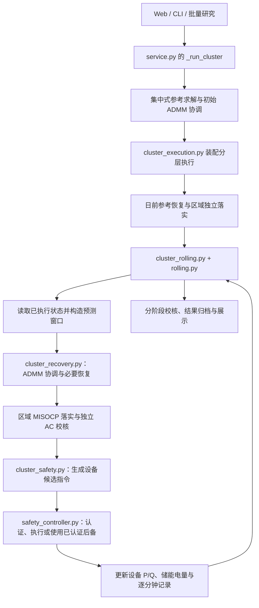

# 延安多层级微电网集群控制算法的源代码分布说明

本文说明“延安地区多层级微电网集群控制”这一条要求在当前项目中对应哪些代码、各文件承担什么职责，以及主要调用关系，供按功能阅读源码时使用。

依据：[《3.1 技术要求及方案（区域型油田电网新能源协同控制运行技术研究）630》](<../docs/3.1 技术要求及方案（区域型油田电网新能源协同控制运行技术研究）630.docx>)“委托研发方案”第（3）项：

> 基于延安地区油田分散式风电，针对分散的多层级微电网（各个微电网分属不同区域电网），研究建立分层分级的分布式微电网集群控制模型，提出微电网集群优化控制算法，并开展对应的优化仿真分析。

以下按当前代码实际职责建立对应关系；部分文件由单微电网、集群和其他研究功能共用，不能仅凭文件名认定其专为这一项编写。

## 1. 先看整体分布

这条要求的实现主要分布在区域数据与网络建模、分布式协调优化、区域计划落实、集群滚动执行和仿真评价五部分。

| 要求中的内容 | 主要代码位置 | 负责的问题 |
| --- | --- | --- |
| 基于延安地区分散式风电 | `bootstrap/assets/unified_dataset.json`、`bootstrap/adapters/project_dataset.py` | 化子坪、榆树的参考设备与接入关系，以及模拟运行曲线如何进入算例 |
| 各微电网分属不同区域电网 | `data.py`、`network_model.py`、`regional_control.py` | 如何分别表达各区域的网络、资源、运行限制和本地优化问题 |
| 分层分级集群控制模型 | `bootstrap/adapters/cluster_execution.py`、`cluster_rolling.py`、`workflows/cluster_execution/` | 集群、区域、设备三个层级如何衔接，目标与实际状态如何传递 |
| 分布式集群优化算法 | `admm.py`、`regional_control.py`、`misocp_model.py` | 如何协调区域 P/Q 参考，再按区域网络与设备约束落实 |
| 对应的优化仿真分析 | `service.py`、`bootstrap/adapters/cluster_study.py`、`analysis.py`、`tests/` | 如何组织运行、比较方案、校核各阶段并保存结果 |

除 `tests/` 外，上表相对路径均以 `src/oilfield_energy/` 为起点。PCC 指微电网与上级电网的连接点，P/Q 分别指有功、无功功率。

当前正式集群执行使用 `cluster-rolling-v6`。默认三个区域为 SC（山城）、YA_B（参考化子坪）、YA_C（参考榆树）。各区域拥有独立网络模型，通过集群容量、功率因数及备用要求进行协调。

## 2. 正式入口与主调用链

| 文件 | 主要作用 |
| --- | --- |
| [service.py](../src/oilfield_energy/service.py) | 统一应用服务。`run_simulation()` 将集群协调、通信故障场景交给 `_run_cluster()`，组织集中式对照、ADMM、分层执行及结果汇总。 |
| [cli.py](../src/oilfield_energy/cli.py) | 命令行入口。`cluster`、`cluster-batch` 和 `hierarchical` 别名复用正式集群服务；归档后根据执行状态返回成功或失败。 |
| [bootstrap/adapters/cluster_study.py](../src/oilfield_energy/bootstrap/adapters/cluster_study.py) | 文件与批量研究适配器。调用同一服务，保存请求、完整结果和集群执行证据；批量运行保留失败项并继续后续算例。 |
| [bootstrap/adapters/cluster_execution.py](../src/oilfield_energy/bootstrap/adapters/cluster_execution.py) | 分层执行装配中心。`run_cluster_execution()` 准备策略和输入，`ExecutionEngines` 组织日前区域落实、日内滚动及分钟证据汇总。 |
| [bootstrap/adapters/cluster_rolling.py](../src/oilfield_energy/bootstrap/adapters/cluster_rolling.py) | `RollingClusterEngine` 维护连续状态与滚动窗口，读取已执行 P/Q 和储能电量，重新协调、落实计划并推进模拟设备。 |
| [workflows/cluster_execution/api.py](../src/oilfield_energy/workflows/cluster_execution/api.py) | 除导出公开函数外，还实现 `verify_execution()`，组织日前、日内和分钟三个阶段的评价，并汇总区域及集群约束状态。 |

主流程可按下面的关系理解：

这是职责关系图。后续执行受初始安全认证、计划采用和输入有效性检查约束；读取流程时应同时看失败与停止分支。新经济计划失败时，若已有有效后备，仍可按其继续运行。

## 3. 延安场景建模与分布式协调

### 3.1 区域网络、设备与运行输入

| 文件 | 主要作用 |
| --- | --- |
| [bootstrap/assets/unified_dataset.json](../src/oilfield_energy/bootstrap/assets/unified_dataset.json) | 默认统一台账，是数据文件。保存三个区域的设备、网络、参数来源和模拟配置；YA_B、YA_C 分别保留化子坪线路 T 接、榆树 35 kV 接入等参考关系。 |
| [bootstrap/adapters/project_dataset.py](../src/oilfield_energy/bootstrap/adapters/project_dataset.py) | 加载统一台账；`build_synthetic_case()` 按区域生成输入后装配三区域算例，保留数据版本、摘要及日前/日内类型。 |
| [bootstrap/adapters/simulation_case.py](../src/oilfield_energy/bootstrap/adapters/simulation_case.py) | 将单区域研究配方、网络及时间序列转换成优化器使用的 `ProjectCase`。 |
| [data.py](../src/oilfield_energy/data.py) | 定义 `ProjectCase`、`MicrogridData`、`Storage` 等输入类型，区分区域网络与设备参数、时序输入和集群公共限制。 |
| [network_model.py](../src/oilfield_energy/network_model.py) | 定义并校验母线、线路、变压器、固定补偿和运行方式，检查网络是否适用于当前求解器。 |
| [modules/resources/contracts.py](../src/oilfield_energy/modules/resources/contracts.py) | 定义资源身份、风机无功策略及 SVG 能力等公共规则，供规划与控制共同使用。 |
| [modules/studies/application.py](../src/oilfield_energy/modules/studies/application.py) 与 [domain.py](../src/oilfield_energy/modules/studies/domain.py) | 前者组织日前、日内和原生一分钟输入生成；后者实现负荷、风光及预测误差等模拟曲线规则。 |

### 3.2 集群与区域之间如何协调

| 文件 | 主要作用 |
| --- | --- |
| [admm.py](../src/oilfield_energy/admm.py) | 共识 ADMM 主算法。创建区域控制器和集群协调器，交换 P/Q 计划，更新参考与对偶变量，计算残差并判断收敛；同时处理陈旧消息、自治降级和恢复。`CoordinationWorkspace` 复用已编译模型。 |
| [regional_control.py](../src/oilfield_energy/regional_control.py) | 定义两个核心控制器：`RegionalConvexController` 求本地区域凸优化计划；`ClusterProjectionController` 按总受电、功率因数、峰值和爬坡等公共约束协调各区参考。 |
| [communication.py](../src/oilfield_energy/communication.py) | `SimulatedCommunicationChannel` 模拟延迟、丢包和指定区域失联，记录消息发送、接收及故障覆盖情况。 |
| [modules/control/application.py](../src/oilfield_energy/modules/control/application.py) | `accept_coordination_message()` 按轮次、发送时刻和有效期决定是否接受消息，防止重复、乱序或过时报文回退协调状态。 |
| [modules/dispatch/application_coordination.py](../src/oilfield_energy/modules/dispatch/application_coordination.py) | 捕获同一次完整协调更新的区域计划、参考、对偶量和残差，保证收敛及费用评价使用一致快照。 |

## 4. 区域优化落实与不可行参考恢复

### 4.1 把集群参考落实为设备计划

| 文件 | 主要作用 |
| --- | --- |
| [bootstrap/adapters/cluster_execution.py](../src/oilfield_energy/bootstrap/adapters/cluster_execution.py) | `realize_regional_plan()` 按单个区域求解并检查目标跟踪；`diagnose_regional_reference()` 在严格落实不成功时提供物理诊断和反馈，诊断结果不直接作为执行计划。 |
| [misocp_model.py](../src/oilfield_energy/misocp_model.py) | 共用的联合优化模型。建立风光、储能、SVG、PCC 和支路变量，以及节点 P/Q 平衡、储能互斥、能量、电压和容量约束；既供集中式参照，也供各区域独立落实。 |
| [planning_security.py](../src/oilfield_energy/planning_security.py) | 生成各区域逐时段 PCC 最小受电与防倒送安全下界，供协调、物理规划及校核共同使用。 |
| [ac_consistency.py](../src/oilfield_energy/ac_consistency.py) | 组织优化与独立 AC 检查，评估锥松弛和网络一致性，必要时进行紧化或物理可行性恢复。 |
| [modules/dispatch/application_ac_recovery.py](../src/oilfield_energy/modules/dispatch/application_ac_recovery.py) | 编排有预算限制的 AC 可行性恢复，保存候选及证明结果，分别记录物理可行性和原经济目标最优性。 |
| [modules/dispatch/application_quality.py](../src/oilfield_energy/modules/dispatch/application_quality.py) | 根据计算质量策略管理求解预算、重试和结果质量，保留停止原因，供集中式与区域规划使用。 |

### 4.2 区域无法落实时如何反馈与重协调

| 文件 | 主要作用 |
| --- | --- |
| [bootstrap/adapters/cluster_recovery.py](../src/oilfield_energy/bootstrap/adapters/cluster_recovery.py) | 将 ADMM、区域严格求解、诊断和联合恢复接到统一工作流，汇总每次尝试的网络、跟踪及集群约束检查。 |
| [workflows/cluster_execution/recovery.py](../src/oilfield_energy/workflows/cluster_execution/recovery.py) | `run_reference_recovery()` 控制同一窗口内的参考求解、严格落实、反馈重协调和恢复预算，保留采用或拒绝原因。 |
| [workflows/cluster_execution/candidates.py](../src/oilfield_energy/workflows/cluster_execution/candidates.py) | 管理当前窗口的区域物理候选池、来源轮次和已尝试组合，防止混用其他窗口或重复使用候选。 |
| [modules/dispatch/application_candidates.py](../src/oilfield_energy/modules/dispatch/application_candidates.py) | 从区域候选中选择满足公共容量与功率因数等筛选条件的组合，交回工作流作进一步协调和严格落实。 |
| [bootstrap/adapters/cluster_joint_recovery.py](../src/oilfield_energy/bootstrap/adapters/cluster_joint_recovery.py) | 必要时用联合 MISOCP/AC 问题恢复物理参考；结果标明 `joint-network` 来源，仍需区域重新落实和最终采用检查。 |
| [modules/dispatch/application_network_calibration.py](../src/oilfield_energy/modules/dispatch/application_network_calibration.py) | 整理、比较和截取 P/Q 网损及固定补偿校准信息，使反馈与同一预测窗口对应。 |
| [modules/dispatch/application_capacity.py](../src/oilfield_energy/modules/dispatch/application_capacity.py) | 为各区域同时出现正向跟踪误差预留集群受电余量，不修改物理容量上限。 |
| [modules/dispatch/application_power_factor.py](../src/oilfield_energy/modules/dispatch/application_power_factor.py) | 计算跟踪误差所需的功率因数参考余量，并根据最终计划的联合校核结果收紧参考。 |

这里有两类恢复：`ac_consistency.py` 关注一个优化问题的 AC 物理一致性；`cluster_recovery.py` 关注多个区域之间的参考能否共同落实。它们分别解决不同层级的问题。

## 5. 滚动反馈、设备执行与安全续接

### 5.1 当前集群执行主线

| 文件 | 主要作用 |
| --- | --- |
| [workflows/cluster_execution/rolling.py](../src/oilfield_energy/workflows/cluster_execution/rolling.py) | `run_feedback_loop()` 管理窗口先后顺序，只有经济候选获准或已有认证后续方案时才推进执行，再保存实际末电量和进度。 |
| [bootstrap/adapters/cluster_rolling.py](../src/oilfield_energy/bootstrap/adapters/cluster_rolling.py) | 构造滚动预测窗口，反馈实际 P/Q 和电量，接入储能备用、无功及有功可达约束，调用参考恢复与安全执行适配器。 |
| [bootstrap/adapters/cluster_safety.py](../src/oilfield_energy/bootstrap/adapters/cluster_safety.py) | 将算例转换为集群安全控制域。`ClusterSafetyPort` 读取当前分钟模拟输入，把区域资源计划转为候选指令，反馈检查点并形成分钟执行记录。 |
| [workflows/cluster_execution/safety_controller.py](../src/oilfield_energy/workflows/cluster_execution/safety_controller.py) | `ClusterSafetyController` 是当前集群设备执行的统一监督器，管理经济动作、认证后备、终端控制及显式接纳的备用事件，推进并记录实际模拟状态。 |
| [workflows/cluster_execution/safety_certificates.py](../src/oilfield_energy/workflows/cluster_execution/safety_certificates.py) | 检查单步联合动作，构造可持续终端状态和到达它的后续控制路径，供初始启动及候选采用时认证。 |
| [workflows/cluster_execution/safety_network.py](../src/oilfield_energy/workflows/cluster_execution/safety_network.py) | 将设备与负荷范围转为节点净 P/Q 需求，检查各区域连续 AC 网络约束，再联合检查集群受电和功率因数。 |
| [modules/control/application_cluster_tube.py](../src/oilfield_energy/modules/control/application_cluster_tube.py) | 实现 `cluster-device-v1` 设备响应及区间检查，采用分钟内线性 P/Q 过渡，并按充放电效率积分储能电量，包含换向过程。 |
| [modules/control/application_tube.py](../src/oilfield_energy/modules/control/application_tube.py) 与 [application_safe_command.py](../src/oilfield_energy/modules/control/application_safe_command.py) | 前者提供共用设备能力、响应及状态区间运算；后者将期望指令投影到设备能力和动作预算内。集群最终电量递推仍使用上一行的专用模型。 |

默认常规更新周期为 15 分钟、预测窗口为 240 分钟、设备步长为 1 分钟。具体配置在 `ExecutionPolicy` 中，时间推进发生在离线仿真中。实际状态来自已经完成的执行步骤；安全保证以声明的模型和输入范围为条件。

### 5.2 储能备用与设备可达性配套

| 文件 | 主要作用 |
| --- | --- |
| [bootstrap/adapters/cluster_reserve.py](../src/oilfield_energy/bootstrap/adapters/cluster_reserve.py) 与 [modules/dispatch/application_reserve.py](../src/oilfield_energy/modules/dispatch/application_reserve.py) | 前者把备用要求装入滚动算例；后者根据预测误差计算双向功率、电量及受电余量等规划约束。 |
| [bootstrap/adapters/cluster_reactive.py](../src/oilfield_energy/bootstrap/adapters/cluster_reactive.py) 与 [modules/dispatch/application_reactive.py](../src/oilfield_energy/modules/dispatch/application_reactive.py) | 前者从当前设备检查点装配无功规划输入；后者生成无功响应、能力和预留约束。 |
| [modules/dispatch/application_storage_reachability.py](../src/oilfield_energy/modules/dispatch/application_storage_reachability.py) | 根据实际储能初始有功构造名义可达约束，并独立检查计划响应和电量一致性；由 `cluster_rolling.py` 的 `with_storage_reachability()` 接入。 |
| [workflows/cluster_execution/safety_reserve.py](../src/oilfield_energy/workflows/cluster_execution/safety_reserve.py) | 计算终端能量预留范围，并检查当前或候选状态是否具有要求的备用响应和支撑能力。 |
| [workflows/cluster_execution/reserve_delivery.py](../src/oilfield_energy/workflows/cluster_execution/reserve_delivery.py) | 认证单区域备用产品和多区域同时调用能力，并根据当前备用请求生成储能动作。 |
| [workflows/cluster_execution/safety_activation.py](../src/oilfield_energy/workflows/cluster_execution/safety_activation.py) | 接纳显式备用事件前检查调用过程及结束后的共同返回路径，执行时按当前信号生成各区域命令。 |
| [modules/dispatch/application_reserve_recovery.py](../src/oilfield_energy/modules/dispatch/application_reserve_recovery.py) | 根据已完成的实际状态更新备用恢复任务，保留原绝对期限，不能因重新规划而延后期限或把未知状态当作恢复完成。 |

备用规划约束与实际可交付性认证分别位于不同文件；普通集群仿真也不会自动生成一轮真实备用调用。阅读调用事件时，应从 `safety_controller.py` 的 `accept_reserve_event()` 继续追踪。

## 6. 优化仿真分析、结果保存与展示

### 6.1 潮流、集群约束与经济比较

| 文件 | 主要作用 |
| --- | --- |
| [ac_power_flow.py](../src/oilfield_energy/ac_power_flow.py) | 独立计算 AC 潮流，复核区域计划的 PCC P/Q、节点电压、支路容量及损耗。 |
| [modules/power_flow/application.py](../src/oilfield_energy/modules/power_flow/application.py) | 按相同时标汇总各区域受电，检查集群总容量，并分别保存集中式参考、ADMM 参考及执行阶段结论。 |
| [modules/power_flow/application_power_factor.py](../src/oilfield_energy/modules/power_flow/application_power_factor.py) | 对各区域同步 P/Q 的总量进行集群功率因数校核，保留缺失、未计算及越限状态。 |
| [modules/power_flow/application_envelope.py](../src/oilfield_energy/modules/power_flow/application_envelope.py) 与 [application_loss_envelope.py](../src/oilfield_energy/modules/power_flow/application_loss_envelope.py) | 前者提供 AC 网络区间认证和点响应；后者利用获证网损范围收紧 PCC 功率范围，支撑连续安全及备用认证。 |
| [analysis.py](../src/oilfield_energy/analysis.py) | 检查优化计划中的不倒送、功率因数、电压、线路和储能约束，比较基准与优化结果，并提供数据导出。 |
| [modules/dispatch/domain.py](../src/oilfield_energy/modules/dispatch/domain.py) 与 [application.py](../src/oilfield_energy/modules/dispatch/application.py) | 前者实现费用与新能源利用量公式；后者校验输入并比较集中式参考、协调参考等经济结果，避免把优化惩罚项直接算成运行费用。 |
| [workflows/cluster_execution/safety_replay.py](../src/oilfield_energy/workflows/cluster_execution/safety_replay.py) | 从保存的控制域和动作记录重新计算初始续接、逐步执行及备用事件，检查证据是否一致；这是同一算法的重算，不是另一套独立求解器。 |

完整结果由 `service.py` 汇总，文件归档由第 2 节的 `cluster_study.py` 负责，主要生成 `request.json`、`result.json` 和 `cluster_execution.json`。其中，`day_ahead_recovery`、`rolling_updates` 和 `safety` 分别保存日前参考恢复、滚动记录和实际安全执行证据。

### 6.2 场景、服务与前端配套

| 文件 | 主要作用 |
| --- | --- |
| [scenario_events.py](../src/oilfield_energy/scenario_events.py) 与 [modules/studies/application_events.py](../src/oilfield_energy/modules/studies/application_events.py) | 前者将风光和负荷扰动应用到优化算例；后者校验事件定义、编译通信事件，并计算各轮故障窗口及影响。 |
| [web_api.py](../src/oilfield_energy/web_api.py) 与 [job_worker.py](../src/oilfield_energy/job_worker.py) | 前者提供 Web 请求入口；后者执行后台任务，最终调用统一仿真服务。 |
| [runtime/parallel.py](../src/oilfield_energy/runtime/parallel.py) | 管理本机独立区域求解进程及生命周期，供滚动计算并行落实区域计划；不实现现场通信协议。 |
| [cluster-coordination/ui.tsx](../web/frontend/features/cluster-coordination/ui.tsx) 与 [workspace-views.tsx](../web/frontend/features/cluster-coordination/workspace-views.tsx) | 前者展示协调轮次、各区申报和参考；后者组织运行态势、协调过程和执行校核视图。 |
| [cluster-coordination/execution-panel.tsx](../web/frontend/features/cluster-coordination/execution-panel.tsx)、[dynamic-tracking.tsx](../web/frontend/features/cluster-coordination/dynamic-tracking.tsx)、[reserve-details.tsx](../web/frontend/features/cluster-coordination/reserve-details.tsx) | 分别展示分阶段执行与滚动状态、动态跟踪、备用相关记录，读取后端证据而不重新求解或生成安全结论。 |

## 7. 配套契约、相邻功能与验证入口

### 7.1 数据契约在哪里

| 文件 | 定义的内容 |
| --- | --- |
| [hierarchy_types.py](../src/oilfield_energy/hierarchy_types.py) | ADMM 配置、通信参数、协调信号、区域计划、迭代记录和参考结果等层间交换类型。 |
| [cluster_execution/contracts.py](../src/oilfield_energy/workflows/cluster_execution/contracts.py) | `ExecutionPolicy`、区域与阶段检查、参考恢复、滚动更新及 `ClusterExecution` 总结果。 |
| [cluster_execution/contracts_safety.py](../src/oilfield_energy/workflows/cluster_execution/contracts_safety.py) | 集群声明域、区域预测范围、联合安全路径、逐分钟状态与完整安全执行证据。 |
| [cluster_execution/contracts_reserve.py](../src/oilfield_energy/workflows/cluster_execution/contracts_reserve.py) | 备用交付输入、资源范围、区域与集群证书，以及备用调用命令。 |
| [dispatch/contracts.py](../src/oilfield_energy/modules/dispatch/contracts.py)、[contracts_network.py](../src/oilfield_energy/modules/dispatch/contracts_network.py)、[contracts_reserve.py](../src/oilfield_energy/modules/dispatch/contracts_reserve.py) | 分别提供公共调度与协调类型、网络协调恢复配置、储能备用策略及恢复任务等契约。 |
| [control/contracts_tube.py](../src/oilfield_energy/modules/control/contracts_tube.py) 与 [power_flow/contracts_envelope.py](../src/oilfield_energy/modules/power_flow/contracts_envelope.py) | 前者定义设备状态、命令和响应区间；后者定义网络区间模型与 AC 证据。 |

多数目录中的 `api.py` 用于汇集公开函数；但 `workflows/cluster_execution/api.py` 还包含实际阶段编排和评价，不能只把它看作导入转发文件。数值区间与向外舍入的底层实现位于 [kernel/intervals.py](../src/oilfield_energy/kernel/intervals.py) 和 [enclosures.py](../src/oilfield_energy/kernel/enclosures.py)。

### 7.2 相邻功能与历史实现

- **单微电网执行**：`workflows/single_execution/` 有自己的统一控制流程。集群会通过 [bootstrap/adapters/single_model.py](../src/oilfield_energy/bootstrap/adapters/single_model.py) 复用物理模型装配，但当前集群执行器仍是 `ClusterSafetyController`，不会逐区域调用单网的完整执行工作流。
- **现场数据与 D5000**：[field_data/case_builder.py](../src/oilfield_energy/field_data/case_builder.py) 提供资料就绪检查和固定时刻快照入口；全日现场优化算例构建仍是独立待实现部分。[d5000_contracts.py](../src/oilfield_energy/field_data/d5000_contracts.py) 提供工程数据契约，主要对应[《3.1 技术要求及方案（区域型油田电网新能源协同控制运行技术研究）630》](<../docs/3.1 技术要求及方案（区域型油田电网新能源协同控制运行技术研究）630.docx>)“委托研发方案”第（4）项工程对接要求。

### 7.3 代表性验证入口

| 文件 | 主要验证对象 |
| --- | --- |
| [tests/integration/studies/test_yanan_reference_data.py](../tests/integration/studies/test_yanan_reference_data.py) | 化子坪、榆树风机及网络参考关系、参数换算、固定电容和模拟扩展标记。 |
| [tests/test_cluster_rolling.py](../tests/test_cluster_rolling.py) | 当前集群逐步状态与资源记录、停用储能，以及 ADMM 延迟、丢包、失联和恢复。 |
| [tests/workflows/test_cluster_rolling.py](../tests/workflows/test_cluster_rolling.py) | 滚动准备、执行、状态反馈的时间顺序及失败处理。 |
| [tests/integration/dispatch/test_network_physical_recovery.py](../tests/integration/dispatch/test_network_physical_recovery.py) | 网络约束进入协调及联合物理参考恢复。 |
| [tests/integration/dispatch/test_cluster_power_factor.py](../tests/integration/dispatch/test_cluster_power_factor.py) | 最终区域计划汇总后的集群功率因数及恢复处理。 |
| [tests/workflows/test_cluster_safety.py](../tests/workflows/test_cluster_safety.py) 与 [test_cluster_interval_constraints.py](../tests/workflows/test_cluster_interval_constraints.py) | 前者覆盖安全续接、经济候选失败及备用事件；后者检查连续区间设备与网络约束。 |
| [tests/integration/service/test_cluster_execution.py](../tests/integration/service/test_cluster_execution.py) 与 [test_cluster_authority.py](../tests/integration/service/test_cluster_authority.py) | 前者覆盖正式服务的集群阶段结果；后者核对 Web、作业与文件入口共用服务、失败归档及历史结果身份。 |
| [tools/verify_cluster_audit.py](../tools/verify_cluster_audit.py) | 集群研究、停用储能和通信诊断的复现工具；其中 `hierarchy` 模式使用现行滚动服务。 |
| [tools/verify_cluster_safety.py](../tools/verify_cluster_safety.py) | 重算已保存的 v6 安全执行证据，并可核对安装包与源码文件的一致性。 |