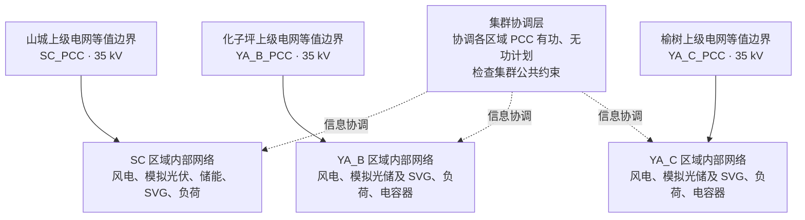
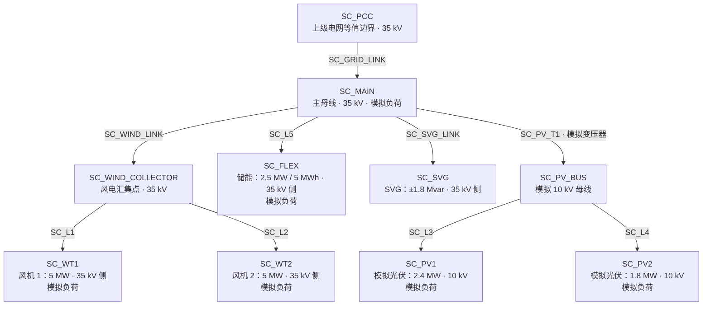
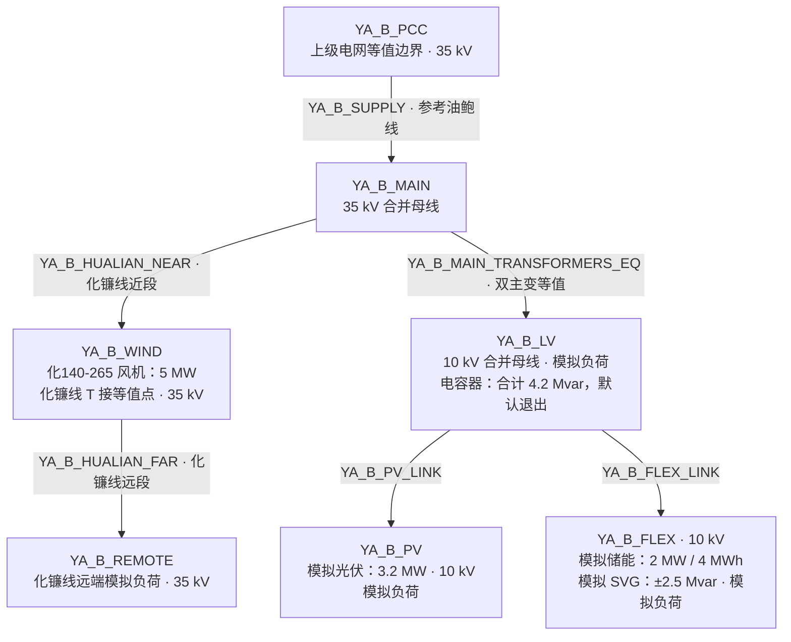
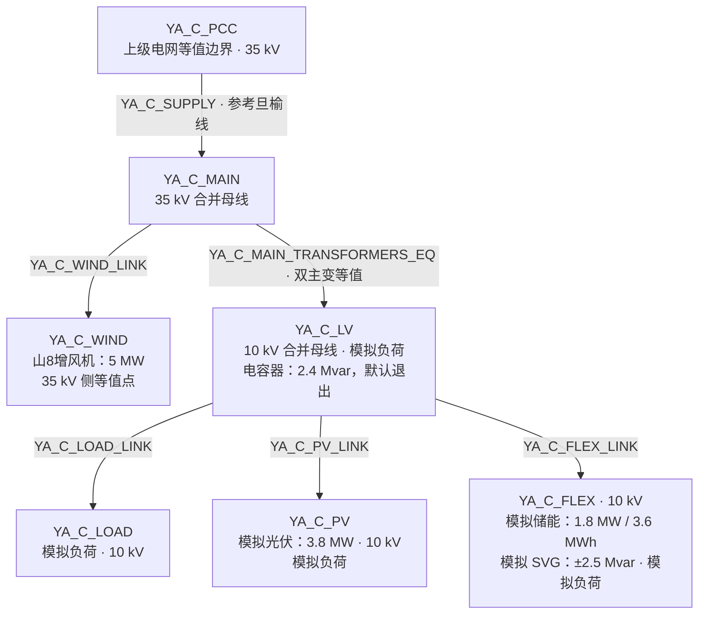

# 延安多层级微电网集群控制算法的电网架构说明

本文说明正式集群算法 `cluster-rolling-v6` 使用的电网结构，包括各区域与上级电网的关系、区域内部接线、设备接入位置及主要建模简化。

这里描述的是程序实际采用的研究模型。部分结构和设备规模有现场资料依据，另含研究等值和模拟扩展，尚不是三个区域完整确认的现场接线图。调度过程另见[调度策略说明](延安多层级微电网集群控制算法_调度策略说明.md)。

## 1. 集群由三个分别建模的区域组成

当前默认集群包含 SC（山城）、YA_B（参考化子坪）、YA_C（参考榆树）。每个区域都有自己的上级电网连接点、内部网络、发电设备、储能和负荷。

**电气上，程序分别计算三个区域的网络；控制上，通过集群协调层关联各区域的受电计划和公共约束。** 当前没有建立三区域之间的直接电力联络线，也没有展开共同上游电网的支路模型。

| 项目 | SC：山城 | YA_B：参考化子坪 | YA_C：参考榆树 |
| --- | --- | --- | --- |
| 母线／支路数量 | 10 个／9 条 | 7 个／6 条 | 7 个／6 条 |
| 支路组成 | 8 条线路等值、1 条模拟变压器支路 | 5 条线路等值、1 条双主变并联等值支路 | 5 条线路等值、1 条双主变并联等值支路 |
| 上级电网连接点 | `SC_PCC`，35 kV | `YA_B_PCC`，35 kV | `YA_C_PCC`，35 kV |
| 模型电压层级 | 35 kV、10 kV | 35 kV、10 kV | 35 kV、10 kV |
| 风电 | 2 台，各 5 MW | 1 台，5 MW | 1 台，5 MW |
| 光伏 | 2 组，合计 4.2 MW，模拟配置 | 1 组，3.2 MW，模拟配置 | 1 组，3.8 MW，模拟配置 |
| 储能 | 2.5 MW／5 MWh，规模有资料依据 | 2 MW／4 MWh，模拟配置 | 1.8 MW／3.6 MWh，模拟配置 |
| SVG 无功调节范围 | ±1.8 Mvar，额定规模按 2 MVA 表达 | ±2.5 Mvar，模拟配置 | ±2.5 Mvar，模拟配置 |
| 模拟负荷分组 | 6 组，峰值参数合计 14 MW | 4 组，峰值参数合计 9.6 MW | 4 组，峰值参数合计 8.64 MW |

合计为 **24 个母线、21 条区域内部支路**，不是一张由 24 个母线连成的单一电网。表中的负荷峰值参数用于生成时序，不代表各组负荷同时达到峰值，也不是现场实测最大负荷。

## 2. 整体架构及区域之间的关系

下图实线表示各区域接入本区域上级电网的电气关系，虚线表示集群层与各区域之间的信息协调。区域内部网络在后续章节展开。

PCC 是微电网与上级电网的公共连接点。各区域在 PCC 处计算受电有功 P 和无功 Q；集群层汇总这些量，施加总受电上限、集群功率因数及备用承诺等协调条件。默认集群总受电上限为 26 MW、功率因数目标为 0.95，均属于当前研究设置。

因此，26 MW 不能直接解释成某条实际公共线路的容量。一个区域减少受电、另一个区域增加受电，在模型中表现为协调计划的变化，不代表电力经某条已建模的跨区域联络线直接送达。实际区域之间是否存在共同上游通道，以及共同考核边界，仍需现场资料确认。

“分层分级”还包含集群协调、区域优化、设备执行三个控制层级。控制层级与 35 kV／10 kV 电压层级是不同概念，集群协调层本身不是电气母线或变电站。

## 3. 山城区域 SC：35 kV 主干与模拟 10 kV 扩展

### 3.1 接线结构

山城以 `SC_PCC` 为网络根节点，通过 35 kV 连接支路到达 `SC_MAIN`，再分为风电、储能、SVG 和模拟光伏与负荷分支。

以下各区域图中的箭头仅用于从 PCC 向下展开拓扑，不表示支路功率只能沿箭头方向流动。设备节点的电压标注指计算用接入侧电压基准，不等于设备机端电压。

### 3.2 母线和负荷分布

| 母线 | 电压基准 | 主要作用或接入设备 | 模拟负荷峰值参数 |
| --- | --- | --- | ---: |
| `SC_PCC` | 35 kV | 上级电网等值边界 | 无 |
| `SC_MAIN` | 35 kV | 各分支的主连接母线 | 6.2 MW |
| `SC_WIND_COLLECTOR` | 35 kV | 两台风机汇集点 | 无 |
| `SC_WT1` | 35 kV | 第一台 5 MW 风机 | 1.0 MW |
| `SC_WT2` | 35 kV | 第二台 5 MW 风机 | 1.0 MW |
| `SC_FLEX` | 35 kV | 储能 | 1.8 MW |
| `SC_SVG` | 35 kV | SVG | 无 |
| `SC_PV_BUS` | 10 kV | 模拟变压器低压侧、光伏分支汇集点 | 无 |
| `SC_PV1` | 10 kV | 2.4 MW 模拟光伏 | 2.0 MW |
| `SC_PV2` | 10 kV | 1.8 MW 模拟光伏 | 2.0 MW |

风机或储能节点上的负荷是模拟聚合负荷，不能直接解释为设备自耗。储能与 SVG 接在不同母线；虽然 SVG 资源标识保留为 `SC:svg:SC_FLEX`，其真实模型接入字段 `bus_id` 为 `SC_SVG`。

`SC_GRID_LINK` 是同电压等级的线路等值，不是主变。图中唯一显式变压器 `SC_PV_T1` 是光伏研究扩展用的模拟 35/10 kV 支路，不代表已经还原山城变电所的实际站内主变。

## 4. 化子坪参考区域 YA_B：35 kV 线路 T 接风机

### 4.1 接线结构

该区域选择参考油鲍线的路径从 `YA_B_PCC` 接入 35 kV 合并母线。风机位于化镰线的 T 接等值点，线路继续延伸至模拟远端负荷；另一分支通过双主变并联等值接至 10 kV 母线。

风机作为电源注入 `YA_B_WIND` 节点，并不是电力必须穿过风机才能到远端负荷。模型将风机连接阻抗纳入等值，没有另设机端母线和独立升压变支路。

### 4.2 母线和负荷分布

| 母线 | 电压基准 | 主要作用或接入设备 | 模拟负荷峰值参数 |
| --- | --- | --- | ---: |
| `YA_B_PCC` | 35 kV | 所选供电线路上级端的模拟边界 | 无 |
| `YA_B_MAIN` | 35 kV | 合并后的站内高压母线 | 无 |
| `YA_B_WIND` | 35 kV | 化镰线 T 接风机等值点 | 无 |
| `YA_B_REMOTE` | 35 kV | 化镰线远端模拟负荷 | 1.920 MW |
| `YA_B_LV` | 10 kV | 合并后的低压母线、电容器 | 3.648 MW |
| `YA_B_PV` | 10 kV | 模拟光伏 | 2.304 MW |
| `YA_B_FLEX` | 10 kV | 模拟储能和 SVG，共用接入母线 | 1.728 MW |

### 4.3 接线依据和等值处理

统一台账及资料说明引用《西交大-资料提供》第 1 页的 5 MW 风机及化镰线 T 接关系，第 2、9 页的母线、主变和线路资料。当前采用以下简化：

- 油鲍线采用资料中的 7.03 km、270 A；选择它作为单一供电路径属于研究假设。
- 化镰线总长 14.72 km，按模拟中点 T 接拆成两个 7.36 km 段，准确 T 接位置尚未确认；远端负荷为模拟配置。
- 两台 6.3 MVA、8 MVA 主变按相同变比并联等值为一条支路，当前等值容量上限约 13.9742 MVA；由于两台阻抗不同，该上限不直接取铭牌容量之和。
- 35 kV 和 10 kV 的分段母线分别合并；电容器四组 0.9、0.9、0.8、1.6 Mvar 均映射至 `YA_B_LV`，默认投入组数为零。

图中的光伏、储能、SVG 及其接入分支均为模拟研究扩展，不能认定为化子坪已有设备。电容器与 SVG 是不同设备，台账没有用模拟 SVG 替代有资料依据的电容器。

## 5. 榆树参考区域 YA_C：35 kV 母线分支接入风机

### 5.1 接线结构

该区域选择参考旦榆线的路径接入 35 kV 合并母线，风机通过专用等值支路接入该母线。双主变并联等值连接 10 kV 母线，下接模拟负荷、光伏、储能及 SVG。

### 5.2 母线和负荷分布

| 母线 | 电压基准 | 主要作用或接入设备 | 模拟负荷峰值参数 |
| --- | --- | --- | ---: |
| `YA_C_PCC` | 35 kV | 所选供电线路上级端的模拟边界 | 无 |
| `YA_C_MAIN` | 35 kV | 合并后的站内高压母线 | 无 |
| `YA_C_WIND` | 35 kV | 山8增风机接入侧等值点 | 无 |
| `YA_C_LV` | 10 kV | 合并后的低压母线、电容器 | 3.2832 MW |
| `YA_C_LOAD` | 10 kV | 独立模拟负荷分支 | 1.7280 MW |
| `YA_C_PV` | 10 kV | 模拟光伏 | 2.0736 MW |
| `YA_C_FLEX` | 10 kV | 模拟储能和 SVG，共用接入母线 | 1.5552 MW |

### 5.3 接线依据和等值处理

统一台账及资料说明引用《西交大-资料提供》第 2～3 页的风机和接入关系，以及第 3、8、9 页相关网络资料。当前采用以下处理：

- 旦榆线采用资料中的 16.88 km、272 A；选择它作为供电路径属于研究假设，西榆线等其他线路未纳入当前方式。
- 风机容量 5 MW、接入 35 kV 系统有资料依据，`YA_C_WIND_LINK` 的阻抗和 6 MVA 容量限制仍是模拟值。
- 两台 10 MVA、12.5 MVA 主变按相同变比并联等值，形成一条容量上限为 22.5 MVA 的支路。
- 35 kV、10 kV 分段母线分别合并；资料中的 2.4 Mvar 电容器映射至 `YA_C_LV`，默认退出。

化子坪与榆树的核心结构差别是：化子坪保留线路中途 T 接风机及远端负荷的关系；榆树保留风机从 35 kV 主母线分支接入的关系。榆树图中的光伏、储能、SVG 和各组负荷同样含模拟扩展。

## 6. 电压、开关和运行方式在模型中如何表达

三个区域均采用固定拓扑、平衡正序的径向交流网络，即从各自 PCC 出发形成无闭环的树状结构。程序逐母线、逐支路计算功率平衡、电压、损耗和容量限制；集群并不是仅由三个总负荷、总发电量组成的聚合模型。

| 内容 | 当前表达方式 |
| --- | --- |
| 上级电网 | 每个区域在 PCC 处独立等值，执行模型根电压固定为 1 pu，即本侧额定电压；没有展开上级输配电网络。 |
| 计算基准 | 各区域统一功率基准为 20 MVA，母线分别采用 35 kV 或 10 kV 电压基准。 |
| 变压器 | 山城模拟变压器的非额定标幺变比为 1.0；两处延安等值主变按 35/10.5 kV 铭牌与 35/10 kV 系统基准，取非额定标幺变比 10/10.5。当前不优化档位。 |
| 山城开关 | `SC_GRID_DISCONNECT`、`SC_PCC_SWITCH` 共同控制并网支路；`SC_WIND_TRIP_SWITCH` 控制风电汇集支路。默认均闭合，不额外增加母线或支路。 |
| 延安开关 | 当前等值台账没有逐个表达实际站内开关及母联；通过合并母线、选择供电路线定义研究方式。 |
| 固定电容器 | 记录容量和投入状态；默认两区均退出。显式投入后按电压计算容性注入，当前优化不决定投切。 |
| 默认运行边界 | 母线电压为 0.95～1.05 pu，各区域 PCC 有功受电基础范围为 0.5～18 MW；动态安全下限和支路限值仍须同时满足。 |

变比 1.0 不表示变压器两侧实际电压相同，而是两侧分别以各自额定电压为基准后的比例。延安两区的 10 kV 母线标注也不能直接改写为主变铭牌的 10.5 kV。

所选油鲍线、旦榆线的模型容量约为 16.37、16.49 MVA，因此 PCC 参数中的 18 MW 不能作为必然可用的受电能力。这些 MVA 数值按额定电压和资料电流换算，仍是当前模型中的容量代理。

若输入开关或支路状态导致网络断开或出现不支持的结构，程序会拒绝按当前完整径向模型计算，不会自动形成新的孤岛控制方案或替代供电路线。现场其他线路未进入模型，也不表示已确认它们实际断开。

## 7. 资料依据、模拟扩展及适用范围

| 内容 | 资料依据和当前边界 |
| --- | --- |
| 山城主干与设备规模 | 35 kV 并网结构、风电／储能／SVG 分支及主要规模参考山城资料；场内拆分、支路阻抗、容量和部分设备参数仍含模拟设置。 |
| 延安风电及站内主干 | 风机数量、5 MW 容量、T 接或站内接入关系，以及部分线路、主变、电容器参数有资料依据；母线合并、供电路线选择和主变并列方式属于研究等值。 |
| 光伏及部分调节资源 | 三区域光伏和延安两区储能、SVG 的容量与位置属于模拟扩展，尚未被当地完整设备台账确认。 |
| 负荷 | 各组容量、位置及运行曲线为模拟聚合输入，不是完整现场逐母线量测。 |
| 延安线路与主变参数 | 部分长度、电流、容量及短路阻抗有资料依据；线路正序电阻／电抗、部分主变损耗缺失时使用明确记录的假设。 |
| 区域及考核边界 | 延安 PCC 位于选定供电线路的上级端，计算包含线路损耗；不能直接认定它就是现场站端计量点。跨区域公共约束及真实考核关系仍待确认。 |

## 8. 关键代码与配置位置

| 文件 | 与本架构的关系 |
| --- | --- |
| [unified_dataset.json](../src/oilfield_energy/bootstrap/assets/unified_dataset.json) | 三区域母线、支路、变压器、开关、电容器、资源和负荷的统一台账，含逐项来源。 |
| [project_dataset.py](../src/oilfield_energy/bootstrap/adapters/project_dataset.py) | 读取台账，为每个区域分别构建网络，再组合为一个集群研究算例。 |
| [simulation_case.py](../src/oilfield_energy/bootstrap/adapters/simulation_case.py) | 按资源的 `bus_id` 映射设备接入位置，把网络、资源和时序装配为优化输入。 |
| [network_model.py](../src/oilfield_energy/network_model.py) | 解析运行方式、开关、变比及补偿状态，检查连通性与径向结构。 |
| [regional_control.py](../src/oilfield_energy/regional_control.py) | 分别建立区域网络协调模型，通过 PCC 功率关联集群公共约束。 |
| [misocp_model.py](../src/oilfield_energy/misocp_model.py) | 在区域网络上建立设备出力、节点平衡、支路潮流、电压和容量约束。 |
| [single_model.py](../src/oilfield_energy/bootstrap/adapters/single_model.py) | 共用的物理模型装配器；按区域构造网络边界、设备能力及根电压，集群也调用它。 |
| [cluster_safety.py](../src/oilfield_energy/bootstrap/adapters/cluster_safety.py) | 把各区域物理网络、设备和预测范围组合成当前集群执行模型。 |
| [safety_network.py](../src/oilfield_energy/workflows/cluster_execution/safety_network.py) | 分别检查各区域交流网络，再汇总 PCC 功率检查集群条件，不额外生成区域间电力联络线。 |