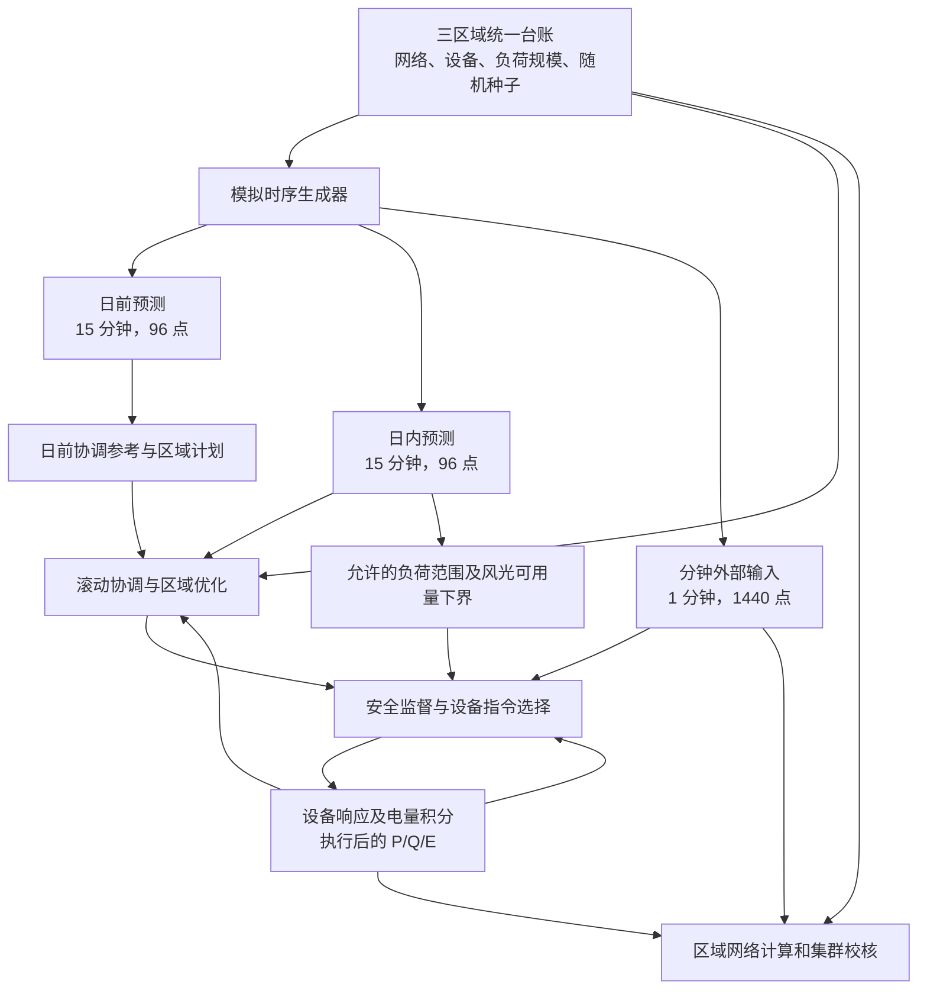

# 延安多层级微电网集群控制算法的电网运行数据说明

本文说明正式集群算法 `cluster-rolling-v6` 使用和产生的运行数据，以默认 SC（山城）、YA_B（参考化子坪）、YA_C（参考榆树）三区域算例为范围。重点介绍数据构成、来源、时间尺度和相互关系，不展示某次优化仿真的运行曲线。

## 1. 运行数据由哪些部分组成

| 数据类别 | 主要内容 | 当前来源 |
| --- | --- | --- |
| 网络和设备基础参数 | 母线、线路、变压器、资源接入位置、设备容量、储能效率和电量边界 | 包内统一台账及模型配置，包含现场资料参考项和模拟设定 |
| 外部运行输入 | 各母线负荷有功 P、无功 Q，以及各风光接入点的可用功率 | 按设备和负荷规模、日变化公式及固定随机种子生成 |
| 经济和控制输入 | 分时电价、费用权重、预测允许偏差、设备响应、备用及跟踪要求 | 代码中的研究参数，以及由预测和设备能力计算的边界 |
| 集群协调参考 | 各区域各时段的 PCC 有功、无功参考 | 分布式协调或明确标记的联合恢复计算 |
| 区域设备计划 | 风光利用量、储能充放电及电量、设备无功计划 | 各区域优化及物理可行性检查 |
| 分钟执行状态 | 实际采用的指令、设备执行前后 P/Q、储能电量 | 安全监督、设备响应模型和能量积分 |
| 网络及评价结果 | PCC 功率、母线电压、线路负载、网损、功率因数、经济性和检查状态 | 规划求解、潮流计算、连续过程校核及结果汇总 |

## 2. 基础数据、设备规模和初始状态

### 2.1 默认台账及资料性质

默认数据来自 [unified_dataset.json](../src/oilfield_energy/bootstrap/assets/unified_dataset.json)，数据集 ID 为 `oilfield-unified-synthetic`，当前台账修订标识为 `2026-09-21-v1`。程序运行时读取整理后的台账，不会每次自动从 PDF 或现场系统提取参数。

山城两台 5 MW 风机、2.5 MW/5 MWh 储能，以及延安两区各一台 5 MW 风机和部分网络接入关系有资料依据；三区域光伏、延安两区储能及 SVG、负荷分布和时序等仍含模拟配置。具体接线及来源见[电网架构说明](延安多层级微电网集群控制算法_电网架构说明.md)。

| 数据项 | SC：山城 | YA_B：参考化子坪 | YA_C：参考榆树 |
| --- | --- | --- | --- |
| 风电装机 | 2 台，各 5 MW | 1 台，5 MW | 1 台，5 MW |
| 光伏装机 | 2.4＋1.8 MW | 3.2 MW | 3.8 MW |
| 储能最大充／放电功率 | 2.5 MW | 2.0 MW | 1.8 MW |
| 储能额定能量 | 5.0 MWh | 4.0 MWh | 3.6 MWh |
| 储能允许电量范围 | 0.5～5.0 MWh | 0.4～4.0 MWh | 0.36～3.6 MWh |
| 储能初始电量 | 2.5 MWh | 2.0 MWh | 1.8 MWh |
| 充电／放电效率 | 分别为 0.95／0.95 | 分别为 0.95／0.95 | 分别为 0.95／0.95 |
| SVG 无功调节范围 | ±1.8 Mvar | ±2.5 Mvar | ±2.5 Mvar |

装机容量只是能力参数，不是每个时刻的发电量或充放电量。默认光伏和储能无功控制关闭，Q=0；风机与 SVG 参与无功调节，风机还受到有功出力、绝对无功上限和视在容量的共同限制。

### 2.2 集群默认初始状态

正式集群装配以**所有可控资源的有功、无功均为零，储能使用台账给定初始电量**作为执行初态，包括 SVG 初始无功也为零。启动时还须验证从该初态安全继续运行的条件，不能仅因初值已经填入就认定能开始执行。

默认初态不是从现场遥测自动恢复的。后续设备状态由上一分钟执行递推产生，不会每个时刻重新随机生成，也不会每次滚动都恢复为初始电量。

## 3. 负荷和风光时序怎样生成

核心函数是 [generate_profiles()](../src/oilfield_energy/modules/studies/domain.py)，由 [generate_inputs()](../src/oilfield_energy/modules/studies/application.py) 分别生成日前、日内和分钟输入。

### 3.1 各母线负荷 P/Q

负荷有功按“该节点峰值参数 × 日变化系数 × 随机扰动系数”生成。日变化系数包含基础负荷、早上 9 点附近和晚上 19 点附近的抬升，以及小幅正弦变化。曲线形状由程序给定，没有在该生成流程中根据现场历史数据训练或拟合。

负荷无功根据该组固定功率因数计算：

> Q = P × tan(arccos(PF))。

| 区域 | 负荷接入母线 | 峰值参数 | 固定功率因数 PF |
| --- | --- | ---: | ---: |
| SC | `SC_MAIN` | 6.2 MW | 0.92 |
| SC | `SC_WT1` | 1.0 MW | 0.93 |
| SC | `SC_WT2` | 1.0 MW | 0.91 |
| SC | `SC_PV1` | 2.0 MW | 0.94 |
| SC | `SC_PV2` | 2.0 MW | 0.92 |
| SC | `SC_FLEX` | 1.8 MW | 0.93 |
| YA_B | `YA_B_LV` | 3.648 MW | 0.92 |
| YA_B | `YA_B_REMOTE` | 1.920 MW | 0.92 |
| YA_B | `YA_B_PV` | 2.304 MW | 0.92 |
| YA_B | `YA_B_FLEX` | 1.728 MW | 0.92 |
| YA_C | `YA_C_LV` | 3.2832 MW | 0.92 |
| YA_C | `YA_C_LOAD` | 1.7280 MW | 0.92 |
| YA_C | `YA_C_PV` | 2.0736 MW | 0.92 |
| YA_C | `YA_C_FLEX` | 1.5552 MW | 0.92 |

三个区域峰值参数分别合计 14、9.6、8.64 MW，不表示负荷全天恒定，也不代表各组同时达到峰值。台账中没有配置负荷的母线由生成器补齐零序列；这是模拟配方中的无负荷设定，不是将缺失的现场量测自动填零。

### 3.2 风电可用功率

每台风机按装机容量乘以预设波动系数生成可用功率。系数包含日周期和较短周期的正弦变化、设备序号引入的差异及随机扰动，最后限制在 0.15～0.90 之间。

这一过程没有读取真实风速、风向或气象预报，也没有使用现场风机功率曲线。15%～90% 是当前原生模拟曲线的生成范围，不是实际风机始终能提供至少 15% 出力的保证；后续场景事件还可能改变输入。

### 3.3 光伏可用功率

光伏以 6:00～18:00 的模拟日照形状为基础，在约 13.3 时附近加入局部衰减，再叠加随机扰动、乘以装机容量，并限制在零至装机容量之间。夜间零可用量由公式产生。

这里没有接入真实辐照度、云量或组件温度。风光的 `available` 数据表示模型中可利用的发电能力；后续优化是否限发、设备是否到达目标，决定最终执行出力，二者不能混用。

## 4. 日前、日内和分钟数据如何对应

### 4.1 原生时间尺度与随机种子

| 数据 | 原生间隔与全日长度 | 负荷生成扰动幅度 | 随机种子 | 主要用途 |
| --- | --- | --- | --- | --- |
| 日前预测 `day_ahead` | 15 分钟，96 点 | ±2.5% | 区域配置种子 | 全天参考与日前区域计划 |
| 日内预测 `intraday` | 15 分钟，96 点 | ±1.2% | 区域配置种子＋1 | 滚动窗口预测及安全域构建 |
| 分钟输入 `plant` | 1 分钟，1,440 点 | ±0.4% | 区域配置种子＋2 | 当前分钟的模拟负荷和风光可用量 |

区域配置种子分别为 SC：`20260915`、YA_B：`20260916`、YA_C：`20260917`。同一配方和生成代码可以重复生成相同输入，但三个区域不是简单复制同一组数据。

上表扰动百分比针对负荷的乘法扰动；风电将扰动加在归一化出力系数上，光伏将扰动乘在日照形状上。它们不是现场统计出的预测准确率，也不是程序已经保证“分钟输入一定落在预测允许范围内”。

默认配方起点均为 `2026-09-15T00:00:00+08:00`，这是模拟日期。数据集修订日期、配方起点和结果生成时间各有不同含义，不能将其中任何一个直接当作现场采样日期。

### 4.2 全日重采样与滚动窗口

`build_synthetic_case(steps=...)` 始终构造覆盖 24 小时的算例。默认 96 点对应 15 分钟；例如 8 点对应每点 3 小时，含义是全日重采样，不是只运行最初 8 个 15 分钟。

这个全日装配步骤对负荷和风光曲线作周期线性插值，电价保持阶梯值。之后，集群滚动所用的 `forecast_grid()` 按原预测区间**逐段保持**到需要的时间网格；默认 15 分钟预测值在对应分钟内保持，不进行逐分钟线性插值。

默认每 15 分钟读取未来 4 小时的预测窗口。窗口初始储能电量和设备状态来自已经完成的模拟执行；末端电量参考日前计划，并按备用条件作调整。当前没有在每个窗口重新训练预测模型，也不把未来分钟输入当作预测来源。

### 4.3 自备算例、场景事件与日末数据

显式传入 `input_case` 且采用自备算例路径时，日内沿用原预测，分钟输入按原时段逐段保持，不自动生成一套更准确的新预测。该路径会标明“持续性场景”。

负荷突变、风光变化等预设事件由 `scenario_events.py` 修改指定区域和时段的输入，属于人为设置的研究工况。默认打包流程将相应物理事件应用到日前、日内和分钟输入，不能把它们都理解为控制器事先未知的现场突发事件。通信事件另由协调过程解释，使用的迭代轮次也不能当作分钟时间轴。

备用支撑或恢复需要超出日末的预测时，代码按最后一个预测值延伸；安全论证也声明末端范围持续保持。这是明确的研究假设，不是获得了下一天的真实预测或量测。

## 5. 经济参数、运行边界和允许误差

### 5.1 电价与费用参数

| 参数 | 默认值 | 含义 |
| --- | --- | --- |
| 00:00—07:00 电价 | 280 元/MWh，即 0.28 元/kWh | 低价时段的模拟购电价格 |
| 17:00—22:00 电价 | 1,180 元/MWh，即 1.18 元/kWh | 高价时段的模拟购电价格 |
| 其余时段电价 | 720 元/MWh，即 0.72 元/kWh | 其他时段的模拟购电价格 |
| 弃风、弃光费用系数 | 520 元/MWh | 对未利用新能源计入的研究代价 |
| 储能退化费用系数 | 70 元/MWh | 按充放电量计入的使用代价 |
| 网损价值系数 | 650 元/MWh | 优化及费用评价使用的网损权重 |

代码还设置电压偏差、受电峰值和功率变化等权重。各求解阶段使用的目标项有所区别，上述参数不是从现场账单自动统计得出的实际结算规则。

### 5.2 运行和控制参数

| 内容 | 当前默认设置或计算方法 |
| --- | --- |
| 各区域 PCC 受电基础范围 | 0.5～18 MW；规划还可能采用更高的动态防倒送下限，网络支路限值同时生效。 |
| 集群总受电上限 | 26 MW，属于研究设置。 |
| 母线电压范围 | 0.95～1.05 pu；执行网络 PCC 根电压固定为 1 pu。 |
| 功率因数 | 区域基础下限为 0.90，规划参数中的区域调度目标为 0.92；集群协调及安全策略默认目标为 0.95。它们与负荷生成使用的固定功率因数含义不同。 |
| 调度与执行时间 | 默认滚动更新 15 分钟、预测窗口 240 分钟、设备执行步长 1 分钟。 |
| PCC 计划跟踪容差 | 有功 0.05 MW、无功 0.05 Mvar；分钟动态跟踪还使用响应及连续确认条件。 |
| 设备响应 | 使用研究设定的响应时间常数和爬坡能力；默认通用时间常数 2 分钟、光伏有功时间常数 0.25 分钟，不是现场试验辨识值。 |
| 储能备用 | 默认按 0.05 MW 加预测负荷与风光规模的 2% 计算需求；安全域采用声明时域内最大需求作为区域承诺，交付能力另行检查。 |

### 5.3 输入生成扰动与安全允许范围是两回事

集群安全域围绕日内预测构造以下边界：

- 各母线负荷 P/Q：预测值加减其绝对值的 2.5%。
- 风电保证可用量：预测值扣减额定有功的 5%，并截断到非负。
- 光伏保证可用量：预测值扣减额定有功的 15%，并截断到非负。

例如，一台额定 5 MW 风机某时刻预测可用 3 MW，则其保证可用量下界为 `3−5×5%=2.75 MW`。这是说明计算方法的例子，不是某次运行的结果；它既不是要求风机必须输出 2.75 MW，也不是测量到的功率。

这些边界用于限制规划可依赖的能力和检查后续安全。滚动规划中的风光可用量还会被相应保证下界收紧。执行时每次只读取当前分钟输入并核对边界；超出声明范围时，不能继续沿用原有安全保证。生成器的随机扰动幅度不会自动构成这项保证。

## 6. 运行过程中计算出来的数据

### 6.1 集群参考、区域计划和实际指令

集群协调先得到各区域 PCC P/Q 参考，各区域再计算设备出力和电量计划。计划通过相关检查后，分钟执行层结合当前状态生成设备指令，并决定采用经济候选、后备、终端或备用控制。

因此，“上层要求多少”“区域计划做到多少”“设备本分钟实际执行到多少”是不同数据。采用后备控制时可以偏离经济目标，记录会保留控制来源及偏差，不把后备出力改写为原目标。

### 6.2 设备状态、储能电量与 SOC

设备出力由 `execute_cluster_device_command()` 根据执行前状态、指令和响应参数计算。当前集群模型假设设备 P/Q 在分钟内沿初末值线性变化，储能按这段功率轨迹及充放电效率积分；充放电换向时分别计入两部分能量。

内部保存的储能状态是 MWh 单位的电量 E，并没有另外随机生成一条 SOC 曲线。如果展示 SOC 百分比，需要明确容量基准；这种换算仍是模拟状态，不等于现场 BMS 量测。

初始状态、电量和每分钟状态都属于同一连续执行过程。若中途停止，后面没有执行的分钟不会自动成为已完成数据。

### 6.3 PCC、电压、支路和网损

网络量由输入负荷、设备出力及网络参数计算，需区分以下结果：

| 结果类别 | 数据含义 |
| --- | --- |
| 集中式参考及区域规划结果 | 计划对应的 PCC P/Q、母线电压、支路负载、网损等，表示预期运行状态。 |
| 分钟区域 PCC 点值 | 用该分钟外部输入和设备执行后状态计算的 PCC P/Q，保存在分钟阶段区域记录的 `p_mw`、`q_mvar` 中。它是模型计算值，不是电表采样。 |
| 每分钟安全区间 | `safety.steps[].path` 保存区域网络检查和集群 PCC P/Q 包围范围，用于覆盖声明条件下的连续过程；上下界不是另一条实测曲线，也不是概率置信区间。 |

并非所有中间电气量都会逐项保存成每分钟曲线。不能用规划电压曲线替代执行电压，也不能用区间中值冒充某个时刻的实际量测。

分钟记录中的 `minute` 标识该步起点；`before` 和 `after` 分别是该步执行前后状态。读取电量或设备出力时应同时确认使用哪一个端点，避免与输入时间错位。

### 6.4 经济评价数据

服务层经济改善值首先来自集中式基准与选定参考计划的比较；另有 ADMM 参考费用和日前区域落实费用。字段中的“落实费用”也不等于整天分钟执行后的费用结算，尤其不能在执行中断时当作完整运行实绩。

## 7. 数据在哪里保存、怎样辨认

下表结果路径以完整的 `result.json` 为起点；单独读取 `cluster_execution.json` 时，去掉路径中的 `cluster_execution.` 前缀。

| 数据结构或文件 | 主要内容及识别方式 |
| --- | --- |
| `ProjectCase` / `MicrogridData` | 网络、设备、费用和预测输入；负荷及风光数组以母线编号组织，时间由 `time_hours` 和步长确定。 |
| `PlantInputs` / `BusSeries` | 起点、时间步长及各母线数值序列；日前、日内与分钟输入复用结构，需结合生成来源区分。 |
| `cluster_execution.safety.domain.regions` | 各区域网络、设备顺序、初态、逐分钟负荷允许范围和风光下界。 |
| `cluster_execution.stages` | 日前、日内、分钟三个阶段的区域记录、检查状态和公共约束评价。 |
| `cluster_execution.rolling_updates` | 每个滚动窗口的初始状态、末端电量目标、P/Q 参考、采用情况和执行后电量。 |
| `cluster_execution.safety.steps` | 每分钟 `observed`、`commands`、`before`、`after`、控制来源 `source` 及区间检查 `path`。 |
| `cluster_execution.safety.reserve_events` | 已接纳的备用调用及返回方案；配置了备用不表示一定产生调用。 |
| `metadata` | 数据集 ID、revision、源台账 SHA-256、预测类型、结果生成时间等；算法身份另见 `cluster_execution.algorithm_version`。 |
| `request.json` | 本次运行的场景、步数、储能开关、求解策略和事件等请求参数。 |
| `result.json` / `cluster_execution.json` | 完整服务结果／其中的集群执行记录；文件研究入口归档时保留真实失败状态。 |
| `input_case.json` / `failure.json` | 文件研究入口显式传入算例时另存输入；发生异常时记录错误类型和信息。不是每次运行都同时生成这些文件。 |

默认文件入口不会另外自动导出全部原生预测和分钟输入 CSV。复现时应保存请求、台账内容及摘要、代码版本和必要的运行环境；仅有日期、随机种子或算法版本字符串不足以唯一确定全部结果。

`safety.steps` 中的区域数组顺序对应 `safety.domain.regions`；各区域设备状态数组对应其 `devices.resources`，负荷数组对应其网络母线顺序。接入位置应按资源的母线映射读取，例如 `SC:svg:SC_FLEX` 的接入母线实际是 `SC_SVG`，不能从资源 ID 的后缀推断。

服务层常规 `timeseries` 使用请求所选区域的集中式参考结果组装，不是自动汇总三区域分钟实绩。`cluster_timeseries` 也包含不同来源：总负荷来自算例输入，新能源利用量来自集中式优化结果，集群 P/Q 和区域受电量来自 ADMM 协调参考；整张表不能当作分钟执行实绩。

主要单位为 P：MW，Q：Mvar，电量 E：MWh，设备及支路容量：MVA，电压：kV 或 pu，电价：元/MWh。PCC 有功正值表示从上级电网受电；设备有功正值表示向区域网络注入，储能正值为放电、负值为充电；负荷 P/Q 表示需求。

## 8. 现场数据接入与当前研究数据的区别

当前默认集群不直接读取真实站端遥测作为分钟反馈。项目虽有现场资料检查、固定时刻潮流和接口数据定义，但全日逐母线时序映射仍未完成；完整真实数据集还需要明确区域、设备与母线映射、单位倍率、计量方向、同期时间戳和数据质量。

因此，模拟曲线可用于研究调度和检验控制逻辑，实际油田的出力、电量、预测精度及运行收益仍需以现场数据和验证结果为依据。具体限制见[实现限制及原因说明](延安多层级微电网集群控制算法_实现限制及原因说明.md)。

## 9. 关键源码位置

| 文件 | 数据职责 |
| --- | --- |
| [unified_dataset.json](../src/oilfield_energy/bootstrap/assets/unified_dataset.json) | 三区域基础配置、负荷峰值、功率因数、设备规模、初始电量和种子。 |
| [domain.py](../src/oilfield_energy/modules/studies/domain.py)、[application.py](../src/oilfield_energy/modules/studies/application.py) | 曲线公式、随机扰动和日前／日内／分钟三套输入生成。 |
| [project_dataset.py](../src/oilfield_energy/bootstrap/adapters/project_dataset.py) | 加载统一台账、计算摘要及全日重采样。 |
| [simulation_case.py](../src/oilfield_energy/bootstrap/adapters/simulation_case.py)、[data.py](../src/oilfield_energy/data.py) | 设备网络映射、电价、费用系数和规划数据结构。 |
| [cluster_execution.py](../src/oilfield_energy/bootstrap/adapters/cluster_execution.py)、[scenario_events.py](../src/oilfield_energy/scenario_events.py) | 日内及分钟输入装配、自备算例保持方式和预设事件处理。 |
| [cluster_rolling.py](../src/oilfield_energy/bootstrap/adapters/cluster_rolling.py) | 预测逐段保持、窗口切片、执行状态反馈和日末延伸。 |
| [cluster_safety.py](../src/oilfield_energy/bootstrap/adapters/cluster_safety.py) | 集群初态、安全域、当前观察、设备映射及分钟 PCC 点值。 |
| [contracts_safety.py](../src/oilfield_energy/workflows/cluster_execution/contracts_safety.py)、[safety_controller.py](../src/oilfield_energy/workflows/cluster_execution/safety_controller.py) | 声明边界和逐步执行记录，以及输入越界与动作采用检查。 |
| [application_cluster_tube.py](../src/oilfield_energy/modules/control/application_cluster_tube.py)、[safety_network.py](../src/oilfield_energy/workflows/cluster_execution/safety_network.py) | 设备响应、储能能量积分和区域／集群网络区间计算。 |
| [contracts.py](../src/oilfield_energy/workflows/cluster_execution/contracts.py)、[service.py](../src/oilfield_energy/service.py)、[cluster_study.py](../src/oilfield_energy/bootstrap/adapters/cluster_study.py) | 阶段结果、常规展示和经济汇总、文件归档。 |
| [case_builder.py](../src/oilfield_energy/field_data/case_builder.py)、[d5000_contracts.py](../src/oilfield_energy/field_data/d5000_contracts.py) | 现场输入构建和接口定义的现有边界。 |