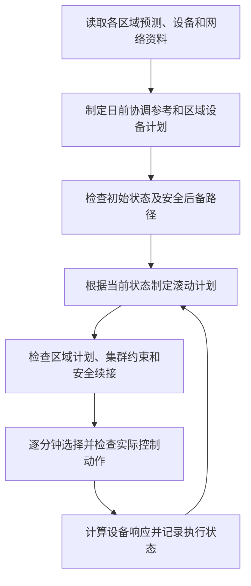

# 延安多层级微电网集群控制算法的调度策略说明

本文说明正式集群算法 `cluster-rolling-v6` 如何制定计划、分配设备出力、根据执行状态调整计划，以及处理异常情况。默认研究对象为 SC（山城）、YA_B（参考化子坪）、YA_C（参考榆树）三个区域。

## 1. 总体思路：分层制定计划，滚动调整，逐步检查后执行

算法先结合负荷、风光预测、电价、网络条件和设备能力，协调各区域与上级电网交换的功率，再由各区域确定风电、光伏、储能和无功设备的具体出力。运行过程中，根据已经执行后的状态继续调整后续计划。

调度遵循的主要规则是：**在满足网络、设备和安全要求的前提下改善经济性；新的经济方案通过检查才采用，否则沿已验证的后备路径继续运行。若连安全继续运行的条件也不满足，则停止本次推进并记录原因。**

图中为具备继续运行条件时的主要流程。新计划未通过、使用后备路径或停止运行的具体规则见第 7、8 节。

这里的 PCC 是区域微电网与上级电网的连接点；P 表示有功功率，Q 表示无功功率。PCC 有功为正表示从上级电网受电；储能有功为正表示放电，为负表示充电。

依据：[正式算法与入口说明](modeling/Cluster_Algorithm_Authority.md)、[集群执行装配](../src/oilfield_energy/bootstrap/adapters/cluster_execution.py)、[滚动流程](../src/oilfield_energy/workflows/cluster_execution/rolling.py)。

## 2. 调度希望达到什么效果

算法不是只追求单一的最低电费，而是在给定权重下综合考虑以下因素。

| 考虑因素 | 对调度决策的影响 |
| --- | --- |
| 向上级电网购电的费用 | 结合分时电价，安排各时段受电量和储能充放电。 |
| 弃风、弃光的代价 | 在设备和网络允许的条件下，提高可用新能源的利用程度。 |
| 储能使用损耗 | 对充放电量计入退化费用，避免仅为很小收益而过度使用储能。 |
| 网络损耗和电压偏差 | 结合资源接入位置分配有功、无功，兼顾网损和电压状态。 |
| 集群受电峰值和功率变化 | 抑制过高的总受电峰值，减少相邻时段受电功率的大幅变化。 |

不同求解阶段的目标表达不完全相同：区域协调还包含使本地方案接近集群参考的项，集群协调考虑总受电峰值和变化，区域物理落实进一步处理设备和网络约束。因此，不能把全过程理解成一个固定设备顺序，也不能把“已得到优化方案”直接等同于“最终执行全过程已证明全局经济最优”。

默认模拟电价为：00:00—07:00 为 0.28 元/kWh，07:00—17:00 和 22:00—24:00 为 0.72 元/kWh，17:00—22:00 为 1.18 元/kWh。这会影响储能计划，但代码没有规定这些时段必须充电或必须放电。

依据：[区域及集群协调目标](../src/oilfield_energy/regional_control.py)、[物理优化目标](../src/oilfield_energy/misocp_model.py)、[费用权重](../src/oilfield_energy/data.py)、[模拟电价](../src/oilfield_energy/bootstrap/adapters/simulation_case.py)。

## 3. 哪些条件优先于经济收益

| 约束 | 当前调度处理方式 |
| --- | --- |
| 区域供需平衡 | 各母线发电、负荷、储能及线路功率必须平衡，并考虑网损。当前负荷作为给定输入，不通过自动切负荷来弥补计划缺口。 |
| 防止向上级电网倒送 | PCC 保持正向受电；默认固定下限为 0.5 MW，规划还会按预测风险计算动态安全下限，采用两者中更严格的值。 |
| 区域和集群受电容量 | 默认各区域 PCC 研究上限为 18 MW，集群总受电上限为 26 MW；线路、主变等网络限制同时生效，不能仅按 PCC 上限安排出力。 |
| 电压、线路容量和功率因数 | 检查区域网络及设备约束，并对各区域计划合计后的集群功率因数再作检查；默认集群目标为 0.95。 |
| 储能和变流器能力 | 不超过充放电功率、电量和 P/Q 联合能力范围；最终区域计划处理储能充放电互斥，避免同时充放电。 |
| 设备响应速度 | 新目标必须考虑当前出力、响应滞后和变化速度，不能假设所有设备瞬间到达目标。 |
| 后续运行能力 | 当前动作执行后仍需有经过验证的安全后续路径；启用储能备用时还需满足相关能力及恢复要求。 |

集群参考会预留跟踪误差余量，而不是把 26 MW 全部分配给区域计划。这样，各区域实际落实出现允许范围内的偏差时，仍有容量空间；最终计划和实际动作还要分别检查。

26 MW 等参数属于研究设置，各区域之间如何协调不等于现场一定存在共同物理通道。动态防倒送下限也是基于模拟预测的研究规则，不能替代现场保护定值。

依据：[默认台账](../src/oilfield_energy/bootstrap/assets/unified_dataset.json)、[动态防倒送下限](../src/oilfield_energy/planning_security.py)、[区域物理约束](../src/oilfield_energy/misocp_model.py)、[集群连续安全说明](modeling/Cluster_Recursive_Safety.md)。

## 4. 三个控制层分别作出什么决定

| 层级 | 主要决定 | 与其他层的关系 |
| --- | --- | --- |
| 集群协调层 | 各区域各时段的 PCC 有功、无功参考，即每个区域应从上级电网受多少电、交换多少无功。 | 接收各区域计算的方案，结合总容量、集群功率因数和总受电变化进行协调。 |
| 区域优化层 | 风机和光伏实际利用多少出力、储能如何充放电、风机和 SVG 如何调节无功。 | 在本区域网络和设备约束下落实上层参考；落实困难时反馈诊断结果，推动参考重新调整。 |
| 设备执行及安全监督层 | 当前这一分钟实际采用哪些设备指令，以及是否切换到安全后备控制。 | 根据当前状态和设备响应能力处理候选指令，检查本步及后续安全，再更新模拟执行状态。 |

集群协调使用 ADMM。其运行过程可以理解为：各区域分别提出本地方案，协调层调整公共参考，各区域再根据新参考重新计算，循环到满足收敛条件或达到计算上限。这里不是平均分配受电量或储能功率，各区承担多少由本地条件和公共约束共同决定。

当前协调模型已经包含区域内部网络。ADMM 得到的参考仍要交给区域物理优化和独立交流潮流检查，不能仅因协调收敛就直接下发设备执行。

依据：[ADMM 协调](../src/oilfield_energy/admm.py)、[区域与集群模型](../src/oilfield_energy/regional_control.py)、[区域计划落实](../src/oilfield_energy/bootstrap/adapters/cluster_execution.py)。

## 5. 日前、日内和分钟执行如何衔接

### 5.1 日前：形成全天协调参考和设备计划

默认算例覆盖 24 小时、96 个计划点，每点代表 15 分钟。主要过程如下：

1. 读取日前负荷、风光预测、电价、网络和设备参数。
2. 服务先计算集中式无储能基准及选定方案，用于对照并提供相关校准信息。
3. 开展分布式协调，形成各区域全天 PCC 有功、无功参考。
4. 各区域落实设备计划，检查网络、储能、参考跟踪及集群公共约束；必要时进入参考调整和恢复流程。

日前计划还提供储能电量轨迹，作为后续滚动窗口末端电量的参考。默认全天储能末端电量以初始电量为目标，并允许模型规定的误差，避免通过把储能一次性放空制造表面收益。

### 5.2 日内：每 15 分钟重新规划未来 4 小时

默认在 00:00、00:15、00:30 等时刻更新计划。例如，10:00 根据当前状态计算至 14:00 的安排，但只推进执行到 10:15；到 10:15，再根据新状态计算后续窗口。

每次更新会读取已执行后的储能电量、有功和各设备无功状态，结合对应窗口的日内预测重新协调。窗口末端电量参考日前轨迹，再按备用要求作必要调整，防止某个窗口只顾当前费用而耗尽后续所需电量。

打包算例使用同版本的模拟日内预测，按窗口截取；不是每到一个窗口就训练或生成一套新的预测，也不读取尚未发生的分钟执行结果。显式传入的自备算例若没有新的预测输入，则沿用原预测，并将分钟输入逐段保持。

接近日末时普通窗口缩短；备用支撑和恢复需要时，可以延伸计算范围，并按明确的末值保持假设补足输入。非标准时间分辨率的算例会调整内部时间网格，15 分钟／4 小时是默认配置。

### 5.3 分钟执行：根据当前状态执行并反馈

每个滚动窗口内按 1 分钟步长执行。程序取当前时刻对应的设备计划，考虑设备响应和能力边界生成候选指令，经过安全检查后，计算设备实际响应和储能电量变化。

下一分钟延续这些状态，下一次滚动优化也从这些状态出发，不会将设备和电量重置为日前预测值。这里每分钟进行的是动作选择、检查和响应计算，常规完整经济重规划仍按滚动周期开展。

依据：[服务入口](../src/oilfield_energy/service.py)、[日前及输入装配](../src/oilfield_energy/bootstrap/adapters/cluster_execution.py)、[滚动窗口和状态反馈](../src/oilfield_energy/bootstrap/adapters/cluster_rolling.py)、[分钟执行](../src/oilfield_energy/bootstrap/adapters/cluster_safety.py)。

## 6. 风、光、储能和无功设备具体如何调度

### 6.1 各类资源的分工

| 对象 | 当前策略 |
| --- | --- |
| 风电 | 在预测可用出力内决定利用量；受网络、防倒送和设备能力约束时可以限发。参与无功调节，但受到有功出力、无功上限和视在容量的共同限制。 |
| 光伏 | 在可用出力内决定利用量，必要时限发。默认台账采用纯有功控制，无功为零。 |
| 储能 | 联合考虑电价、负荷、风光、受电峰值、充放电效率、退化费用、电量及备用要求，决定充电、放电或待机。默认不参与无功调节。 |
| SVG | 根据区域无功需求、功率因数和电压条件提供或吸收无功，不承担有功供电。 |
| 固定电容器等补偿设备 | 按算例给定的投运状态计入网络，当前不由优化算法决定投切。 |
| 上级电网 | 在 PCC 和网络约束允许的范围内补充区域所需电力；受电量与本地资源出力一起优化。 |

风电和光伏之间没有固定的“先弃谁、后弃谁”顺序，也不是所有设备按容量比例平均分摊。无功同样由优化和设备约束共同分配，不能将其他控制模块中的设备优先级直接当作本集群算法的常规分配规则。

### 6.2 储能不会机械地按电价充放电

低价时充电、高价时放电可能带来收益，但只有在总受电容量、网络、电量、响应速度和备用要求均允许时才会采用。即使处于低价时段，储能也可能因为电量较高或受电通道紧张而不充电；即使处于高价时段，也可能为后续运行保留电量。

启用储能备用后，程序还会保留向上、向下调整的功率和能量空间。向上调整可减少 PCC 受电，向下调整可增加 PCC 受电；这两种能力都受储能当前出力、电量及网络条件限制。

默认备用需求以负荷和风光预测规模为依据，采用“0.05 MW 加预测规模的 2%”这一研究规则。规划按时段安排备用，v6 安全控制域则取声明时域内需求的最大值作为区域承诺，并对交付能力另作检查。

### 6.3 备用调用与普通经济调度有区别

默认备用调用要求 1 分钟响应、随后支撑 15 分钟。系统要先确认待命状态、备用能力以及调用结束后的安全返回路径，才接纳调用；调用期间由备用控制接管相应动作，普通经济候选不能抢占。

调用结束后沿已验证路径恢复，完整恢复并重新确认待命能力后才允许下一轮调用。已有恢复期限不会因为开始新的滚动窗口而重新计时。普通调度不会自动产生一次备用调用；是否实际调用应查看对应事件记录。

这些是当前研究策略，不表示真实电站已经接收过备用指令，也不表示任意经济运行状态都能立即提供相同的备用增量。

依据：[区域设备优化](../src/oilfield_energy/misocp_model.py)、[默认设备控制配置](../src/oilfield_energy/bootstrap/adapters/simulation_case.py)、[规划备用安排](../src/oilfield_energy/bootstrap/adapters/cluster_reserve.py)、[安全域及备用需求](../src/oilfield_energy/bootstrap/adapters/cluster_safety.py)、[备用接纳与执行](../src/oilfield_energy/workflows/cluster_execution/safety_controller.py)。

## 7. 新计划不合适时，如何保证后续仍有控制方案

正式执行启动前，会从算例给定的初始电量、可控资源有功和无功均为零的初态出发，寻找并验证一条安全后续路径及其最终可持续保持的状态。若无法完成这项检查，就不开始分钟执行。

运行中，新经济指令不仅要检查当前这一分钟，还要确认执行之后仍能接续安全路径。只有两者均通过，才替换原先保留的方案。

| 当前情况 | 实际采用的策略 |
| --- | --- |
| 有新的经济候选，且本步及后续安全检查通过 | 采用新候选，并保存与它配套的安全后续路径。 |
| 新候选没有产生、求解失败或未通过安全检查 | 在已保留路径仍有效的条件下，执行该路径的下一步。 |
| 已保留路径执行到最终待命状态 | 采用已验证的终端控制；储能有功为零，风光和无功设备维持获准的状态。 |
| 已接纳备用调用 | 按备用请求及已验证的调用方案执行，结束后接续返回路径。 |
| 实际输入或状态超出安全保证范围、选定动作检查失败，或备用恢复逾期未获证明 | 停止推进，保存已执行部分和失败原因。 |

这里的后备控制是一条经过验证的后续动作路径，不是简单保持上一条功率指令，也不是无条件让所有设备停机。使用后备时可能偏离经济目标，因此安全继续运行与经济目标跟踪是否通过需要分别记录。

依据：[安全监督器](../src/oilfield_energy/workflows/cluster_execution/safety_controller.py)、[后续路径构造](../src/oilfield_energy/workflows/cluster_execution/safety_certificates.py)、[滚动候选采用与回退](../src/oilfield_energy/bootstrap/adapters/cluster_rolling.py)。

## 8. 参考落实困难和通信异常如何处理

### 8.1 区域无法落实集群参考

程序先检查是否有满足区域网络和设备约束的替代方案，将诊断结果反馈给协调层，再调整参考并重新落实。如果各区域分别合格，但合计后的集群功率因数等公共约束不满足，还会收紧相应参考条件后重试。

普通重协调默认最多 3 次。满足恢复入口条件时，还可进行最多 2 次多区域联合物理恢复：先尽量减少相对原参考的偏离，再改善经济和网络目标。恢复后的方案仍需通过区域及集群检查，并接受第 7 节的安全采用判断。

上述尝试有计算预算，不保证一定找到方案。诊断结果不能直接当作执行计划；通信协调未形成有效结果时，也不能借联合恢复绕过该问题。

### 8.2 消息延迟、丢失或区域失联

协调层和区域之间按轮次交换信息，过期或顺序不正确的消息会被拒绝。暂时没有新消息时可以沿用仍有效的协调信息；超过有效期后，区域转为不依赖上层参考的本地优化。

这种本地优化属于协调阶段的降级处理。只有收齐同一协调轮次的有效区域响应，集群才更新全局参考；不能因为某一区域还能本地计算，就认为整个集群已经协调成功。若新的协调方案未成功，实际执行是否继续仍由已保留的安全路径决定。

当前消息故障和设备反馈均在软件中模拟，不能据此认定真实站点已经具备相同的失联运行能力。

依据：[参考恢复流程](../src/oilfield_energy/workflows/cluster_execution/recovery.py)、[联合物理恢复](../src/oilfield_energy/bootstrap/adapters/cluster_joint_recovery.py)、[恢复预算](../src/oilfield_energy/modules/dispatch/contracts.py)、[联合恢复预算](../src/oilfield_energy/modules/dispatch/contracts_network.py)、[通信与自治逻辑](../src/oilfield_energy/admm.py)。

## 9. 用几种场景理解调度结果

以下是依据策略作出的定性说明：

| 场景 | 调度如何考虑 |
| --- | --- |
| 风光出力较高、负荷较低 | 在可行范围内利用新能源，结合储能充电能力安排出力；若仍触及防倒送或网络限制，则可能限发风光。充电和限发共同优化，没有固定先后次序。 |
| 负荷升高或风光预测下降 | 重新分配上级电网受电和储能出力；检查总受电、线路、电量及备用限制。 |
| 电价进入高峰时段 | 在全窗口收益和约束允许时安排储能放电，但可能因电量、备用或后续时段需要而少放或不放。 |
| 风机有功降低、无功能力随之减小 | 重新计算风机与 SVG 等资源的无功分配；若区域参考无法满足，则反馈并调整参考。 |
| 某区域可用能力下降 | 在已声明且仍可验证的条件内重新协调各区域；若变化超出安全控制域，则停止并报告，而不是无条件继续调整。 |
| 新一轮优化失败 | 已有安全后续路径仍有效时继续后备控制；没有可用路径时停止。 |