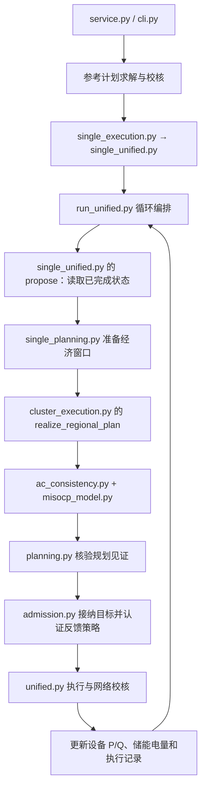

# 新能源最优协同控制算法的源代码分布说明

本文说明“新能源最优协同控制”这一条要求在当前项目中对应哪些代码、各文件承担什么职责，以及主要调用关系，供按功能阅读源码时使用。

依据：[《3.1 技术要求及方案（区域型油田电网新能源协同控制运行技术研究）630》](<../docs/3.1 技术要求及方案（区域型油田电网新能源协同控制运行技术研究）630.docx>)“委托研发方案”第（2）项：

> 在现有微电网运行基础上，形成新能源最优协同控制策略，对区域电网内源网荷储进行电网控制策略与逻辑的开发，实现分布式新能源的群体调控，确保区域电网有功无功平衡以及经济性最优。

以下按当前代码实际职责建立对应关系；部分文件由多个功能共用。

## 1. 先看整体分布

这条要求的实现主要分布在单微电网优化与执行、设备控制、潮流校核和经济核算四部分，另有独立的光伏群控与山城本地控制模块。

| 要求中的内容 | 主要代码位置 | 负责的问题 |
| --- | --- | --- |
| 在现有微电网运行基础上 | `data.py`、`network_model.py`、`bootstrap/adapters/project_dataset.py` | 网络、设备、负荷、风光出力和运行参数如何进入模型 |
| 新能源最优协同控制策略 | `misocp_model.py`、`bootstrap/adapters/single_unified.py` | 如何联合安排风、光、储、SVG 的 P/Q 计划，并滚动更新 |
| 源网荷储控制策略与逻辑 | `workflows/single_execution/`、`modules/control/` | 计划如何转为可执行指令，如何反馈、跟踪和安全续接 |
| 分布式新能源群体调控 | `group_control.py`、`shancheng_control.py` 及其配套文件 | 多站限发、恢复，以及风储和无功指令分解 |
| 有功无功平衡 | `misocp_model.py`、`ac_power_flow.py`、`modules/power_flow/` | 节点 P/Q 平衡、独立潮流及执行过程的网络约束检查 |
| 经济性优化与评价 | `misocp_model.py`、`modules/dispatch/`、`analysis.py` | 优化目标、成本分项及基准方案比较 |

上表的相对路径均以 `src/oilfield_energy/` 为起点。

当前正式单微电网执行使用 `unified-single-v7`。其中，“源”和“储”是主要可控对象；“网”主要表现为固定拓扑下的潮流与运行约束；“荷”主要作为逐节点有功、无功需求输入。

## 2. 正式入口与主调用链

| 文件 | 主要作用 |
| --- | --- |
| [service.py](../src/oilfield_energy/service.py) | 应用服务入口。`run_simulation()` 按场景分流；`_run_single_microgrid()` 组织基准与优化求解、独立校核、统一执行和结果汇总。 |
| [cli.py](../src/oilfield_energy/cli.py) | 命令行入口。单微电网计算复用相同的规划准备和统一执行入口，并组织结果导出。 |
| [bootstrap/adapters/single_execution.py](../src/oilfield_energy/bootstrap/adapters/single_execution.py) | 很薄的入口桥接，将 `run_unified_single` 暴露为 `run_single_execution`，本身不另写控制算法。 |
| [bootstrap/adapters/single_unified.py](../src/oilfield_energy/bootstrap/adapters/single_unified.py) | 正式单网的装配中心。准备预测、模拟观察、初态及储能任务；`SingleNumericalPorts.propose()` 根据已完成的设备状态构造并求解下一经济窗口。 |
| [bootstrap/adapters/single_planning.py](../src/oilfield_energy/bootstrap/adapters/single_planning.py) | 选择单个区域，设置执行策略，并把实际设备状态和联合 P/Q 动态约束放入规划输入。 |
| [bootstrap/adapters/single_model.py](../src/oilfield_energy/bootstrap/adapters/single_model.py) | 将算例中的网络、设备容量及控制权限转换为统一执行器使用的网络与设备响应模型。 |

主流程可按下面的关系理解：

这里复用了两个名字带 `cluster` 的文件，但单网流程没有因此运行多微电网 ADMM：

- [bootstrap/adapters/cluster_execution.py](../src/oilfield_energy/bootstrap/adapters/cluster_execution.py)：复用 `execution_inputs()` 和 `realize_regional_plan()`，分别提供执行输入与单区域物理规划求解。后者在此以 `cluster_coordination=False` 求解。
- [bootstrap/adapters/cluster_rolling.py](../src/oilfield_energy/bootstrap/adapters/cluster_rolling.py)：复用 `forecast_grid()` 和 `window_case()`，完成时间网格整理及滚动窗口截取。

## 3. 数据建模与联合优化

### 3.1 网络、资源与运行输入

| 文件 | 主要作用 |
| --- | --- |
| [data.py](../src/oilfield_energy/data.py) | 定义 `ProjectCase`、`MicrogridData`、`Storage` 等优化输入，集中保存母线负荷、风光可用量、储能参数、电价及运行限值。 |
| [network_model.py](../src/oilfield_energy/network_model.py) | 定义并检查网络台账、线路、变压器、固定补偿及运行方式，保证数值模型与网络定义一致。 |
| [modules/resources/contracts.py](../src/oilfield_energy/modules/resources/contracts.py) | 定义资源身份、风机无功策略和 SVG 能力等公共规则，统一资源标识与容量边界。 |
| [bootstrap/assets/unified_dataset.json](../src/oilfield_energy/bootstrap/assets/unified_dataset.json) | 默认统一台账，保存 SC、YA_B、YA_C 的设备、网络及模拟配置，是数据文件。 |
| [bootstrap/adapters/project_dataset.py](../src/oilfield_energy/bootstrap/adapters/project_dataset.py) | 加载台账，构造默认优化算例及各区域模拟输入，并保留数据版本和摘要。 |
| [bootstrap/adapters/simulation_case.py](../src/oilfield_energy/bootstrap/adapters/simulation_case.py) | 将研究配方、网络与时序输入装配为优化器使用的 `ProjectCase`。 |
| [modules/studies/application.py](../src/oilfield_energy/modules/studies/application.py) 与 [domain.py](../src/oilfield_energy/modules/studies/domain.py) | 前者组织日前、日内和分钟输入生成；后者实现模拟曲线生成规则。 |

默认台账带有明确的模拟数据标识。这里的代码负责把资料与参数组织成可计算对象，并不等于已经完成真实现场参数校准。

### 3.2 经济计划、设备约束与可执行性准备

| 文件 | 主要作用 |
| --- | --- |
| [misocp_model.py](../src/oilfield_energy/misocp_model.py) | 核心联合优化模型。建立风光 P/Q、储能充放电及能量、SVG、PCC 和支路潮流变量，加入有功无功平衡、设备与网络约束，并求解加权经济运行目标。 |
| [planning_security.py](../src/oilfield_energy/planning_security.py) | 将区域最小受电、防倒送裕度和动态群控阈值汇总为规划使用的 PCC 受电下界。它复用群控阈值函数，不运行群控状态机。 |
| [modules/dispatch/application_pq.py](../src/oilfield_energy/modules/dispatch/application_pq.py) | 生成联合 P/Q 动态规划约束，并独立重算规划见证，检查初态到计划端点之间的能力、响应及爬坡约束。 |
| [modules/dispatch/application_storage_window.py](../src/oilfield_energy/modules/dispatch/application_storage_window.py) | 根据原始储能任务和剩余时间计算当前窗口的末能量必要边界，并区分硬任务与软参考。 |
| [modules/dispatch/application_reactive.py](../src/oilfield_energy/modules/dispatch/application_reactive.py) | 构造固定有功条件下的无功响应与预留约束，供参考规划等路径使用；正式具有实际初态的联合 P/Q 滚动规划使用上一行的联合动态模型。 |
| [ac_consistency.py](../src/oilfield_energy/ac_consistency.py) | 组织优化求解和独立 AC 一致性检查，处理锥松弛误差、必要的紧化及物理可行性恢复，决定计划能否被采用。 |
| [modules/dispatch/application_ac_recovery.py](../src/oilfield_energy/modules/dispatch/application_ac_recovery.py) | 管理有预算限制的 AC 可行性恢复尝试及候选保留，分别记录可行性与原经济目标的证明情况。 |
| [modules/dispatch/application_quality.py](../src/oilfield_energy/modules/dispatch/application_quality.py) | 按配置的计算质量与预算规则评价求解结果，处理允许的重试，保留求解停止原因和质量证据。 |

`misocp_model.py` 负责“求计划”，后续执行工作流负责“该计划对应的目标能否安全跟踪”。

## 4. 控制策略、实际状态反馈与安全续接

以下工作流文件均位于 `src/oilfield_energy/workflows/single_execution/`，是当前单网控制主线。

| 文件 | 主要作用 |
| --- | --- |
| [run_unified.py](../src/oilfield_energy/workflows/single_execution/run_unified.py) | 按执行周期读取观察、按规划周期申请经济方案，组织见证检查、目标接纳、执行和最终评价；规划失败时尝试续接原目标。 |
| [forecast.py](../src/oilfield_energy/workflows/single_execution/forecast.py) | 从预测与声明的误差边界构造负荷 P/Q 区间、风光保证可用量和统一控制域。 |
| [planning.py](../src/oilfield_energy/workflows/single_execution/planning.py) | 检查经济规划见证是否与实际初态、资源、时间网格、未来能力、计划端点及能量一致。 |
| [admission.py](../src/oilfield_energy/workflows/single_execution/admission.py) | 接纳控制目标：优先认证原请求，必要时搜索附近的内部目标并比较获证候选；保留请求、调整及拒绝记录，外部固定目标不改写。 |
| [tracking.py](../src/oilfield_energy/workflows/single_execution/tracking.py) | 构造并认证有限时间内的 P/Q 反馈跟踪策略，联合检查响应期限、误差带、设备能力、网络和后续任务。 |
| [allocation.py](../src/oilfield_energy/workflows/single_execution/allocation.py) | 将总调节需求分到逐台资源，构造调节器选择、参与比例及分配候选。 |
| [unified.py](../src/oilfield_energy/workflows/single_execution/unified.py) | 统一执行器。采用获证策略，生成本周期反馈指令，检查设备和网络响应，更新一次设备状态与储能电量；也提供执行证据独立重算。 |
| [certificates.py](../src/oilfield_energy/workflows/single_execution/certificates.py) | 认证候选之后的安全续接序列与可持续安全终态，并检查当前观察是否仍在声明范围内。 |
| [tasks.py](../src/oilfield_energy/workflows/single_execution/tasks.py) | 将原始储能末能量与绝对期限纳入安全续接，分别判断任务保证和实际到期结果。 |
| [task_allocation.py](../src/oilfield_energy/workflows/single_execution/task_allocation.py) | 临近储能任务期限时，在保持已接纳 PCC 目标的条件下提出资源重新分配候选。 |
| [network.py](../src/oilfield_energy/workflows/single_execution/network.py) | 按时刻更新设备可用能力，将负荷与设备 P/Q 范围转换为节点净需求，并调用 AC 区间校核。 |
| [economics.py](../src/oilfield_energy/workflows/single_execution/economics.py) | 对获证反馈策略在预测条件下重新计价，供候选比较；这里的估计费用与全日参考计划经济指标分开。 |

工作流使用的底层控制规则主要位于 `src/oilfield_energy/modules/control/`：

| 文件 | 主要作用 |
| --- | --- |
| [application_policy.py](../src/oilfield_energy/modules/control/application_policy.py) | 按当前总负荷、设备状态和参与比例生成 P/Q 平衡反馈指令，并认证该反馈规则。 |
| [application_tube.py](../src/oilfield_energy/modules/control/application_tube.py) | 实现正式单网设备响应、储能能量更新和响应区间认证，供策略试算、执行及重算共同使用。 |
| [application_safe_command.py](../src/oilfield_energy/modules/control/application_safe_command.py) | 将期望指令投影到逐资源能力、爬坡和共享无功动作预算内，形成待进一步认证的候选。 |
| [application_backup.py](../src/oilfield_energy/modules/control/application_backup.py) | 构造包含 PCS 独立动作的备用候选，供工作流选择可安全续接的方案。 |
| [application_energy_policy.py](../src/oilfield_energy/modules/control/application_energy_policy.py) | 生成并认证储能能量回归指令，使原始能量任务能够与安全控制衔接。 |

这些底层文件负责设备规则；网络检查、目标接纳及完整执行顺序由上面的工作流负责。

## 5. 有功无功平衡与经济性评价

### 5.1 电网计算和独立校核

| 文件 | 主要作用 |
| --- | --- |
| [ac_power_flow.py](../src/oilfield_energy/ac_power_flow.py) | 独立 AC 潮流计算与调度校核，计算 PCC P/Q、节点电压、线路潮流及损耗，并与优化计划比较。 |
| [modules/power_flow/application_numerics.py](../src/oilfield_energy/modules/power_flow/application_numerics.py) | 提供恒功率电流、节点需求检查和功率平衡残差评价等基础计算。 |
| [modules/power_flow/application_envelope.py](../src/oilfield_energy/modules/power_flow/application_envelope.py) | 对一定范围内的节点净需求计算 AC 区间证据，检查电压、线路和 PCC 约束，支撑控制过程安全认证。 |
| [modules/power_flow/application_loss_envelope.py](../src/oilfield_energy/modules/power_flow/application_loss_envelope.py) | 计算获证损耗范围，并利用总净需求与损耗关系收紧 PCC P/Q 平衡范围。 |
| [kernel/intervals.py](../src/oilfield_energy/kernel/intervals.py) 与 [enclosures.py](../src/oilfield_energy/kernel/enclosures.py) | 前者提供区间运算；后者提供向外舍入等数值基础，供设备和网络范围认证使用。 |

因此，“有功无功平衡”的代码分为三个层次：`misocp_model.py` 建立节点平衡等式，`ac_power_flow.py` 独立检查计划，执行工作流通过区间潮流检查反馈动作过程。PCC 可以与上级电网交换功率，平衡不要求 PCC 的 P、Q 都为零。

### 5.2 费用核算与结果汇总

| 文件 | 主要作用 |
| --- | --- |
| [modules/dispatch/domain.py](../src/oilfield_energy/modules/dispatch/domain.py) | 实现购电、弃电、储能吞吐退化和网损等费用公式，以及新能源利用量的核算。 |
| [modules/dispatch/application.py](../src/oilfield_energy/modules/dispatch/application.py) | 校验经济核算输入、计算方案成本和比较结果；`assess_single_economic_requirement()` 判断当前计划成本改善是否达到 10%。 |
| [analysis.py](../src/oilfield_energy/analysis.py) | `compare_results()` 比较基准与优化成本；`validate_result()` 检查不倒送、功率因数、电压、线路容量和储能运行约束。 |
| [service.py](../src/oilfield_energy/service.py) | 将计划质量、执行安全、跟踪、储能任务和经济指标整理为分项与总体结果。 |

实际电价与结算规则、同期运行及电量账单、拟纳入计算的储能退化和运维等费用依据尚未齐备；正式评价所采用的对照基准、费用范围、统计周期及对应运行记录也仍需补充或确认，尚不足以完成有依据的现场经济计算与对比。

## 6. 配套契约、相邻功能与验证入口

### 6.1 数据契约在哪里

算法之外，还需要用契约明确各模块交换的状态、指令和证据：

| 文件 | 定义的内容 |
| --- | --- |
| [single_execution/contracts.py](../src/oilfield_energy/workflows/single_execution/contracts.py) | 对外的单网执行结果及相关公共类型。 |
| [single_execution/contracts_unified.py](../src/oilfield_energy/workflows/single_execution/contracts_unified.py) | 统一控制域、研究策略、经济候选、目标接纳、计划证书和逐周期记录。 |
| [single_execution/contracts_domain.py](../src/oilfield_energy/workflows/single_execution/contracts_domain.py) | 显式负荷边界、风光保证可用量、外部目标与可选初态。 |
| [single_execution/contracts_tasks.py](../src/oilfield_energy/workflows/single_execution/contracts_tasks.py) | 储能期限任务、续接证据和完成评价。 |
| [control/contracts_tube.py](../src/oilfield_energy/modules/control/contracts_tube.py)、[contracts_policy.py](../src/oilfield_energy/modules/control/contracts_policy.py)、[contracts_energy_policy.py](../src/oilfield_energy/modules/control/contracts_energy_policy.py) | 分别定义设备状态与响应区间、P/Q 平衡反馈策略、能量回归策略。 |
| [dispatch/contracts_pq.py](../src/oilfield_energy/modules/dispatch/contracts_pq.py) | 联合 P/Q 规划输入和逐分钟规划见证。 |
| [power_flow/contracts_envelope.py](../src/oilfield_energy/modules/power_flow/contracts_envelope.py) | 网络区间模型及 AC 认证数据。 |
| [hierarchy_types.py](../src/oilfield_energy/hierarchy_types.py) 与 [control_contracts.py](../src/oilfield_energy/control_contracts.py) | 前者包含群控状态、阈值和决策类型；后者定义站级限额意图、仲裁结果及 PCC 安全分配等契约。 |

各目录中的 `api.py` 主要汇集公开函数。阅读具体算法时，应继续进入相应的 `application_*.py` 或工作流文件。

### 6.2 相邻功能的范围

- **跨区域集群协同**：[admm.py](../src/oilfield_energy/admm.py)、[regional_control.py](../src/oilfield_energy/regional_control.py) 和 [workflows/cluster_execution/rolling.py](../src/oilfield_energy/workflows/cluster_execution/rolling.py) 分别承担分布式协调、区域优化响应和集群滚动编排；[safety_controller.py](../src/oilfield_energy/workflows/cluster_execution/safety_controller.py) 是当前集群认证执行器。
- **现场数据与 D5000 边界**：[field_data/case_builder.py](../src/oilfield_energy/field_data/case_builder.py) 检查资料就绪条件并提供固定时刻快照入口；[d5000_contracts.py](../src/oilfield_energy/field_data/d5000_contracts.py) 定义量测、质量、回执及 PCC 方向转换，不提供真实 D5000 通信。
- **服务与界面**：[web_api.py](../src/oilfield_energy/web_api.py)、[job_worker.py](../src/oilfield_energy/job_worker.py) 负责请求入口和任务执行；`web/frontend/` 展示结果。核心控制和优化算法位于前述后端文件。
- 
### 6.3 代表性验证入口

| 文件 | 主要验证对象 |
| --- | --- |
| [tests/integration/single_execution/test_single_execution.py](../tests/integration/single_execution/test_single_execution.py) | 正式单网入口、实际状态反馈、规划失败续接和执行评价。 |
| [tests/integration/single_execution/test_joint_pq_execution.py](../tests/integration/single_execution/test_joint_pq_execution.py) | 真实 MISOCP 联合 P/Q 求解、执行见证及异常见证拒绝。 |
| [tests/unit/control/test_device_tube.py](../tests/unit/control/test_device_tube.py) 与 [test_local_allocation.py](../tests/unit/control/test_local_allocation.py) | 设备响应与区间认证，以及逐资源分配和反馈规则。 |
| [tests/unit/dispatch/test_economics.py](../tests/unit/dispatch/test_economics.py) | 成本分项、经济比较口径及输入校验。 |
| [tools/verify_single_unified.py](../tools/verify_single_unified.py) | 正式单网运行、结果保存和独立证书重算的验证工具。 |