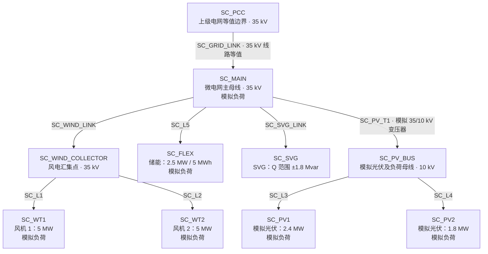

# 新能源最优协同控制算法的电网架构说明

本文说明当前新能源最优协同控制算法 `unified-single-v7` 所采用的电网结构，以默认山城区域 `SC`、启用储能的配置为例。

这里说明的是程序实际采用的电气网络模型。其部分主干接线和设备规模参考山城资料，另含模拟等值和扩展，尚不是完整确认的山城现场电网。

## 1. 整体架构

当前模型是一个**通过单一 PCC 与上级电网连接、拓扑固定的径向交流微电网**，共有 **10 个母线、9 条支路**，其中 8 条为线路等值，1 条为模拟变压器支路。

PCC 是微电网与上级电网的公共连接点。模型以 `SC_PCC` 为根节点，经一条 35 kV 连接支路接至微电网主母线 `SC_MAIN`，再分成风电、储能、SVG 和光伏与负荷四类分支。径向表示各节点沿树状支路连接，不构成闭合环路。

| 项目 | 当前采用的结构 |
| --- | --- |
| 上级电网边界 | `SC_PCC`，35 kV 侧等值电源，执行模型根电压固定为 1 pu，即本侧额定电压 |
| 主干电压 | 35 kV；风机、储能和 SVG 节点均按 35 kV 侧等值接入 |
| 模拟扩展电压 | 经一条 35/10 kV 模拟变压器接入两组光伏及部分负荷 |
| 电源与调节设备 | 两台各 5 MW 风机、两组合计 4.2 MW 模拟光伏、一套 2.5 MW/5 MWh 储能、一套 SVG |
| 负荷 | 六组模拟负荷，分布在不同母线，峰值参数合计 14 MW |
| 网络数学模型 | 平衡正序、径向稳态等值，统一功率基准为 20 MVA |

台账虽然同时包含其他区域，正式单网流程只选择一个区域建模。

## 2. 接线示意图

以下箭头表示从 PCC 向下展开的拓扑关系，不表示功率只能沿箭头流动。图中的设备节点是计算用接入点，风机、储能和 SVG 的 35 kV 标注不代表其机端额定电压。

主干 `SC_PCC → SC_MAIN` 是同电压等级的线路等值，不是降压变压器。唯一显式建模的变压器 `SC_PV_T1` 位于光伏模拟扩展分支，也不代表资料中的山城变电所实际站内主变。

## 3. 各母线及设备的作用

| 母线编号 | 额定电压基准 | 接入资源或作用 | 模拟负荷峰值参数 |
| --- | --- | --- | ---: |
| `SC_PCC` | 35 kV | 上级电网边界，计算微电网与上级电网之间的 P/Q 交换 | 无 |
| `SC_MAIN` | 35 kV | 微电网主母线，连接各分支 | 6.2 MW |
| `SC_WIND_COLLECTOR` | 35 kV | 两台风机的等值汇集点 | 无 |
| `SC_WT1` | 35 kV | 第一台 5 MW 风机的接入侧等值节点 | 1.0 MW |
| `SC_WT2` | 35 kV | 第二台 5 MW 风机的接入侧等值节点 | 1.0 MW |
| `SC_FLEX` | 35 kV | 储能接入侧等值节点 | 1.8 MW |
| `SC_SVG` | 35 kV | SVG 独立接入节点 | 无 |
| `SC_PV_BUS` | 10 kV | 模拟变压器低压侧，连接光伏与负荷分支 | 无 |
| `SC_PV1` | 10 kV | 第一组模拟光伏，容量 2.4 MW | 2.0 MW |
| `SC_PV2` | 10 kV | 第二组模拟光伏，容量 1.8 MW | 2.0 MW |

负荷峰值参数用于生成负荷时序，不是每个时刻恒定消耗的功率，也不意味着六组负荷实际同时达到 14 MW。挂在风机或储能节点上的负荷仍是模拟聚合负荷，不能解释为已确认的设备自耗。

当前设备分工如下：

- **风机：** 提供有功，并参与无功调节；每台无功同时受 `|Q| ≤ 0.30P`、绝对无功上限及视在容量约束。
- **光伏：** 提供可调有功，当前无功控制关闭，模型中 Q=0。
- **储能：** 进行有功充放电，受功率和能量边界约束；当前无功控制关闭，模型中 Q=0。
- **SVG：** 提供无功补偿，模型中 P=0、Q 范围为 ±1.8 Mvar，额定视在容量按 2 MVA 表达。
- **负荷：** 作为各母线的给定 P/Q 时序输入，不作为可主动调节的需求响应变量。

SVG 与储能接在不同节点。虽然 SVG 的资源标识保留为 `SC:svg:SC_FLEX`，其实际 `bus_id` 是 `SC_SVG`；接入位置应读取台账映射，不能从资源标识的文字后缀推断。

## 4. 开关、变压器与模型边界

台账记录了三个开关：`SC_GRID_DISCONNECT`（刀闸）和 `SC_PCC_SWITCH`（并网开关）共同控制 `SC_GRID_LINK`，`SC_WIND_TRIP_SWITCH` 控制风电汇集支路 `SC_WIND_LINK`。默认均闭合；它们控制既有支路，不另外增加母线和支路数量。

正式算法按已选定的连接方式计算，不优化开关分合，也不模拟保护动作时序。若输入开关状态使上述网络失去连通性，当前网络检查会拒绝将其作为同一完整径向网络求解，而不是自动切换为孤岛运行。

模拟变压器的固定非额定标幺变比为 1.0。由于高低压侧分别以 35 kV、10 kV 为电压基准，这个 1.0 不表示实际高低压电压相等。当前规划不调节变压器档位，正式执行也不支持非零相移。

在电气计算中，程序使用节点 P/Q 平衡、线路阻抗和损耗、节点电压及支路容量约束，执行阶段另作径向 AC 网络校核。因此，这不是只有区域总负荷和总发电量的聚合模型。当前默认电压范围为 0.95～1.05 pu，PCC 有功受电基础范围为 0.5～18 MW，规划还可能施加更高的动态安全下界；这些数值是当前研究设置，不是已确认的现场定值。

当前范围不包含三相不平衡、完整站级环网、孤岛频率控制或电磁暂态过程。上级电网也没有展开为完整输配电系统，而是在 PCC 处作边界等值。

## 5. 哪些有资料依据，哪些属于模拟配置

| 内容 | 当前依据与性质 |
| --- | --- |
| 35 kV 并网主干，以及风电、储能、SVG 独立分支 | 项目台账及资料说明引用《山城微电网控制策略逻辑》第 1 页；具体设备端点仍采用计算等值 |
| 两台各 5 MW 风机、2.5 MW/5 MWh 储能 | 规模有山城资料依据；风机视在容量、部分能力参数及储能效率、能量边界仍含模拟假设 |
| SVG 额定规模及调节边界 | 台账引用《西交大-资料提供》第 9 页的 2 Mvar，以及山城策略中的 ±1.8 Mvar 调节边界 |
| 两组光伏、35/10 kV 光伏扩展支路 | 保留的模拟研究配置，尚未确认其对应山城实际设备、容量与接入位置 |
| 六组负荷及其分布、时序 | 模拟聚合负荷；不是从完整现场逐母线历史量测构建 |
| 风电场内部拆分、各支路阻抗与容量限值 | 含模拟等值；山城当前全部支路 R/X 和容量限值未作为现场核实参数使用 |
| 开关常闭方式、运行上下限 | 当前算例假设，仍需现场资料确认 |

## 6. 关键代码与配置位置

| 文件 | 与本架构的关系 |
| --- | --- |
| [unified_dataset.json](../src/oilfield_energy/bootstrap/assets/unified_dataset.json) | 山城母线、支路、开关、设备、负荷和来源说明的原始台账 |
| [project_dataset.py](../src/oilfield_energy/bootstrap/adapters/project_dataset.py) | 读取包内台账并生成默认研究算例 |
| [simulation_case.py](../src/oilfield_energy/bootstrap/adapters/simulation_case.py) | 将设备、负荷及网络映射为优化所用的 `MicrogridData` 和 `ProjectCase` |
| [network_model.py](../src/oilfield_energy/network_model.py) | 解析运行方式和开关状态，检查径向连通性，并统一支路方向、变比等信息 |
| [single_planning.py](../src/oilfield_energy/bootstrap/adapters/single_planning.py) | 从项目算例中选择单一区域，构造正式单网规划输入 |
| [single_model.py](../src/oilfield_energy/bootstrap/adapters/single_model.py) | 将网络和设备装配为执行模型，设置 PCC 根节点、1 pu 根电压及设备 P/Q 能力 |
| [misocp_model.py](../src/oilfield_energy/misocp_model.py) | 在网络上建立联合优化、支路潮流、节点平衡及电压容量约束 |
| [single_unified.py](../src/oilfield_energy/bootstrap/adapters/single_unified.py) | 将上述网络、设备和预测数据接入正式单微电网执行流程 |