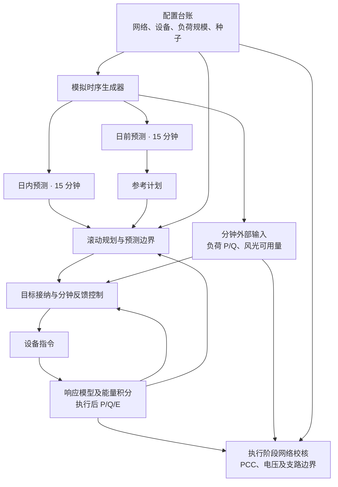

# 新能源最优协同控制算法的电网运行数据说明

本文说明新能源最优协同控制算法 `unified-single-v7` 使用和产生的运行数据，以默认山城区域 `SC` 为范围，重点介绍数据构成、来源及相互关系，不展示某次仿真的具体运行结果或曲线。

## 1. 运行数据由哪些部分组成

| 数据类别 | 主要内容 | 当前来源 |
| --- | --- | --- |
| 网络与设备基础参数 | 母线、支路、设备接入位置、阻抗、容量、控制权限、储能效率及能量边界 | 包内 JSON 台账及代码中的模型配置，包含资料参考项和模拟设定 |
| 外部运行输入 | 各母线负荷 P/Q、各风光接入点可用有功功率 | 按配置规模、日变化公式及固定随机种子生成 |
| 经济与控制输入 | 电价、费用系数、负荷误差范围、风光可用量下界、响应与跟踪参数 | 代码中的研究参数，以及由预测计算的边界 |
| 规划与接纳结果 | 未来设备 P/Q、储能能量计划、PCC 目标请求及最终接纳目标 | 优化求解和目标接纳流程计算 |
| 分钟执行状态 | 实际采用的设备指令、执行前后 P/Q、储能能量 E | 反馈控制、设备响应模型和能量积分计算 |
| 网络计算结果 | PCC P/Q、母线电压、支路潮流与负载水平、网损、功率因数及校核范围 | 规划模型、潮流计算及执行阶段的 AC 校核 |

## 2. 网络、设备与初始状态的来源

### 2.1 基础台账

[unified_dataset.json](../src/oilfield_energy/bootstrap/assets/unified_dataset.json) 是默认业务模拟台账，定义山城的 10 个母线、9 条支路、两台风机、两组光伏、一套储能、一套 SVG，以及六组负荷。

其中，两台各 5 MW 风机、2.5 MW/5 MWh 储能及部分 SVG 参数有项目资料依据；光伏配置、负荷分布、支路阻抗和容量限值等仍含模拟设定。运行时读取的是整理后的台账，程序不会每次自动从 PDF 中提取这些参数。

具体接线见[电网架构说明](新能源最优协同控制算法_电网架构说明.md)。

### 2.2 初始状态

默认储能初始能量从台账读取，为 2.5 MWh；能量允许范围为 0.5～5 MWh。默认设备初始 P/Q 采用程序构造并校核的安全终态：各设备 P 为零，风光及储能 Q 为零，SVG 使用由预测负荷和能力边界确定的固定 Q。

算法也支持显式传入初始状态，但默认流程没有自动从现场遥测恢复设备初态。后续设备状态由每分钟执行递推产生，不是每个时刻重新随机生成。

## 3. 负荷和风光运行时序怎样生成

核心函数是 [generate_profiles()](../src/oilfield_energy/modules/studies/domain.py)，由 [generate_inputs()](../src/oilfield_energy/modules/studies/application.py) 分别生成日前、日内和分钟输入。

### 3.1 负荷 P/Q

有功负荷 P 按下式生成：

> P = 该节点的负荷峰值参数 × 预设日变化系数 ×（1＋随机扰动）。

日变化系数包含基础负荷、早上 9 点附近的抬升、晚上 19 点附近的抬升，以及小幅正弦变化。曲线形状在代码中给定，没有在当前生成流程中从现场历史负荷拟合或训练。

无功负荷根据该组负荷的固定功率因数 PF 计算：

> Q = P × tan(arccos(PF))。

| 负荷接入母线 | 峰值参数 | 固定功率因数 |
| --- | ---: | ---: |
| `SC_MAIN` | 6.2 MW | 0.92 |
| `SC_WT1` | 1.0 MW | 0.93 |
| `SC_WT2` | 1.0 MW | 0.91 |
| `SC_PV1` | 2.0 MW | 0.94 |
| `SC_PV2` | 2.0 MW | 0.92 |
| `SC_FLEX` | 1.8 MW | 0.93 |

峰值参数合计为 14 MW，不表示负荷全天恒定为 14 MW，也不表示各节点必然同时达到峰值。其他四个母线由生成器补齐零负荷序列。挂在风机或储能节点上的负荷是模拟聚合负荷，不是已确认的机组自耗。

### 3.2 风电可用功率

风电可用量由各风机的装机容量乘以预设波动系数生成。系数包含日周期和较短周期的正弦变化以及随机扰动，并限制在 0.15～0.90 之间。

因此，当前生成器并未读取现场风速、风向或气象预报，也没有根据真实风机功率曲线估计出力。这一限幅范围属于当前模拟曲线规则，不是风机在真实运行中永远有至少 15% 可用功率的保证。

### 3.3 光伏可用功率

光伏采用以 6:00～18:00 为发电时段的日照形状函数，叠加约 13.3 时附近的局部衰减和随机扰动，再乘以各组装机容量，并限制在零至装机容量之间。

这里的日照时段和衰减形状是模拟设置，没有接入真实辐照度、云量或组件温度。夜间零可用量由公式产生，不是读取到的现场停发记录。

**风光可用量表示当时模型允许利用的发电能力，不等于最终输出。** 设备是否满发、限发以及如何响应指令，由后续控制和设备模型决定；因此 `wind_available`、`pv_available` 不能直接当作执行出力。

## 4. 日前、日内和分钟输入有什么区别

| 数据 | 原生间隔与全日长度 | 负荷 P 的生成扰动 | 随机种子 | 用途 |
| --- | --- | --- | --- | --- |
| 日前预测 `day_ahead` | 15 分钟，96 点 | ±2.5% | 配置种子 | 构造参考规划输入 |
| 日内预测 `intraday` | 15 分钟，96 点 | ±1.2% | 配置种子＋1 | 正式滚动规划及声明边界 |
| 分钟输入 `plant` | 1 分钟，1,440 点 | ±0.4% | 配置种子＋2 | 提供当前周期的模拟负荷和风光可用量 |

山城配置种子为 `20260915`，固定种子使同一配方可重复生成。三套数据具有相同的基础日变化规律，但扰动种子和时间分辨率不同，并非直接复制同一条曲线。

上表百分比是负荷生成时的扰动幅度，不是现场统计出的预测准确率。风电在归一化出力系数上加扰动，光伏对日照形状乘扰动，不能把三类功率的扰动统一解释为同一种预测误差。

执行边界由日内预测默认线性插值到各分钟，最后一个预测区间保持末值。预测边界构造函数不接收未来分钟实绩；观察端口每次只读取当前周期。因而“未来预测”和“当前观察”在流程中是分开的。

运行主要按相对分钟步号和日内小时对齐。配方日期、适配器中的仿真起点及结果生成时间均不能作为现场采样日期使用；真实数据接入还需明确统一时区和时间戳含义。

## 5. 其他输入数据从哪里来

| 内容 | 来源与性质 |
| --- | --- |
| 电价 | `simulation_case.py` 按日内时刻设置：0～7 时 280 元/MWh，17～22 时 1,180 元/MWh，其余 720 元/MWh；属于模拟电价，重采样时保持阶梯值 |
| 弃电、储能退化、网损等费用系数 | `data.py` 中的 `ModelAssumptions` 默认参数，不是现场账单自动统计值 |
| 设备响应、爬坡、跟踪周期与容差 | 控制及执行策略配置，属于声明的研究参数 |
| 负荷允许范围 | `forecast.py` 围绕各母线日内预测构造 P/Q 区间，默认相对误差 2.5%；Q 使用预测值加减其绝对值的 2.5% |
| 风光保证可用量下界 | `forecast.py` 使用预测值扣减装机容量的 5%（风）或 15%（光），并截断于零；不是现场量测，也不是要求实际出力必须达到该数值 |
| 预设事件 | 如用户选择负荷突降、突增或风光变化，由 `scenario_events.py` 对指定时段输入进行修改，属于人为设定的研究场景 |

负荷区间和风光下界属于算法保证成立的条件。每分钟观察值会与其比较；超界时原保证前提失效，程序不会自动把边界扩宽后继续声称原校核有效。显式提供固定边界时，会使用该声明替代默认自动边界。

## 6. 哪些数据是运行过程中计算出来的

### 6.1 规划、目标和指令

优化器根据输入预测、设备网络参数和费用生成计划，包括设备出力、储能能量轨迹、PCC P/Q 和规划网络状态。目标接纳流程随后记录原请求、尝试的候选及接纳结果。分钟反馈再据此生成本周期实际采用的设备指令。

这些量的含义分别是“预计怎样运行”“正式接受什么目标”和“本分钟给设备什么命令”，不能因为单位相同就互相代替。

### 6.2 设备出力、储能能量与 SOC

设备执行后的 P/Q 由 `execute_tube_command()` 根据执行前状态、指令及响应参数计算。储能能量在每周期按充放电功率、效率和时长积分一次，形成下一周期的 E。

正式单网内部以 MWh 为单位保存能量状态，不依赖一条另行随机生成的 SOC 曲线。若将能量换算为 SOC 百分比，还必须明确容量基准；该换算值也不能直接当作现场 BMS 的 SOC 量测。

### 6.3 PCC、电压、支路与网损

这些量结合网络参数、负荷及设备出力计算。需要区分两类结果：

- **参考或滚动规划结果：** 包含 PCC P/Q、功率因数、母线电压、支路负载率和网损等计划计算值。
- **执行校核结果：** 对设备过程和端点作 AC 区间校核，计算电压范围、支路容量上界及 PCC P/Q 范围。每个 `UnifiedStep` 保存的 `pcc_p_mw`、`pcc_q_mvar` 是上下界区间，不是电表采样点；其数值包围范围也不是概率预测区间。

默认执行模型将 PCC 根电压固定为 1 pu，其他母线电压据网络模型求得。规划曲线中的电压不能直接替代分钟执行电压；代码参与校核的全部中间电气量，也不一定都逐项保存为每分钟输出曲线。

经济改善比例同样是派生结果：当前服务层比较基准与选定参考计划成本，尚不是按完整执行记录结算的实绩费用。

## 7. 数据如何组织和辨认

| 数据结构或结果位置 | 主要内容及识别方式 |
| --- | --- |
| `MicrogridData` | `load_p_mw`、`load_q_mvar`、`wind_available_mw`、`pv_available_mw` 等按母线编号保存的数组，附网络和设备参数 |
| `PlantInputs` / `BusSeries` | 起点、时间步长，以及每个母线的 `values` 序列；预测与分钟输入复用此结构，需要结合来源区分 |
| `UnifiedDomain.forecasts` | 逐分钟、逐母线负荷区间及逐资源风光下界，不是未来实测序列 |
| `single_execution.unified.economic_proposals` | 每轮经济规划请求和名义规划证据 |
| `single_execution.unified.target_admissions` | 目标请求、候选尝试及接纳结果 |
| `single_execution.unified.steps` | 每分钟 `observed`、`command`、`before`、`after`、PCC 区间及校核状态 |
| 结果元数据 | 数据集 ID、revision、源文件 SHA-256、预测类型及算法版本等，用于追踪数据来源 |

设备状态数组的顺序对应 `domain.devices.resources`，需要用资源 ID 与母线映射解读。以 SVG 为例，资源 ID 为 `SC:svg:SC_FLEX`，接入母线却是 `SC_SVG`；不能从 ID 后缀猜测接入位置。

主要单位为 P：MW，Q：Mvar，E：MWh，容量：MVA，电压及部分电流/负载量：pu，电价：元/MWh。PCC 有功正值表示受电；设备有功正值表示注入，储能正值为放电。读取数据还应区分设备注入无功与负荷需求无功的含义。

服务层的常规时序展示由参考计划结果组装，分钟执行记录另存于 `single_execution`。判断一列数据的来源时，应检查其所在结构和时间轴，不能仅凭“实际”“运行”或设备名称等显示文字判断。

## 8. 关键源码位置

| 文件 | 数据职责 |
| --- | --- |
| [domain.py](../src/oilfield_energy/modules/studies/domain.py)、[application.py](../src/oilfield_energy/modules/studies/application.py) | 负荷与风光曲线公式、扰动、随机种子及三套输入生成 |
| [project_dataset.py](../src/oilfield_energy/bootstrap/adapters/project_dataset.py) | 加载台账、计算数据集摘要、构造及重采样算例 |
| [simulation_case.py](../src/oilfield_energy/bootstrap/adapters/simulation_case.py)、[data.py](../src/oilfield_energy/data.py) | 网络设备映射、负荷数组、电价及费用参数 |
| [cluster_execution.py](../src/oilfield_energy/bootstrap/adapters/cluster_execution.py) | 被单网复用的输入装配函数：日内预测、分钟输入、事件及捕获算例保持方式 |
| [single_unified.py](../src/oilfield_energy/bootstrap/adapters/single_unified.py) | 当前周期观察、滚动输入、设备初态及最终执行记录 |
| [forecast.py](../src/oilfield_energy/workflows/single_execution/forecast.py)、[certificates.py](../src/oilfield_energy/workflows/single_execution/certificates.py) | 预测插值、声明区间与下界，以及观察值的边界检查 |
| [application_tube.py](../src/oilfield_energy/modules/control/application_tube.py)、[unified.py](../src/oilfield_energy/workflows/single_execution/unified.py) | 设备响应、能量积分、网络校核及每周期状态提交 |
| [misocp_model.py](../src/oilfield_energy/misocp_model.py)、[contracts_envelope.py](../src/oilfield_energy/modules/power_flow/contracts_envelope.py) | 规划电气结果及 AC 校核结果的数据含义 |
| [contracts_unified.py](../src/oilfield_energy/workflows/single_execution/contracts_unified.py)、[service.py](../src/oilfield_energy/service.py) | 执行记录结构、元数据及参考计划展示的组装 |
| [case_builder.py](../src/oilfield_energy/field_data/case_builder.py)、[d5000_contracts.py](../src/oilfield_energy/field_data/d5000_contracts.py) | 现场数据构建及 D5000 对接的现有边界 |

调度如何使用这些数据，见[调度策略说明](新能源最优协同控制算法_调度策略说明.md)。
