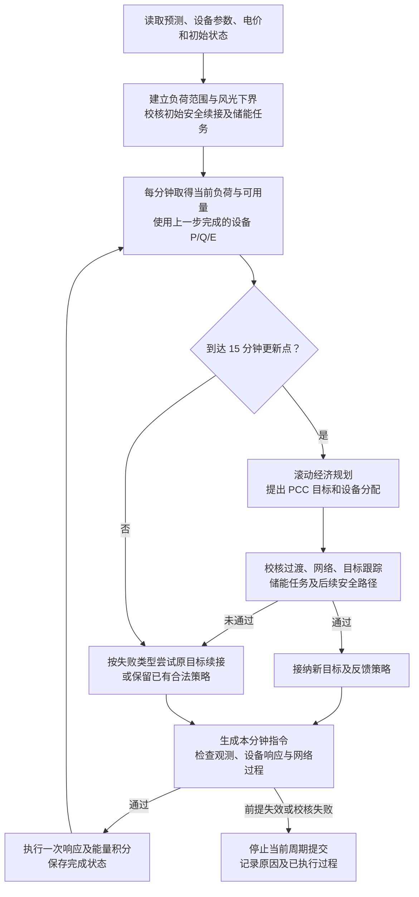

# 新能源最优协同控制算法的调度策略说明

本文依据当前代码说明 `unified-single-v7` 的具体调度策略，以默认山城区域 `SC`、启用储能的单微电网为例。联合 P/Q 规划版本为 `single-pq-planning-v2`，执行证据版本为 `single-execution-v9`。

本算法在固定径向电网上协调风电、光伏、储能和 SVG。电网接线及设备位置见[电网架构说明](新能源最优协同控制算法_电网架构说明.md)。本文中的“当前状态”和“执行”指离线仿真中已经完成的设备响应及能量变化，尚不是通过 D5000 获取量测并下发指令的现场闭环。

## 1. 总体策略：滚动优化、接纳前校核、分钟反馈

算法每 15 分钟根据当前状态重新安排未来一段时间的设备 P/Q 和储能能量，每分钟根据当前负荷修正设备指令。经济规划给出的首个 PCC 目标及设备分配，需要通过执行校核后才能采用。

算法同时处理三类要求：

- **安全边界：** 设备能力、储能能量、节点电压、线路容量、PCC 受电范围和功率因数等。
- **控制任务：** 在规定期限内跟踪已接纳的 PCC P/Q 目标，并在结束时满足储能能量任务；这些承诺以取得相应校核证据为前提。
- **经济偏好：** 综合减少购电、弃风弃光、储能吞吐和网损等代价，并考虑电压偏差和功率变化。

经济偏好不能放宽执行安全标准。即使一次经济求解失败，只要原有保证条件仍成立，执行器仍可使用已保存的合法续接策略。

图中的“校核证据”是程序保存并可重算的模型检查结果。初始化若连安全续接也无法取得，则不会进入正常执行循环。

## 2. 调度使用什么输入，多久更新一次

| 输入或参数 | 当前用途及默认值 |
| --- | --- |
| 逐母线负荷 P/Q 预测 | 安排未来供需平衡，并构造允许波动区间；默认区间为预测值 ±2.5% |
| 风光可用功率预测 | 构造保证可用量：风电预测减装机的 5%，光伏减装机的 15%，最低取零；正式滚动规划使用这些保守能力边界 |
| 当前设备 P/Q 和储能 E | 每轮规划继承已经执行完成的状态，不把上一计划的预期状态当成已实现状态 |
| 设备与网络参数 | 确定功率、无功、响应、爬坡、能量、电压和支路容量等边界 |
| 电价及费用参数 | 参与经济优化，决定不同时间、不同设备动作的代价 |
| 参考计划 | 服务入口先求解参考计划；滚动规划使用其中的储能能量轨迹作为软参考 |
| 执行周期 | 1 分钟 |
| 经济更新周期 | 15 分钟 |
| 滚动预测范围 | 最多向前 240 分钟，临近研究结束时缩短 |
| 新接纳目标的响应期限 | 默认 10 分钟；同一目标续接沿用原绝对期限 |
| PCC 跟踪误差带 | P：±0.05 MW；Q：±0.05 Mvar |

上述误差、响应和跟踪参数是研究设置。默认预测与分钟运行输入由模拟数据生成器提供；经济计划虽然滚动更新，但当前流程没有每轮利用现场实测重新训练预测模型。

PCC 有功正值表示从上级电网受电；设备有功正值表示向微电网注入，储能正值为放电、负值为充电。无功按项目内部注入方向统一计算。

## 3. 每轮经济规划具体决定什么

### 3.1 联合决定设备出力和 PCC 交换功率

规划同时决定风机 P/Q、光伏 P、储能充放电功率、SVG Q，以及 PCC 与上级电网之间的 P/Q 交换。默认山城配置关闭光伏和储能的无功控制，因此它们的 Q 固定为零。

这些决策必须满足逐节点功率平衡和网络约束。以整个微电网的有功关系理解，就是：上级电网受电加风光发电和储能放电，需要覆盖负荷、储能充电及网损。具体计算仍按各母线和支路展开，不只检查总量。

当前 PCC 基础受电范围为 0.5～18 MW，规划还会计算动态安全下界，避免反送电风险。执行网络功率因数下限为 0.9；规划通常采用更严格的目标留出余量，较严格的规划尝试失败时，可按输入的规划目标重试，执行安全标准保持一致。

### 3.2 用综合代价选择方案

| 目标项 | 在调度中的作用 |
| --- | --- |
| 购电费用 | 按各时段电价计算受电费用 |
| 弃风弃光代价 | 鼓励在能力与网络约束内利用新能源 |
| 储能吞吐代价 | 对充放电量计入退化代理费用，抑制没有收益的反复充放电 |
| 网损价值 | 对线路有功损耗设置代价 |
| 电压偏差与受电变化惩罚 | 偏好电压较平稳、相邻经济时段受电变化较小的方案 |
| 窗口末储能能量软参考 | 引导滚动窗口与全日参考能量安排衔接 |

默认模拟电价为：0:00～7:00 为 280 元/MWh，17:00～22:00 为 1,180 元/MWh，其余时段为 720 元/MWh。弃电、储能吞吐及网损价值的默认系数分别为 520、70、650 元/MWh。这些是研究配置，不能直接作为现场结算依据；电压、变化及能量参考惩罚也不等于实际账单项目。

算法没有规定“任何情况下都先用某台设备，再用下一台”的统一经济排序。例如，低价时充电、高价时放电可能有利，但是否采取、采取多少，还取决于效率、剩余电量、后续负荷、风光能力和网络约束。

### 3.3 同时构造设备过渡与储能能量安排

名义规划默认在每个 15 分钟经济区间内，用前 5 分钟构造设备过渡，随后保持计划端点。PCS 有功在名义规划中从第一分钟起保持整个区间的计划值，以便与经济模型的充放电能量计算一致。正式分钟执行仍使用通过校核的反馈策略，不直接照抄这条名义轨迹。

默认储能功率范围为 −2.5～2.5 MW，能量范围为 0.5～5 MWh，初始能量为 2.5 MWh，充放电效率均为 0.95。经济模型通过充放电模式约束避免同一时段同时充、放电。

默认原始算例未另设末能量，因此研究结束时的能量任务为回到初始能量附近，即 2.5±0.05 MWh。这个原始期限和目标不会随滚动窗口重设。窗口末参考能量只是软偏好，原定末能量任务则需要独立的可达性和后续执行校核，不能只凭规划中的能量等式宣称已保证完成。

## 4. 各设备在实际调度中如何配合

| 对象 | 正式策略中的作用 |
| --- | --- |
| 两台风机 | 各自参与有功与无功优化；有功受保证可用量约束，无功同时受本机绝对能力和视在容量约束。减少有功时，也必须考虑无功能力随之收缩 |
| 两组光伏 | 在保证可用量内安排有功；负荷较低、储能吸收能力不足或网络约束较紧时，允许限发；默认 Q=0 |
| 储能 | 通过充放电调节供需和费用，并为分钟反馈提供有功调节能力；不能为追求短期经济收益而突破能量边界或已获保证的末能量任务 |
| SVG | 参与无功优化，并作为默认优先选择的无功反馈调节资源；Q 范围为 ±1.8 Mvar，不能无限补偿 |
| 上级电网 | 在 PCC 允许范围内补充有功、无功需求；算法不以 PCC 零受电作为默认目标 |
| 负荷 | 作为外部 P/Q 需求，当前正式流程不直接下发削减负荷或调整生产计划的指令 |

“优先选择的反馈资源”与“经济优化中的设备优先级”不同。当前反馈构造首先尝试用储能调有功、SVG 调无功，也会尝试共享调节及其他合法分配。无储能能力时，可选择具有调节能力的风机或光伏；没有可用 SVG 时，可尝试有无功权限的其他资源。每种分配均须通过完整校核。

## 5. 经济目标怎样变成每分钟的设备指令

### 5.1 先接纳目标，再按该目标执行

经济规划首点只是 PCC 目标请求。程序先固定这个请求，搜索能够同时满足设备响应、网络安全、跟踪期限、储能任务及后续安全运行的反馈策略。

同一目标下，获证候选先按相对名义指令的干预量排序，再比较预测成本。默认每个目标的分配构造预算为 6，收集到 3 个获证候选即可停止继续搜索。

原请求能够通过校核时，保留原请求。只有尚未接纳的内部经济请求在有限搜索中未获证，才会尝试参考或邻近的 PCC 目标，并在获证替代候选中比较预测费用。请求值、尝试值和最终接纳值分别保存。

外部明确给定的固定目标不按上述方式改写；原目标的续接也不允许变更目标或重置期限。目标被拒绝后，不会把一个修改后的值记作原目标已完成。

### 5.2 每分钟按当前负荷补偿功率偏差

正式执行使用已接纳策略中的设备基础指令和参与权重，根据当前总 P/Q 负荷、各设备上一步状态及预计响应，计算需要补偿的功率差额，再分配给相应调节设备。有功与无功分别分配，并考虑设备响应速度及网络损耗。

例如，在其他条件接近不变时，负荷上升会增加供电需求；反馈可以增加储能放电、减少储能充电，或由其他获准参与的资源共同补偿。具体动作由已经校核的反馈策略决定，不是观察到偏差后任意选择设备。

程序不会先生成越限指令，再简单裁剪后声称原跟踪保证仍成立。反馈范围在接纳前校核，每个周期执行前又检查设备变化和网络过程，执行后的 P/Q/E 必须落入已经校核的范围。

### 5.3 保证有明确期限和范围

默认新目标在 10 分钟响应期限后，需要在证书覆盖时段内的周期末满足 PCC P/Q 误差带；一次证书通常覆盖到下一个 15 分钟更新终点。后续保证需要新的合法续接，不能自动延长为无限期保证。

设备过渡过程仍需满足安全约束，但“期限后的周期末跟踪”不等于从目标改变的第一秒起就始终精确跟踪。

## 6. 规划失败、任务困难和输入异常时如何处理

| 情况 | 当前处理方式 |
| --- | --- |
| 经济规划报错、未通过检查或未取得可执行候选 | 若已有跟踪策略，尝试从当前完成状态重新校核原目标的下一窗口；沿用原目标、原名义分配及原绝对期限 |
| 新经济请求经过接纳搜索仍未获证 | 拒绝新请求，保留已有合法策略及安全续接；不把拒绝记录改写成成功 |
| 原目标续接也未获证 | 使用原来保存的安全尾部，必要时执行储能能量回归策略，最终转入已校核安全终态；不承诺原跟踪目标自动延长 |
| 初始安全策略存在，但储能任务联合保证未取得 | 可以继续安全执行，明确记录任务保证未获证；实际任务是否完成另行评价 |
| 初始安全终态或续接本身无法获证 | 报告未获证明，不能建立正常执行保证 |
| 负荷超出声明范围、风光可用量低于下界、上下文变化或执行校核失败 | 停止当前周期提交并保留已执行记录；控制器已建立时记录条件失效，不自动宣称已完成现场安全处置 |

保存的安全尾部是一组已经校核过的后续动作。当前安全终态采用各设备有功为零、风光及储能无功为零、SVG 保持一个合法固定无功值，由上级电网承担负荷及损耗。到达该终态的过程也必须满足响应、能量和网络约束，不能直接将所有设备瞬间置零。

该终态必须针对声明的负荷和风光边界预先检查；并非任意网络都能通过全弃风光安全运行。正式算法也没有把它当作默认经济运行方式。

## 7. 一个调度窗口怎样运行

以下以 10:00 的更新窗口说明时间关系，不表示实际算例必然采取某组充放电功率。

1. **10:00 更新：** 使用上一周期完成的设备 P/Q/E，读取从 10:00 起最多四小时的预测和费用信息，重新求解联合规划。
2. **目标接纳：** 校核首个 PCC P/Q 请求及对应反馈策略；若需要调整内部请求，先完成调整和校核，再确定接纳目标。
3. **10:00～10:10 过渡：** 各设备按获证策略响应，逐分钟根据负荷变化修正指令，同时满足安全边界。
4. **10:10～10:15：** 对这一新目标，在证书覆盖范围内检查响应期限后的周期末跟踪。储能和其他设备可以按获证策略继续调整分配。
5. **10:15 再规划：** 使用刚完成的状态计算下一窗口；原来预测的远期动作可以改变，已经执行的能量变化和原定末能量任务不能被重写。

这里的 10 分钟响应期限与名义规划中的 5 分钟过渡不是同一概念：前者约束接纳后的 PCC 跟踪，后者用于构造经济规划候选。

## 8. 主要代码与进一步阅读

| 文件 | 对应策略 |
| --- | --- |
| [service.py](../src/oilfield_energy/service.py) | 构造单网参考方案、调用正式执行、汇总结果 |
| [single_unified.py](../src/oilfield_energy/bootstrap/adapters/single_unified.py) | 读取当前观察、构造滚动窗口、使用风光下界、设置储能任务并提出经济请求 |
| [misocp_model.py](../src/oilfield_energy/misocp_model.py) | 联合经济目标、设备功率、储能模式、网络与能量约束 |
| [application_pq.py](../src/oilfield_energy/modules/dispatch/application_pq.py) | 名义逐分钟 P/Q 过渡及 PCS 保持约束 |
| [run_unified.py](../src/oilfield_energy/workflows/single_execution/run_unified.py) | 15 分钟更新、原目标续接及分钟循环 |
| [admission.py](../src/oilfield_energy/workflows/single_execution/admission.py) | 原请求优先、内部替代目标搜索及接纳 |
| [tracking.py](../src/oilfield_energy/workflows/single_execution/tracking.py) | 调节资源选择、反馈与跟踪校核、候选排序 |
| [application_policy.py](../src/oilfield_energy/modules/control/application_policy.py) | 根据当前负荷和设备响应分配功率差额 |
| [unified.py](../src/oilfield_energy/workflows/single_execution/unified.py) | 正式指令执行、网络检查、状态与能量更新、已存策略保留 |
| [tasks.py](../src/oilfield_energy/workflows/single_execution/tasks.py) | 原期限储能任务及共同续接校核 |
| [economics.py](../src/oilfield_energy/workflows/single_execution/economics.py) | 按预测中值对获证反馈候选计价 |
| [simulation_case.py](../src/oilfield_energy/bootstrap/adapters/simulation_case.py)、[data.py](../src/oilfield_energy/data.py) | 默认模拟电价、费用和储能参数的装配与定义 |