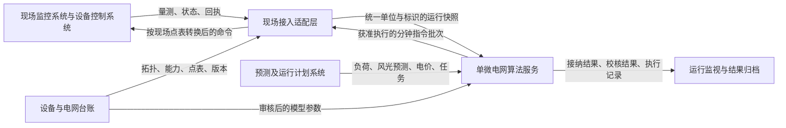
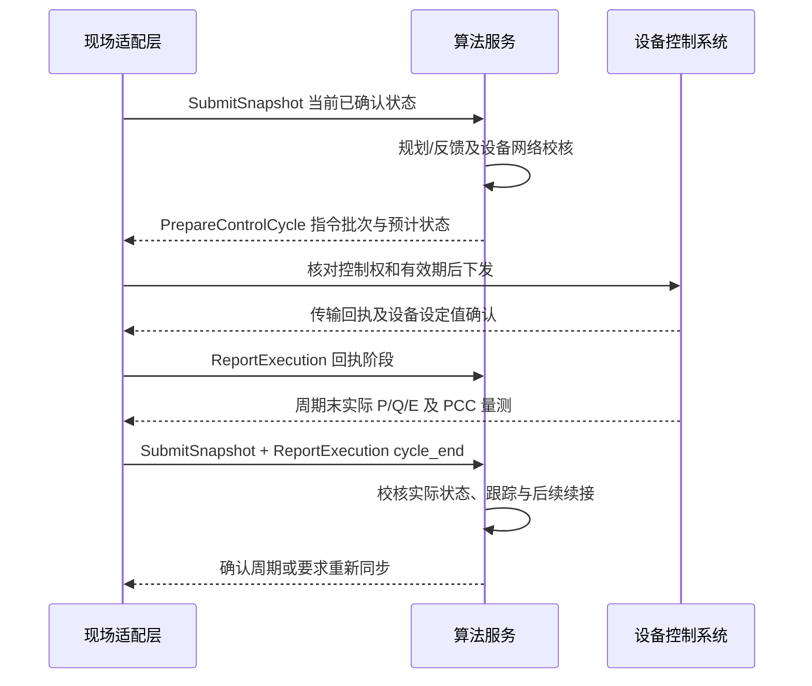

# 新能源最优协同控制算法实际场景接口设计说明

| 项目 | 内容 |
| --- | --- |
| 文档性质 | 面向实际接入的接口设计草案；以现有代码为基础，补充现场所需的数据与交互约定 |
| 文档版本 | 设计草案 0.1；2026-10-16 更新第五项分钟影子指令准备、预测校核及批次失效处理 |
| 算法范围 | 正式单微电网新能源最优协同控制算法 `unified-single-v7`，以山城场景为背景 |
| 当前模型 | 联合 P/Q 规划 `single-pq-planning-v2`，设备执行模型 `unified-device-v1` |
| 交付范围 | 已实现 `InitializeRun`、`UpdatePlanningInputs`、`RequestPccTarget`、`SubmitSnapshot`、`PrepareControlCycle` 的 Python、HTTP 入口（影子模式）；后续三项仍为设计，现场通信及执行闭环未实现 |

**本接口设计要解决的问题是：现场向算法提供什么数据，算法如何形成设备指令，指令执行后如何用现场反馈更新状态。**现有算法已具备规划、目标接纳、分钟反馈和模型校核能力，但正式执行链仍使用模拟设备响应，完整的现场闭环尚未实现。

本文中的逻辑接口名称、对外消息字段、现场状态码和 JSON 示例，除明确标为已实现外，均属于建议设计。前五项已注册 HTTP 路由，实际范围见第 5.4、6.3、7.4、8.1、9.3 节；后续三项尚未注册，也未提供 D5000 通信能力。现场协议、地址、端口、点号及厂商报文格式仍须由项目对接确定。

## 1. 适用范围与系统边界

### 1.1 算法控制什么

本说明面向一个并网运行、固定径向拓扑的微电网，在同一网络模型内协调风电、光伏、储能和 SVG 的 P/Q，处理 PCC 功率目标、安全约束、经济偏好和储能能量任务。

当前正式模型采用平衡正序稳态网络，单网设备模型要求有且仅有一个储能模型对象；停用储能时可将其调节能力置零。算法不直接控制上级电网，也不直接下发负荷削减、生产排程、开关操作或变压器调档命令。本说明不扩展到多微电网集群协调或已删除的独立光伏群控模块。

当前正式装配还具有非反送电 PCC 受电范围、根节点电压固定为 1.0 pu、无移相变压器等模型条件。现场不满足这些条件时，需要调整和验证算法模型，不能只修改接口报文后直接运行。运行方式切换、设备控制权限变化也必须触发新的模型校核。

### 1.2 对接各方的职责



| 参与方 | 提供或处理的内容 |
| --- | --- |
| 现场监控及控制系统 | 设备 P/Q、储能能量或 SOC、PCC 量测、运行方式、远方/就地状态、闭锁、命令回执 |
| 预测及运行计划系统 | 逐母线负荷预测、逐资源风光可用功率预测及边界、电价、PCC 任务、储能末能量任务 |
| 现场接入适配层 | 点号与设备映射、单位倍率和方向转换、时标及质量检查、指令传输、回执关联 |
| 算法服务 | 构造可用模型、滚动规划、目标接纳、计算分钟设备指令、设备与网络校核 |
| 运行管理及归档 | 控制权归属、模式管理、查询、日志和可追溯证据保存 |

算法服务接收规范化数据，不在优化器内部解释 D5000 原始点号。设备动作是否发生，必须由现场反馈确认。

## 2. 当前实现与现场设计的对应关系

| 能力 | 当前代码情况 | 现场接入需要补充的部分 |
| --- | --- | --- |
| 服务 API | 已有仿真任务接口；新增影子初始化、规划资料更新、外部 PCC 目标、快照及分钟指令准备入口 | 实际下发、执行反馈、查询和停止仍待实现 |
| 网络模型 | 初始化现已检查现场网络声明并映射到 `RadialEnvelope`，调用真实安全校核 | 仍需提供实际台账及参数依据；不表示已完成现场验证 |
| 现场时序算例 | `FieldCaseBuilder.assess()` 能检查前提；`build()` 仍抛出逐母线时序映射未配置异常 | 完成真实预测、历史数据与优化 `ProjectCase` 的映射和验证 |
| D5000 数据 | 有 PCC 有功点定义、质量/时标检查、归一化和回执数据结构 | 实际通信、PCC 无功及全部设备量测、完整点表、指令发送与反馈关联 |
| 分钟观测入口 | `SubmitSnapshot` 已独立接入规范化负荷、风光、设备 P/Q/E 及 PCC，检查时标、质量、模型和声明条件 | 现场协议采集与快照组装；结合执行回执提交新的已确认状态 |
| 设备状态推进 | 共享准备函数计算指令和预测 P/Q/E；仿真 `advance()` 再提交模拟状态；现场准备仅保存预测 | 依据现场反馈确认并提交新状态仍待实现 |
| 预测与运行域 | 已实现资料更新检查、暂存、原任务继承，以及在有效确认边界上的新域校核与生效 | 与后续实时快照、未决动作对账及旧指令失效流程衔接 |
| 控制保障 | 已有模型内的设备、网络、跟踪和储能任务校核 | 现场响应参数校准、量测误差、传输延迟与部分执行的覆盖验证 |

已有的现场固定时刻潮流入口只能说明对应快照可进行潮流分析，不能据此认定全时序协同控制或现场闭环已经完成。

## 3. 接口通用约定

### 3.1 传输形式和版本

本文采用逻辑操作与 JSON 数据说明。前五项已有 HTTP 入口及可注入的 Python 应用接口；后续逻辑操作再映射为服务调用、消息通信或厂商接口，不将尚未实现的地址列为现有路由。

建议对外版本标识为 `single-microgrid-field-v0.1-draft`，与内部算法版本分别记录。正式实施时应形成可校验的数据模式及兼容规则。未知字段、未知枚举和缺失必填项应明确拒绝，不能静默忽略会改变控制含义的数据。

### 3.2 消息信封

所有逻辑请求和事件使用下列外层字段。表中的“条件必填”均在说明中给出条件。

| 字段 | 类型 | 必填性 | 含义 |
| --- | --- | --- | --- |
| `interface_version` | string | 是 | 本文建议的接口版本 |
| `operation` | string | 是 | 第 4 节的逻辑操作名称；响应使用原操作名称并以 `correlation_id` 关联 |
| `message_id` | string | 是 | 发送方生成的唯一消息标识，供去重和追溯 |
| `correlation_id` | string 或 null | 响应必填 | 被响应或被关联的消息 ID；无关联请求时为 null |
| `microgrid_id` | string | 是 | 微电网唯一标识；`SC` 只是现有算例标识，现场映射须确认 |
| `run_id` | string 或 null | 初始化请求可为 null | 本次算法运行会话标识；初始化响应分配，后续消息必填 |
| `created_at` | 带时区时间字符串 | 是 | 本消息创建时间，不能代替量测采样时间 |
| `payload` | object | 是 | 对应操作的数据正文 |

所有响应的 `payload` 统一包含 `outcome`（`accepted`、`pending`、`rejected`）、`errors`（错误数组）和 `data`（具体结果或 null）。`accepted` 只表示该操作层面的接纳；仍须读取具体结果中的模型校核、目标接纳和设备执行状态，不能把它解释为设备动作已完成。请求正文使用各接口自己的字段，不套用响应结构。

除初始化、查询和停止请求外，业务正文还携带 `context_id`，用于绑定网络、设备能力、映射、预测和任务等版本。初始化接纳后由算法服务生成上下文标识。在线更换上下文须按第 11 节办理，不能由调用方任意改写字符串。

### 3.3 单位、符号和标识

| 项目 | 统一约定 |
| --- | --- |
| 设备 P | MW；正值为向微电网注入，储能正放电、负充电 |
| 设备 Q | Mvar；正值为向网络注入无功，负值为吸收无功；现场原始方向须按点表转换 |
| 负荷 P/Q | 表示纯负荷消耗，P 非负；Q 可按已确认的负荷无功性质带符号 |
| PCC P/Q | 表示上级电网向微电网输入；P 正值为受电，Q 正值为输入无功 |
| 能量 | MWh；如现场只有 SOC，须有容量基准、SOC 定义及经过确认的转换方法 |
| 电压与阻抗 | 接口明确 kV 或 pu；pu 数据必须绑定功率与电压基准，禁止只给无单位数值 |
| 电价 | 元/MWh；元/kWh 转换由接入层显式完成 |
| 资源与母线 | 每项携带 `resource_id` 或 `bus_id`；不依赖数组位置推断身份 |
| 无效值 | 用 null 加质量状态与原因表示，不用 0、NaN 或 Infinity 代替 |

`resource_id` 和 `bus_id` 分别表示设备与接入母线，同母线可以有多个资源。外部消息按 ID 传输，接入层验证完整性和唯一性后，再按内部 `devices.resources` 顺序构造 `TubeState`、`TubeCommand`。固定并联电容属于网络模型，不能再次作为可控 SVG 或负荷重复计入。

### 3.4 时间和量测值类型

建议持久化使用 UTC，例如 `2026-10-15T02:00:00Z`；允许明确携带 `+08:00` 等偏移的输入，归一化后比较。无时区时间拒绝接纳。当前算法的整数 `step` 需要由现场会话的绝对起点和一分钟网格映射，不能沿用仿真中的固定日期。

量测数值统一采用以下 `MeasuredValue` 对象。外层字段名称声明单位，例如 `p_mw`，对象内部不再重复单位。

| 字段 | 类型 | 必填性 | 说明 |
| --- | --- | --- | --- |
| `value` | number 或 null | 是 | 有效工程值；null 表示无可用值 |
| `observed_at` | 时间字符串 | 是 | 原始采样时间，禁止用快照时间覆盖 |
| `quality` | string | 是 | `good`、`bad`、`questionable`、`unknown`；仅质量为 good 也不免除过期检查 |
| `source_kind` | string | 是 | `measured` 或 `estimated`；估计值不得伪装成实测值 |
| `source_ref` | string | 是 | 点表条目或可追溯估计记录的引用 |
| `value_semantics` | string | 是 | `instantaneous`、`interval_average` 或 `interval_energy` |
| `interval_start`、`interval_end` | 时间字符串 | 非瞬时值必填 | 原始统计区间；区间平均值不能直接冒充周期末瞬时出力 |

当前 `TubeState` 不表达量测误差区间。现场若有不可忽略的测量误差或状态估计误差，需要形成状态范围并重新校核，或扩展现有核心；不能把不确定性从报文中删除后宣称原保证成立。

## 4. 建议逻辑接口总览

**前五项已实现影子初始化、规划资料更新、外部目标接纳、现场快照接收校核及分钟影子指令准备；执行反馈、查询和停止三项尚未实现，需逐项确认后开发。**

| 操作 | 方向 | 调用时机 | 结果 |
| --- | --- | --- | --- |
| `InitializeRun` | 运行管理 → 算法 | 已实现初次影子初始化；已存会话的重新同步尚不开放 | 会话、上下文、真实初始校核及持久化证据 |
| `UpdatePlanningInputs` | 预测/计划系统 → 算法 | 已实现新预测、电价及费用资料更新；本阶段严格继承原储能任务 | 已实现暂存、拒绝，以及满足确认状态与校核条件后的生效 |
| `RequestPccTarget` | 调度系统 → 算法 | 已实现外部明确 PCC 目标申请；缺少有效确认状态时拒绝 | 已实现固定目标校核、接纳或拒绝、原目标状态及明确保证终点 |
| `SubmitSnapshot` | 现场适配层 → 算法 | 已实现每个控制边界的规范化观察接入 | 数据及模型检查、归档、保证失效/需重新同步标记；不确认执行或自动切换规划 |
| `PrepareControlCycle` | 调度运行服务 → 算法 | 每分钟；规划更新由服务在适当边界组织 | 待执行指令批次或不予下发的原因 |
| `ReportExecution` | 现场适配层 → 算法 | 送达、回执、周期末反馈或异常发生时 | 回执归档及本周期现场状态确认结果 |
| `QueryRunStatus` | 运行管理 → 算法 | 查询或恢复对账 | 会话、未决指令、最后确认状态、任务及校核结果 |
| `StopRun` | 运行管理 → 算法/适配层 | 停止算法自动下发 | 停止受理新动作，归档未决执行状态 |

`StopRun` 不等于向所有设备下发零功率，也不等于取消已经执行的动作。现场采用什么停机、保持或就地控制方式，须由现场策略另行定义。

## 5. 初始化接口：InitializeRun

### 5.1 请求正文

| 字段 | 类型 | 必填性 | 内容 |
| --- | --- | --- | --- |
| `mode` | string | 是 | 当前接纳 `shadow` 初始化；`closed_loop` 明确返回未具备现场闭环能力，不产生可下发会话 |
| `model_package` | object | 是 | 网络、设备、点表和适用性资料，见下文 |
| `initial_snapshot` | object | 是 | 第 6 节的完整现场快照，初始化时 `context_id` 可为 null |
| `planning_inputs` | object | 是 | 第 7 节的初始预测、电价和任务数据，初始化时 `context_id` 可为 null |
| `control_policy` | object | 是 | 时间参数、跟踪误差、质量及现场交互约定 |
| `authority` | object | 是 | 当前控制权与设备许可；影子运行也需注明无写权限 |

`model_package` 应采用不可变内容或可按摘要解析的受控资料引用。引用对象包含 `artifact_id`、`revision`、`sha256`，其中 sha256 为内容摘要；解析失败或摘要不匹配时拒绝初始化。不能只传开发者本机的绝对文件路径。

| `model_package` 字段 | 类型 | 必填性 | 内容及现有映射 |
| --- | --- | --- | --- |
| `network_model` | object 或资料引用 | 是 | `NetworkModelV2` 对应网络台账、基准、PCC 和参数依据 |
| `operating_mode_id` | string | 是 | 已确认运行方式；解析为固定径向网络 |
| `devices` | array | 是 | 设备身份、母线、容量、控制能力、响应及储能参数 |
| `point_mapping` | array 或资料引用 | 是 | 现场量测/控制点与算法字段的映射 |
| `load_scopes` | array | 是 | 各母线纯负荷的计量范围、去重依据及净馈线量测转换规则 |
| `model_revision`、`mapping_revision` | string | 是 | 模型与点表版本 |
| `provenance_ref` | string | 是 | 参数来源、现场确认和适用性验证记录 |

### 5.2 网络与设备最低数据要求

网络部分至少包括：`network_id`、`base_mva`、`pcc_bus_id`、母线 ID 和额定 kV；每条支路的 ID、两端母线、类型、R/X、容量、变比；开关、投退、分接头和固定并联元件的运行状态，以及运行方式和参数来源。支路字段语义以现有 `NetworkModelV2`、`SeriesBranch` 为依据。

R/X 如提供 Ω，应明确电压基准和折算侧，由适配层转换；如提供 pu，应明确同一套基准。变压器的非额定 pu 变比不能直接填写高低压额定 kV 比。当前正式装配将这些资料映射为 `RadialEnvelope`，模型支持性校核不通过时不得自动删支路或将环网改成树。

每个 `devices[]` 条目建议具有下列字段：

| 字段 | 类型 | 必填性 | 说明 |
| --- | --- | --- | --- |
| `resource_id`、`bus_id` | string | 是 | 唯一资源标识及接入母线 |
| `kind` | string | 是 | `wind`、`pv`、`storage`、`svg` |
| `p_min_mw`、`p_max_mw` | number | 是 | 有功允许范围 |
| `q_min_mvar`、`q_max_mvar` | number | 是 | 无功允许范围；无权限不能由容量推断为可调 |
| `s_max_mva` | number | 是 | 视在容量 |
| `q_abs_over_p_max` | number 或 null | 是 | 适用的 Q/P 限制；null 明确表示该限制不适用 |
| `p_control_enabled`、`q_control_enabled` | boolean | 是 | 本算法是否获准调节对应轴 |
| `alpha_p` | number | 是 | 当前一分钟有功响应系数，范围 `(0,1]`，须有现场适用依据 |
| `p_change_limit_mw_per_cycle` | number | 是 | 本资源每个一分钟周期的有功变化额度 |
| `energy_min_mwh`、`energy_max_mwh` | number | 储能必填 | 储能允许能量区间 |
| `eta_charge`、`eta_discharge` | number | 储能必填 | 固定充放电效率，范围 `(0,1]` |
| `provenance_ref` | string | 是 | 容量、权限和响应参数依据 |

上述权限字段属于建议外部契约。现有 `TubeResource` 没有同名权限字段，需通过受控装配映射为合法能力和指令许可；“禁止调节”也不自动意味着实测出力为零。固定非零出力或现场独立控制行为若当前模型不能表达，应报告不支持。当前单网储能要求 `alpha_p=1`；统一无功模型使用同一 `alpha_q`，不支持仅通过增加字段就给每台设备指定不同的无功动态。

每个 `point_mapping[]` 条目至少包含下列信息。这里定义的是外部点表需求，现有 PCC 有功适配器只实现其中一部分。

| 字段 | 类型 | 说明 |
| --- | --- | --- |
| `mapping_id`、`point_id` | string | 映射条目 ID 与实际现场点号，二者分别唯一管理 |
| `entity_kind`、`entity_id` | string | `bus_load/resource/pcc/operating_state` 及对应对象 ID |
| `quantity` | string | 例如 P、Q、能量、SOC、远方许可、闭锁、设定值或回显；实施模式需封闭枚举 |
| `access` | string | `read` 或 `write`，写点与量测点不能混用 |
| `raw_unit`、`normalized_unit` | string | 原始与规范化单位；状态量注明无量纲 |
| `engineering_multiplier` | number | 工程倍率，有限且大于零 |
| `direction_rule_ref` | string | 原始方向到内部方向的已确认转换规则 |
| `quality_rule_ref`、`timestamp_rule_ref` | string | 质量码及原始时标解释规则 |
| `scope_ref`、`provenance_ref` | string | 计量范围及确认依据 |

状态点和非线性转换量另附类型及转换规则；不要把所有点强制当成“倍率乘以数值”。命令点还须关联相应回执/回显和实际功率量测点，写入时按已确认的逆转换规则恢复厂商单位与方向。

`control_policy` 至少包含：`execution_step_seconds`（当前为 60）、`planning_update_seconds`（参考默认 900）、`planning_horizon_seconds`（参考默认 14400）、`response_deadline_seconds`（参考默认 600）、`p_tracking_tolerance_mw`、`q_tracking_tolerance_mvar`（参考默认均为 0.05）、`alpha_q`、`q_change_limit_mvar_per_cycle`、`settling_resolution`、电压/PCC/PF 边界，以及下列现场参数：

- `telemetry_max_age_seconds`、`snapshot_max_skew_seconds`、`future_clock_skew_seconds`：量测时效及同步要求。
- `compute_budget_seconds`、`dispatch_lead_seconds`、`transport_timeout_seconds`、`feedback_timeout_seconds`：计算、下发和反馈时限。
- `model_error_policy_ref`、`availability_method_ref`、`local_fallback_policy_ref`：模型/量测误差、可用功率估计和现场异常处理的约定。

这些时限和方法必须现场确认，不沿用仿真默认值推定通信性能。所有秒数为有限非负数，执行步长、更新周期、窗口、超时和有效时长须大于零；时间常数、系数及容差还需按对应模型验证。当前统一无功系数和储能有功保持假设不能仅靠传入参数就变成任意设备动态模型。

`authority` 包含 `owner_id`（当前控制方）、`epoch`（由现场控制权管理方分配的非负整数代次）、`valid_until` 和 `permission_revision`。控制权不由客户端自报后自动生效；接入层需与现场授权来源核对。

### 5.3 初始化响应

响应 `data` 包含 `run_id`、`context_id`、`run_state`、`accepted_versions`、`initial_safety_status`、`energy_task_guarantee` 和 `missing_requirements`。`run_state` 的定义见第 12 节。

接纳前应完成资料映射、初态有效性、模型适用性、初始网络与安全续接检查。储能硬任务若是本次运行的强制要求，其联合保证未取得时不得返回“已满足任务条件”；应拒绝该闭环任务或明确等待任务调整。

### 5.4 第一项已实现范围与调用方式

当前入口为 `POST /api/field/single-microgrid/initialize`，可通过现有服务的 `/docs` 查看实际字段。Python 用例为 `workflows.field_initialization.api.InitializeRun.execute()`，由 `bootstrap.field_initialization.create_field_initializer()` 注入存储、资料读取、网络映射和时钟。

实现已包含：字段及数值检查、网络/资源/点表身份与纯负荷范围核对、量测质量与时效检查、显式预测边界的分钟映射、PCC 实测与初态模型对比、初始 AC 安全校核、安全续接及储能任务校核、会话与证据原子保存、重复请求和冲突处理。不会调用设备模拟执行函数推进初态，也不下发现场命令。

成功响应补充 `mode=shadow`、`dispatch_enabled=false`、`evidence_ref` 和 `valid_until`。`run_state=ready` 只表示影子初始化通过。初始化请求的 `run_id/correlation_id` 及内嵌初始快照、预测的 `context_id` 必须为 null。`authority.write_enabled` 默认为 false 且只允许 false，不取得真实设备控制权。

以下内容将原草案中的未细化字段落实为本阶段明确契约：

| 项目 | 当前实现约定 |
| --- | --- |
| 机器模式 | [初始化请求 JSON Schema](../../contracts/field_initialization/initialize.request.schema.json)、[初始化响应 JSON Schema](../../contracts/field_initialization/initialize.response.schema.json)，由代码生成 |
| 量测范围 | 负荷、设备 P/Q、储能 E 和 PCC 使用瞬时实测；风光可用量允许显式估计；当前不直接接纳平均值、SOC 或带未处理不确定性的设备/负荷状态 |
| PCC 电压 | 初始化要求提供 `pcc.voltage_pu` 且值为 1.0，以符合当前模型；全局设计中“建议提供”不适用于本阶段初始化 |
| 独立对比容差 | `control_policy.pcc_model_tolerance_mw`、`pcc_model_tolerance_mvar` 必填，非负；与 PCC 目标跟踪误差分别配置 |
| 当前误差模型 | `model_error_policy_ref=exact-normalized-snapshot-v1`；表示本阶段适用假设，不是现场量测误差已经被建模 |
| 纯负荷范围 | `load_scopes[]` 包含 `scope_ref/bus_id/members/semantics/provenance_ref`，`semantics=gross_load`，计量成员不可重复 |
| 点表与转换 | 接收已归一化数值并验证关联，不再次换算或读取 D5000；当前量枚举为 `p/q/energy/voltage/online/remote_enabled/blocked/p_setpoint/q_setpoint`，方向规则为 `identity/negate` |
| 时间覆盖 | 一分钟网格；预测首点等于初态时刻，末点等于 `valid_until`；至少覆盖 90 分钟、规划窗口和响应期限，最多 24 小时 |
| 末端声明 | 新增必填 `planning_inputs.terminal_boundary_policy=last_bounds_until_valid_until`；末端边界需显式声明，不扩大证据有效期 |
| 资料引用 | 网络及点表支持内嵌对象或 `{artifact_id, revision, sha256}`；从服务受控目录 `objects/<sha256>.json` 读取并核验摘要，不解析任意客户路径或联网下载 |
| 已存会话 | SQLite 保存原请求、解析后的资料、运行域、初态、校核证据与响应；同消息同内容重放原结果，异内容报冲突，同微电网另建会话报 `ACTIVE_RUN_EXISTS` |
| 接纳预算 | `compute_budget_seconds` 是计算结束后的接纳门槛，不是数值计算的强制抢占超时；未达到现场硬实时保证 |

HTTP 200 为影子初始化接纳；409 为业务拒绝或会话冲突；422 为字段/JSON 错误；413 为请求超过 8 MiB；503 为存储不可用。可解析的业务请求使用本文响应信封，无法解析的请求使用 HTTP 边界诊断对象。

必需储能任务未获共同证明返回 `TASK_UNPROVEN`，不创建 ready 会话；可选任务未获证则明确返回 `unproven`。初始化结果重放不延长原有效期限。停止、查询和会话重置尚待后续接口，因此不会静默替换已有会话。

该入口直接将规范化现场资料构造成初始运行域，未修改 `FieldCaseBuilder.build()` 的历史工作簿导入行为，也未实现在线经济规划、分钟指令或执行反馈。详细调用、限制与存储路径见 [第一项初始化使用说明](../guides/Field_Initialization.md)。

## 6. 现场快照接口：SubmitSnapshot

### 6.1 请求正文

| 字段 | 类型 | 必填性 | 说明 |
| --- | --- | --- | --- |
| `snapshot_id` | string | 是 | 不可变快照标识 |
| `context_id` | string | 是 | 当前接纳上下文；初始化内嵌快照例外见第 5 节 |
| `sequence` | integer | 是 | 本数据源会话内单调递增序号，用于识别乱序 |
| `snapshot_at` | 时间字符串 | 是 | 期望对齐的控制边界，不覆盖各点采样时刻 |
| `received_at` | 时间字符串 | 是 | 接入层收到并组装快照的时刻 |
| `model_revision`、`mapping_revision`、`operating_mode_id` | string | 是 | 当前现场版本与运行方式 |
| `permission_revision` | string | 是 | 当前设备控制权限版本 |
| `bus_loads` | array | 是 | 所有模型母线的纯负荷 P/Q |
| `device_states` | array | 是 | 所有模型资源的已观察 P/Q、状态，储能含 E |
| `renewable_availability` | array | 是 | 所有风光资源本分钟可用有功的评估 |
| `pcc` | object | 是 | PCC 标识、实测 P/Q；当前实现电压必填 |
| `operating_state_ref` | string | 是 | 可追溯的开关、投退、分接头及闭锁状态记录 |

子对象定义：

| 数组/对象 | 必填字段 | 条件字段与说明 |
| --- | --- | --- |
| `bus_loads[]` | `bus_id`、`p_mw: MeasuredValue`、`q_mvar: MeasuredValue`、`scope_ref` | 无负荷母线也需显式给出有依据的零值；`scope_ref` 指向纯负荷计量范围 |
| `device_states[]` | `resource_id`、`p_mw: MeasuredValue`、`q_mvar: MeasuredValue`、`online: boolean`、`remote_enabled: boolean`、`blocked: boolean`、`status_observed_at` | 储能必须有 `energy_mwh: MeasuredValue`；状态字段未知时整条状态不可用于放行 |
| `renewable_availability[]` | `resource_id`、`available_p_mw: MeasuredValue`、`method_ref` | 表示可发能力，不是当前实际发电 P；受限运行时不能直接用实发值代替 |
| `pcc` | `bus_id`、`p_import_mw: MeasuredValue`、`q_import_mvar: MeasuredValue`、`voltage_pu: MeasuredValue` | 当前固定根电压模型要求电压为 1.0 pu |

### 6.2 关键语义与现有代码映射

纯负荷应从独立计量或经过确认的估计方法取得。净馈线功率可能已包含风光、储能和损耗，不能直接作为 `bus_loads` 再减一次设备注入。采用估计时保留 `source_kind=estimated` 和方法记录。

风光可用量可能来自设备可发功率估计或上级预测服务。限发后的实际 P 只能说明当前发了多少，不能自动说明还有多少上调空间。现有 `validate_unified_observation()` 要求可用量不低于声明下界；将不可信的估计值当作确定值，会破坏这一前提。

有效的负荷点值映射为 `BoundedBusLoad` 的 `low=high`。第四项已在现场工作流中独立映射设备 P/Q/E 为 `TubeState`，保存风光可用量，并新增 PCC 实测与模型计算值的比较证据。现有仿真 `observe()` 及设备执行循环保持原职责，不通过模拟器生成新的现场完成状态。

响应 `data` 包含 `snapshot_id`、`input_status`（`valid/invalid`）、`state_status`（`consistent/outside_model/unconfirmed`）和具体错误。快照收到或通过格式检查，不自动推进控制步数，也不自动确认上一条指令执行成功。

### 6.3 第四项已实现范围与调用方式

当前入口为 `POST /api/field/single-microgrid/snapshots`；Python 入口为 `workflows.field_initialization.api.SubmitSnapshot.execute()`，通过 `bootstrap.field_initialization.create_snapshot_submitter()` 装配，使用与前三项相同的存储目录。字段以 [快照请求模式](../../contracts/field_initialization/snapshot.request.schema.json)、[快照响应模式](../../contracts/field_initialization/snapshot.response.schema.json) 为准。

接收完整的规范化快照，检查 ID、点表、纯负荷范围、质量、时效、同步程度、版本及设备可用状态。沿用当前精确点值假设：负荷、设备 P/Q/E 和 PCC 必须是实测瞬时值；风光可用量可为明确标识的估计值。尚未增加现场通信、SOC 转换、状态估计误差范围或运行方式在线切换。`operating_state_ref` 改变时要求重新同步，不猜测新运行记录是否仍对应原网络。

根据快照绝对时刻计算相对于当前生效规划起点的分钟索引，检查该时刻的负荷区间、风光下界、设备能力及网络状态，并核对 PCC 实测值。当前目标证据覆盖该时刻时，检查实际状态与目标跟踪范围；原响应期限之后、保证终点之前还检查 PCC 实测跟踪误差。所有检查保持原始数值，不裁剪、不补零，不延长预测有效期，也不重置目标或储能任务的绝对期限。未获证不自动等于已经证明物理不安全。

| 返回信息 | 当前含义 |
| --- | --- |
| HTTP 200 / `accepted` | 当前快照检查通过；不表示执行完成、未来保证成立或会话恢复 |
| HTTP 409 / `rejected` | 身份、时间、输入或模型校核失败；可解析的业务请求仍按规则归档 |
| HTTP 422 / 413 / 503 | 分别为报文无效、超过 8 MiB、持久化不可用 |
| `input_status` | 是否通过输入检查，包括质量、时效、版本及许可，不仅是格式合法 |
| `state_status` | `consistent` 为本次观察与适用模型/证据一致；`outside_model` 为前提或校核不满足；`unconfirmed` 为无法完成判断 |
| `observation_status` | `latest` 为最新按序观测；`archived` 为仅归档；`rejected` 为身份冲突等未建立新记录。最新观测可能无效，不等于已确认状态 |
| `guarantee_status` | `invalidated` 表示已有原保证前提失效的证据；`unconfirmed` 表示本操作未确认执行及后续保证；`not_assessed` 表示未评价对应会话 |
| `resync_required` | 是否存在持久化的重新同步要求 |
| `evaluated_at`、`evidence_ref`、`errors` | 原评估时刻、证据引用和具体原因 |

响应始终为 `mode=shadow`、`dispatch_enabled=false`、`execution_confirmed=false`。最新按序快照若无效或越出声明条件，会保存观察阻断标记；即便模型一致，新分钟边界或与原确认状态不同的设备 P/Q/E 也不能直接取代已确认状态，仍需重新同步。此后新 PCC 目标申请返回 `RESYNC_REQUIRED`，合格规划更新只暂存而不生效。原目标、原期限和历史证书保留。

后续正常快照可以显示 `consistent`，但不自动清除阻断标记或恢复保证。**本项不自动确认执行周期、不替换已确认设备状态、不激活暂存规划，也不实现解除阻断的重新同步操作。** 新确认状态及恢复流程留给后续控制与反馈接口。当前只有初始化快照可作为前三项接口的确认状态。

每个会话当前使用一条由适配层汇聚的序列；序号递增，边界时刻和各点原采样时标不得倒退。同分钟可提交更高序号的修订观察，须使用新的快照 ID。乱序和旧上下文消息可归档但不覆盖新观测。快照 ID 不可变，初始化快照 ID 保留；拒绝记录也绑定其快照身份。同消息同内容跨重启返回原响应；同快照以新消息重发返回原评估并关联新消息，时间等价表示和 ID 数组重排不改变快照身份。重放不是当前状态查询，不延长有效期。

请求、评估、最新观测、最新模型一致观测及阻断标记在同一事务中保存，失败整体回滚；这些观察指针与已确认执行状态分开。五项接口共享消息去重和事务边界。计算预算为完成后的结果接纳门槛，不声明硬实时抢占。详细约定与快速测试入口见 [第四项使用说明](../guides/Field_Snapshots.md)。

## 7. 预测、电价和任务接口：UpdatePlanningInputs

### 7.1 请求正文与时间覆盖

| 字段 | 类型 | 必填性 | 说明 |
| --- | --- | --- | --- |
| `context_id` | string | 是 | 申请更新的旧上下文 |
| `input_revision` | string | 是 | 本批预测、费用和任务版本 |
| `issued_at` | 时间字符串 | 是 | 预测/计划产生时间，必须不晚于使用时刻 |
| `effective_from`、`valid_until` | 时间字符串 | 是 | 申请生效时间与资料有效终点 |
| `source_ref` | string | 是 | 预测、边界或计划来源 |
| `forecast_interpolation` | string | 是 | `linear` 或 `hold`；需与预测时刻和区间语义一致 |
| `forecast_points` | array | 是 | 按时间排序的逐母线/逐资源预测与边界，见下表 |
| `tariff_intervals` | array | 是 | 不重叠且覆盖所需范围的电价区间 |
| `cost_rates` | object | 是 | 弃电、储能吞吐和网损代理费用；均为元/MWh |
| `energy_task` | object 或 null | 是 | 原定末能量任务；null 明确表示未申请该任务，不得用于删除已接纳任务 |
| `terminal_boundary_ref` | string | 是 | 预测窗之后安全续接所依据的边界及有效范围 |

`forecast_points[]` 每项包括 `at`（明确的预测时刻）、`bus_loads[]` 和 `renewables[]`：

- 每项负荷：`bus_id`、`p_forecast_mw`、`q_forecast_mvar`、`p_bounds_mw: {low, high}`、`q_bounds_mvar: {low, high}`。
- 每项风光：`resource_id`、`available_forecast_mw`、`minimum_available_mw`、`bound_method_ref`。下界非负，点预测和下界需符合装机及物理语义。
- 每个时刻覆盖全部模型母线及全部风光资源；时间不得重复、乱序或缺失。`low ≤ high`，点预测应处于声明区间；不允许把缺测点填零生成边界。

预测点的含义是时刻值。若上游提供 15 分钟区间平均值，应先按明确方法形成适用于分钟边界的预测与误差范围，保留转换依据。经济功率区间、执行边界及储能能量积分时钟必须一致。

资料至少覆盖当前经济窗口、控制证书覆盖区间、下一边界以及储能任务和安全续接所需范围。默认经济滚动范围约四小时，不意味着只给四小时数据就一定可以证明全天末能量任务。资料到期后不得自动把最后一个预测点无限延长。

### 7.2 费用与储能任务字段

`tariff_intervals[]` 包含 `start_at`、`end_at`、`import_price_cny_per_mwh`，采用左闭右开区间；`cost_rates` 包含 `curtailment_cny_per_mwh`、`storage_throughput_cny_per_mwh`、`loss_cny_per_mwh` 和 `source_ref`。

这些费用用于当前算法的目标或候选比较，不等于完整电费结算。需量电费、补贴、售电收入等若未被当前模型支持，不能仅增加报文字段就宣称已纳入最优计算。当前非反送电模型不默认支持售电优化。

非空 `energy_task` 包含 `task_id`、`deadline_at`、`energy_min_mwh`、`energy_max_mwh`、`required`（boolean）和 `source_ref`。它映射到内部 `TerminalEnergyTask` 的绝对执行步期限及能量区间。

每 15 分钟更新规划时应继承原任务 ID、目标和绝对期限。需要改变任务时，应提交明确的新任务申请并重新接纳，不能通过刷新预测把任务截止时间往后推。

### 7.3 当前支持程度

现有 `build_unified_domain()` 可以从预测构造逐分钟负荷区间和风光下界，但默认使用研究误差参数。`SingleBoundaryRequest` 可声明绝对边界和固定 PCC 目标，该边界在其使用范围内保持有效；它不是本文所述任意时变边界和在线预测更新接口。

现场接口已新增显式逐时边界的映射与验证，不会丢弃边界后退回模拟默认的 ±2.5%、风电装机 5% 和光伏装机 15% 误差假设。第二项在满足确认状态条件时重建、校核上下文和安全续接；持续现场状态更新仍依赖后续快照与执行反馈接口。

响应 `data` 包含 `input_revision`、`activation_status`（`staged/activated/rejected`）、`new_context_id`（未生效时为 null）、`effective_from`、`preserved_task_id`、`preserved_target_deadline_at` 和原因。当前实现同步完成资料检查后返回上述三种结果，不返回仅表示收到资料的 `pending`；只有切换条件满足后才报告 `activated`。

### 7.4 第二项已实现范围与调用方式

当前入口为 `POST /api/field/single-microgrid/planning-inputs`；Python 入口为 `workflows.field_initialization.api.UpdatePlanningInputs.execute()`，通过 `bootstrap.field_initialization.create_planning_updater()` 装配。两者使用初始化时同一个存储目录，绑定原 `run_id` 和当前 `context_id`。实际字段见 [更新请求模式](../../contracts/field_initialization/planning-update.request.schema.json)、[更新响应模式](../../contracts/field_initialization/planning-update.response.schema.json)。

提交完整一批预测、边界、电价、费用与原储能任务。身份、时间、覆盖、装机边界、电价区间、原任务和版本均先检查。新增的 `terminal_boundary_policy=last_bounds_until_valid_until` 与初始化保持一致。沿用当前一分钟网格、至少 90 分钟及规划/响应/任务所需覆盖、最多 24 小时的适用范围；生成时间不晚于当前时刻和申请生效时刻，不能倒退到当前版本之前。

| 结果 | 当前含义 |
| --- | --- |
| HTTP 200 / `activated` | 在对应时刻的有效确认状态上重新完成设备、观测边界、PCC、网络、安全续接及储能任务校核，原子保存新证据并切换上下文 |
| HTTP 202 / `staged` | 资料及运行域映射通过，但尚无对应生效时刻的有效确认状态；只保存候选资料和原因 |
| HTTP 409 / `rejected` | 会话、上下文、版本、任务、资料或校核不满足要求；不覆盖当前生效版本 |
| HTTP 422 / 413 / 503 | 分别为字段或 JSON 无效、正文超过 8 MiB、会话存储不可用 |

**本阶段只有初始化快照可作为已确认状态。** 生效要求 `effective_from == snapshot_at`，仍处于该快照的一分钟边界区间内，且满足原策略的量测时效限制。完成校核后再次核对时刻，不能把计算期间已经变旧的状态继续用于生效。未来时刻或缺少对应状态的请求先暂存；即使时间到达，也不会自动激活。第四项已能接收、校核和归档新观察，但不提交新的确认状态；观察阻断标记存在时，合格更新同样只暂存并说明 `RESYNC_REQUIRED`。暂存资料与新确认状态的绑定、重新校核和切换留给后续控制与反馈流程。本阶段没有独立激活暂存版本的端点。

储能任务必须完整继承：任务 ID、绝对截止时间、能量区间、`required` 及来源均不可变；null 不能删除已存在任务，也不开放增加或替换任务。网络、点表、能力、控制参数和权限同样不能由此接口改写。存在已接纳外部 PCC 目标时，`preserved_target_deadline_at` 返回原绝对期限；没有目标时为 null。

第三项已补充目标与预测更新的联动：生效前重新校核原 P/Q、原响应截止时间、原误差带及储能任务，新保证终点不得早于原已获保证。不能续接时拒绝预测更新，保留旧上下文与目标；能够续接时在同一事务中保存新输入及新目标证据并切换两个当前指针。目标存在时，响应中的储能任务保证依据目标与任务的共同证据，不仅依据一般安全续接。暂存资料不替换当前目标。

生效响应补充 `valid_until`、`evidence_ref`、`energy_task_guarantee`、`mode=shadow` 和 `dispatch_enabled=false`。暂存时新上下文和证据引用为 null，任务保证为 `not_assessed`；生效时无任务为 `not_required`，任务获证为 `maintained`，可选任务未获证为 `unproven`，强制任务未获证不能生效。生效只是更新影子运行输入和校核证据，不表示完成经济优化或下发设备指令。

SQLite 增量增加更新记录和当前版本指针，保留原初始化记录。请求、响应、新证据和生效指针在同一事务中保存；并发更新须核对同一旧上下文，中途失败整体回滚。同消息同内容跨重启重放原响应，异内容或跨操作复用消息 ID 报冲突。每个会话已接纳或暂存的资料版本不可复用；拒绝的版本不占用，但修正内容须使用新消息 ID。历史重放不延长有效期，也不作为当前状态查询。

计算预算仍为计算后的接纳门槛，不声明硬实时抢占。详细调用、状态、限制与存储约定见 [第二项使用说明](../guides/Field_Planning_Updates.md)。验证以小型解析网络的真实校核、单元测试、事务与 HTTP 测试为主，不运行完整调度仿真。

## 8. 外部 PCC 目标接口：RequestPccTarget

外部调度系统明确给出的目标与算法内部经济规划提出的目标分开处理。内部经济请求在获证搜索中可能采用替代目标；现有 `TargetAdmission` 明确禁止擅自改写外部固定目标。

| 字段 | 类型 | 必填性 | 说明 |
| --- | --- | --- | --- |
| `context_id`、`target_id` | string | 是 | 当前上下文及外部任务唯一 ID |
| `target_p_import_mw`、`target_q_import_mvar` | number | 是 | 按 PCC 输入方向定义的目标 |
| `effective_from` | 时间字符串 | 是 | 目标申请生效时刻 |
| `response_deadline_at` | 时间字符串 | 是 | 首次达到约定跟踪要求的绝对期限 |
| `hold_until` | 时间字符串 | 是 | 请求持续保持到何时，不等同于已获保证到何时 |
| `p_tolerance_mw`、`q_tolerance_mvar` | number | 是 | 申请的误差带，需与模型及现场约定一致 |
| `source_ref` | string | 是 | 外部调度指令来源 |

目标时间必须能映射到受支持的控制网格；不能静默向后取整放宽期限。重发同一目标不重置期限，重新规划也不重置期限。

响应 `data` 包含 `target_id`、`target_status`（`accepted/rejected`）、`requested_target`、`accepted_target`（拒绝为 null）、`response_deadline_at`、`guaranteed_until` 和 `reason`。目标对象包含 `p_import_mw`、`q_import_mvar`。

保证期限可能短于请求的 `hold_until`，需要后续续接。新目标被拒绝时应明确原目标及原策略是否仍有效；不能默默修改目标后返回接纳。外部绝对时间接口已按下节实现影子接纳，本阶段不提供未来目标队列。

### 8.1 第三项已实现范围与调用方式

入口为 `POST /api/field/single-microgrid/pcc-target`；Python 用例为 `workflows.field_initialization.api.RequestPccTarget.execute()`，通过 `bootstrap.field_initialization.create_pcc_target_requester()` 装配。使用前两项同一个会话存储，绑定原 `run_id`、微电网及当前 `context_id`。实际字段见 [目标请求模式](../../contracts/field_initialization/pcc-target.request.schema.json)、[目标响应模式](../../contracts/field_initialization/pcc-target.response.schema.json)。

实现直接调用能够传入明确截止步数的公开固定目标校核入口，按外部提供的绝对时间计算，不套用内部经济目标的默认响应时长。校核保持原 P/Q，误差带允许比配置更严格，但不允许放宽；不调用经济调度仿真或设备执行循环。原储能任务保持不变，强制任务未获共同证明时拒绝接纳。

**当前只有初始化快照可作为确认状态。** `effective_from` 必须等于快照和当前运行域的起点，处理请求仍处于同一分钟内，且通过量测、质量、权限和证据有效期检查。缺少对应状态、快照过期或未来时刻生效时明确拒绝，不进入队列。第四项新观察设置阻断标记后，新目标申请返回 `RESYNC_REQUIRED`，不因后来收到正常快照就恢复。三个目标时刻须在一分钟网格上，满足 `effective_from < response_deadline_at < hold_until`；当前不支持零响应期限。

| 返回 | 当前含义 |
| --- | --- |
| HTTP 200 / `accepted` | 外部原目标、原期限及申请误差带取得设备、网络、跟踪、安全续接及所需储能任务证据，已原子保存 |
| HTTP 409 / `rejected` | 会话、上下文、目标身份、时间、误差带、覆盖或校核不满足条件，原目标不被覆盖 |
| HTTP 422 / 413 / 503 | 分别为字段或 JSON 无效、正文超过 8 MiB、会话存储不可用 |

成功保持 `mode=shadow`、`dispatch_enabled=false`，补充 `evidence_ref` 及储能任务保证；拒绝时 `accepted_target/guaranteed_until/evidence_ref` 为 null。无储能任务为 `not_required`，目标与任务共同获证为 `maintained`，可选任务未获证为 `unproven`，拒绝时为 `not_assessed`。取得策略证据不代表设备已经执行或实际达到目标。

保证终点取 `hold_until`、输入证据有效期、预测终点与权限终点共同覆盖的完整分钟，至少覆盖响应期限及其后一个完整保持分钟；权限在分钟中间到期时，只保证此前的完整分钟。实际 `guaranteed_until` 可早于 `hold_until`，不会自动续期。本阶段尝试该声明范围，未获证时不搜索所有更短保持期限，也不把构造未获证称为全局物理不可行。

同消息同内容跨重启返回原响应；异内容或与前两项跨操作复用消息 ID 报 `DUPLICATE_ID_CONFLICT`。同一会话的 `target_id` 绑定完整目标义务（P/Q、期限、保持终点、误差带及来源），只有上下文可随重新校核变化；已记录的拒绝请求也绑定其目标 ID，修正义务须使用新目标及消息 ID。重发当前相同 P/Q，即使换目标 ID，也不能重置原响应期限。

响应增加 `previous_target_id` 和 `previous_strategy_status`：`none` 为已确认没有原目标，`conditional` 为原证据在声明条件下仍处于有效范围，`expired` 为已到期，`context_changed` 为未绑定当前上下文，`unconfirmed` 为缺少当前确认状态。若消息冲突等发生在读取会话前，返回 `not_assessed`，不声称不存在原目标。该状态描述决策时的原证据条件；新目标获证并提交后才替换当前目标，历史响应重放不作为当前状态查询。

SQLite 增量保存目标请求/响应、当前目标和重新校核历史。目标接纳与替换在一个事务中提交；与预测更新并发时串行核对当前上下文，不留下指向旧上下文的当前目标证据。计算后再次核对时间边界及预算，超预算或跨过确认边界时不接纳。预算不是强制中断计算的硬实时承诺。

详细调用与验证范围见 [第三项使用说明](../guides/Field_Pcc_Targets.md)。验证使用小型解析网络的真实校核、单元、事务及 HTTP 测试，不运行完整调度仿真。

## 9. 分钟控制接口：PrepareControlCycle

### 9.1 请求和执行前检查

请求正文包含 `context_id`、`cycle_id`、`cycle_start_at`、`cycle_end_at`、`snapshot_id` 和 `authority`。起止间隔当前为 60 秒，`cycle_id` 在会话内唯一；该周期与输入快照、未决命令及当前上下文必须一致。

完整设计中，算法服务依次检查快照质量、当前完成状态、控制权限、目标和预测有效性，执行适用的经济更新与目标接纳，计算分钟设备指令，再检查设备变化、网络过程和后续可行性。第五项当前只使用已有获证策略，不在本接口内新增经济更新或目标接纳，实际边界见第 9.3 节。规划工作应提前或异步准备，控制边界再核对状态；基于旧状态得到的计划未经重新验证不得直接下发。

**`UnifiedSingleController.advance()` 仍会提交模拟状态，不能直接拿来充当现场接口。**第五项已抽出共享的 `prepare_certified_cycle()` 准备阶段；现场仅保存指令、预计状态和证据，保持“最后确认状态”不变。原仿真控制器复用准备阶段后继续提交模拟状态。

### 9.2 指令批次输出

完整闭环响应 `data` 的建议字段如下；第五项实际支持范围见第 9.3 节：

| 字段 | 类型 | 说明 |
| --- | --- | --- |
| `decision` | string | `dispatchable`、`shadow_only` 或 `withheld` |
| `cycle_id`、`context_id`、`snapshot_id` | string | 绑定控制周期、模型上下文和输入快照 |
| `command_batch_id` | string 或 null | 不可变指令批次 ID；没有动作时为 null |
| `target_id` | string 或 null | 外部目标 ID；纯内部经济目标可为空，另记录内部目标证据 |
| `apply_at`、`cycle_end_at` | 时间字符串 | 计划应用边界与周期末；不能把到达晚的命令算作已按时执行 |
| `dispatch_deadline_at` | 时间字符串 | 此批命令允许下发的最晚时刻，必须满足现场调度和模型时序约定 |
| `feedback_due_at` | 时间字符串 | 周期末反馈最晚确认时刻 |
| `authority` | object | 与当前控制权及代次绑定 |
| `commands` | array | 按资源标识给出的控制写入，见下文 |
| `predicted_endpoint` | object 或 null | 预计周期末设备状态与储能能量；只作为模型预测保存 |
| `model_check` | object | 校核状态、证据引用及其有效期限 |
| `strategy_source` | string | 对应经济策略、保留反馈、安全续接或终态策略 |
| `reason` | string | withheld 等情况的原因；成功可为空 |

`commands[]` 每项包含 `command_id`、`resource_id`、`p_setpoint_mw`、`q_setpoint_mvar`。两个功率字段均为 number 或 null；null 表示该轴不写，数值零表示明确下发零设定值。每项至少有一个非 null 值。

只为获准控制的轴生成写入。默认山城光伏和储能 Q=0 的模型条件，不等于有权向其无功点写零；SVG 无有功调节时也不生成有功写入。算法模型仍需要这些轴的实际状态及适用依据。

`predicted_endpoint` 包含 `device_states`（每项为 `resource_id`、`p_mw`、`q_mvar`）和 `storage_energy_mwh`；`model_check` 包含 `status`（`passed/unproven/violated`）、`evidence_ref`、`guaranteed_until`。`strategy_source` 使用现有策略来源 `economic/retained_feedback/backup/terminal`，储能能量回归可由额外的证据引用说明。模型校核通过只表示声明条件下取得证据，不能替代现场控制权核对和时序检查。

`dispatchable` 要求模型检查通过且模式、权限、版本和时序均允许写入；影子模式只能返回 `shadow_only`。`withheld` 时 `command_batch_id=null`、`commands=[]`、`predicted_endpoint=null`，不适用的下发/反馈时间为 null，必须给出原因。仅有收到请求的回执时返回 `pending`，不能提前给出可下发结果。

多设备指令属于联合策略。`command_batch_id` 用于关联，不能视为底层通信天然具备原子执行能力。设备逐条送达可能产生不同于同步模型的过渡状态，必须验证现场执行偏差和允许时延；未覆盖时不得按原策略保证下发。

### 9.3 第五项已实现范围与调用方式

现已提供 `POST /api/field/single-microgrid/control-cycles/prepare`，以及 Python `create_control_cycle_preparer(...).execute(PrepareControlCycleRequest)`。请求/响应采用共同信封和严格 JSON 契约，详细调用示例见 [第五项使用说明](../guides/Field_Control_Cycles.md)。

**本增量成功只返回 `shadow_only`，不返回 `dispatchable`。** 基于当前已获证的外部 PCC 反馈、安全续接、终态或储能能量回归策略，准备一个 60 秒周期；没有接入新的 15 分钟经济滚动求解，也不生成新的内部经济目标。有外部目标时必须保留其原 P/Q、误差带、响应期限、保证终点及原储能任务，不能因证据不适用而静默改成无目标控制。

**目前只能从仍新鲜的初始化确认边界准备。** 起点须等于已确认初始快照及当前生效预测起点，终点为其后一分钟，整分钟须有预测和权限覆盖。请求 `authority` 必须与初始化影子权限完全一致。当前上下文已有新观察时必须指定最新快照；设备 P/Q/E 及快照边界仍须与确认状态一致。后一分钟快照、确认状态缺失或观察阻断标记都会阻止准备，不会自动清除阻断、推进确认状态或激活暂存规划。

共享纯计算函数重新检查当前观测、设备变化路径、反馈/能量任务管束及路径和终点 AC 条件，单独保存 `predicted_endpoint`。只为授权轴生成数值指令，未授权轴为 null，完全无控制轴的资源不生成命令项。指令使用规范化资源 ID；不据此推定现场写点映射和通信链已经具备。

本阶段输出 `strategy_source=retained_feedback/backup/terminal`，通过 `energy_feedback` 标记能量回归。额外输出 `target_response_deadline_at`、`target_guaranteed_until`、`energy_task_deadline_at`，保留原义务时钟；无对应义务时为 null。`model_check.status` 当前为 `passed/unproven`，获证终点为当前一分钟的结束时刻，未获证不能解释为已证明全局不可行。

`time_basis=synchronous_model_only`：`apply_at` 是同步模型的计算起点，`cycle_end_at` 是模型周期末；即使请求晚于该边界数秒到达，也只是数据仍新鲜时的影子预测，不能声称命令已按时执行。`dispatch_deadline_at/feedback_due_at` 固定为 null。响应始终为 `mode=shadow`、`dispatch_enabled=false`、`execution_confirmed=false`。拒绝时批次、预测和模型起止时间为 null、命令列表为空，并给出具体原因。

每个会话只保存一个当前影子批次。五项接口共享消息 ID 去重；同消息同内容返回原响应，冲突返回 `DUPLICATE_ID_CONFLICT`。同会话周期 ID 绑定不可变正文，改变正文返回 `CYCLE_ID_CONFLICT`，换消息重发同周期则重放历史结果。已有当前批次时，新周期返回 `CYCLE_ALREADY_PREPARED`。已记录的拒绝也绑定周期身份，修正后须换周期和消息 ID。

新有序观察、已接纳目标或已激活规划在同一事务内使旧影子批次失效；暂存、拒绝及历史重放不会恢复或改变当前批次。历史证据保持不变；过期或失效后重放旧成功响应，不能复活批次或延长期限，也不能当作当前可下发结论。影子批次不是已送达设备、等待反馈的动作。

HTTP 200/409 分别对应准备完成/业务拒绝，422/413/503 分别为契约错误、正文过大、存储不可用。计算后复核时间和预算，保存失败整体回滚。预算为结果接纳条件，不是硬实时承诺。第六项 `ReportExecution`、现场确认及后续重新同步仍待实现。

## 10. 执行反馈接口：ReportExecution

### 10.1 回执、状态量测与实际能量

| 字段 | 类型 | 必填性 | 说明 |
| --- | --- | --- | --- |
| `context_id`、`cycle_id`、`command_batch_id` | string | 是 | 关联原批次及其上下文 |
| `feedback_stage` | string | 是 | `transport`、`device_ack`、`cycle_end`、`exception` |
| `reported_at` | 时间字符串 | 是 | 反馈生成时刻 |
| `command_results` | array | 是 | 本次已知的逐命令状态，可随阶段补充 |
| `observed_snapshot_id` | string 或 null | 周期末必填 | 指向通过质量检查的完整周期末快照 |
| `energy_evidence` | object 或 null | 储能周期末确认必填 | 实测能量或经过确认的区间能量核算依据 |
| `reason` | string | 是 | 异常原因；无异常可为空 |

`command_results[]` 每项包含：

- `command_id`、`resource_id`。
- `transport_status`：`accepted/rejected/unknown`。
- `device_status`：`applied/rejected/unknown`，表示设定值是否被设备采用，不等于功率已经达到设定值。
- `acknowledged_at`、`applied_at`：有对应证据时提供时间，否则为 null。
- `echoed_p_setpoint_mw`、`echoed_q_setpoint_mvar`：归一化的设定值回显，无回显为 null。
- `reason`：失败、未知或回显不一致的原因。

回显是设备接受的设定值，实际 P/Q 来自周期末快照。二者分别保存。对于仅能提供“传输接受”而不能确认设备应用的协议，必须保留未知状态，不能由发送成功推断设备成功。

`energy_evidence` 包含 `method`（`measured_energy`、`soc_conversion` 或 `measured_power_integral`）、`interval_start`、`interval_end`、`source_ref`、`energy_end_mwh` 和 `uncertainty_mwh`。SOC 转换需绑定容量与算法版本；功率积分需有实际采样序列、缺测处理和效率口径，不能用指令功率直接冒充现场能量变化。

当前储能仿真假定接受指令后整个一分钟保持给定功率。现场命令若迟到、未执行或被本地覆盖，原能量计算不再代表现场实绩，须据反馈重新核算并校核后续能量任务。

### 10.2 周期确认规则

完整现场闭环设计如下：快照接收和影子指令准备已实现，实际下发、执行反馈及周期确认仍待实现：



现场证据到达后，算法需检查身份、时序、完整性，判断实际状态是否处于获证范围，并核对 PCC 跟踪及储能任务。证据充分时，才推进“最后确认周期”和“当前完成状态”。未来预测状态始终单独保存。

`ReportExecution` 响应 `data` 至少包含 `command_batch_id`、`cycle_status`（`pending/confirmed/unconfirmed`）、`run_state`、`confirmed_snapshot_id`、`last_confirmed_cycle_id` 和 `reason`。阶段回执可以已归档接纳而周期仍为 pending；只有完整证据满足条件才使用 confirmed。confirmed 表示周期状态已核实，不自动等于 PCC 目标或储能末任务达标，后两项另行评价。

现场状态即使越界也必须如实记录，不能为了维护旧证书把实测值裁剪回允许区间。此时应记录新的观察事实，并将当前保证标为失效；恢复可执行状态需要重新同步和校核。

部分命令执行、设备本地覆盖、回执未知或反馈超时，均不能提交“整批按计划完成”。不得盲目重发整批指令；先按命令 ID 查询、获取实际状态，再按现场约定处理。当前版本没有覆盖这些现场分支的完整闭环实现。

## 11. 规划更新、延迟和上下文切换

### 11.1 默认时间关系

| 项目 | 现有参考默认值 | 现场接口要求 |
| --- | --- | --- |
| 控制步长 | 1 分钟 | 时标、动作区间及反馈均对齐同一网格 |
| 经济更新 | 15 分钟 | 不阻塞分钟控制；计划与实际初态不一致时重新验证 |
| 经济窗口 | 最多向前 240 分钟 | 另提供安全续接和储能任务所需覆盖 |
| 新目标响应期限 | 10 分钟 | 使用绝对时间，同一目标续接不得重置 |
| 名义过渡构造 | 默认 5 分钟 | 属于规划候选构造，不替代现场目标期限 |

一分钟执行、十五分钟更新均为现有算法设置，不是已验证的现场计算与通信性能承诺。若优化不能在时间预算内完成，是否续用旧策略取决于旧策略及其条件仍然有效，不能直接用上一条功率指令顶替任意时长。

当前模型还以一分钟内扰动保持、同步应用指令为计算基础。现场取数、计算和下发必然占用时间，接口不能一边要求使用边界时刻的新量测，一边假定同一时刻已无延迟应用指令。实施时须安排可实现的 `apply_at`，覆盖采样至应用期间的状态变化、预测误差及执行时差；没有相应校核之前只能做影子评估，不能继承无时延模型的现场保证。现场一分钟内的快速负荷变化也需要有相应扰动范围或更细时间尺度验证。

### 11.2 预测、拓扑或权限变化

网络、映射、设备能力、响应参数、控制权限或预测边界改变时，按以下流程处理：暂存新版本，绑定当前现场完成状态，保留原已接纳目标及储能任务的绝对期限，重建运行域并校核续接，再在明确控制边界切换。

切换期间的旧命令与未决回执必须完成对账；已经到设备执行的动作不能通过更换 `context_id` 撤销。旧上下文产生的尚未发送命令应作废。旧证书不能直接用于新上下文，新版本不能悄悄改变原任务。

现有 `forecast_at()` 在超出数组范围时会使用最后一项，研究设置也包含末边界延续。现场接口必须以明确的边界有效期和终态假设约束这种行为；无依据时不能无限保持最后预测。

### 11.3 去重、乱序、超时与恢复

- 同一 `message_id`、`command_id` 或 `command_batch_id` 的重复提交应返回已记录结果；相同 ID 的内容不同应报冲突。传输去重和设备执行去重分别确认，不能承诺网络天然“恰好执行一次”。
- 快照按原始时标和序号判断乱序。晚到消息可归档，但不能覆盖更新的已确认状态。
- 一个控制会话同一时刻只保留一组需要确认的现场动作；如下一分钟仍无法确认前一步，应进入重新同步或现场接管流程。更复杂的流水执行需另行设计和证明。
- 迟到的命令不得沿用原先同步动作和整分钟储能积分的保证。发送截止时间、允许偏差及其校核方法必须现场确认。
- 进程重启先查询持久化的最后确认周期、未决批次及设备实际状态；不得从最后一条命令猜测当前出力。
- 设备无法远方控制或主备控制权代次变化时，旧 `authority` 不再放行；后续由现场已定义策略接管，算法不替代本地保护。

## 12. 运行状态、错误与结果查询

### 12.1 建议现场会话状态

`QueryRunStatus` 请求正文使用可选的 `command_batch_id` 查询某批次；省略时查询当前会话。响应 `data` 至少包含下表状态、`context_id`、最后确认快照/周期、未决批次、当前目标及期限、储能任务保证与实际结果、最近错误和证据引用。

`StopRun` 请求正文包含 `reason`、`requested_at` 和可核验的 `authority`；它停止后续自动写入，不要求故障时仍持有旧 `context_id`。响应 `data` 包含 `run_state`、`stopped_at`、`pending_batch_ids` 及 `reason`。如有在途动作，应作废尚未发送的命令并持续接收已发送动作的反馈；不把停止会话记录成所有设备已经停止输出。

| `run_state` | 含义 |
| --- | --- |
| `initializing` | 初始资料或校核未完成，不能生成可下发指令 |
| `ready` | 当前状态与条件有效，可准备下一周期；仍需逐次校核 |
| `awaiting_feedback` | 已形成或发出待确认动作，当前真实完成状态尚未提交 |
| `resync_required` | 现场状态、上下文或执行结果需重新同步，暂停正常自动下发 |
| `stopped` | 本会话停止生成新动作，保留既有执行事实 |

上述是建议现场状态，不是当前代码枚举。现有 `UnifiedExecution.status` 的 `passed/unproven/assumption_violated` 表示模型内执行结论，不能直接转换成“设备执行成功”。

结果应分别保存输入有效性、求解状态、目标接纳、模型安全校核、传输结果、设备设定值应用、实际功率跟踪、储能任务保证及实际完成情况。经济费用应注明预测口径或实绩口径；算法完成计算不代表达到 10% 经济提升或取得全局最优性证明。

### 12.2 建议错误格式与处理

`errors[]` 每项包含 `code`、`message`、`field_path`（无对应字段时为 null）、`resource_id`（不适用为 null）、`retryable`、`required_action`。下表错误码为对外建议映射，不是当前全部已实现的异常枚举。

| 错误码 | 情况 | 接口处理 |
| --- | --- | --- |
| `INVALID_MESSAGE` | 字段、单位、枚举或数值无效 | 拒绝消息，返回具体字段 |
| `IDENTITY_MISMATCH` | 母线/设备缺失、重复或资源映射不匹配 | 拒绝用于控制，不按位置补齐 |
| `TELEMETRY_INVALID` | 坏质量、过期、未来时标或快照不同步 | 保留原记录，等待有效快照 |
| `METERING_SCOPE_UNCONFIRMED` | 纯负荷与净馈线边界不明确 | 拒绝构造控制输入 |
| `MODEL_UNSUPPORTED` | 拓扑、权限或动态超出当前模型 | 返回适用性缺口，停止当前模式接纳 |
| `CONTEXT_CHANGED` | 模型、预测、权限版本变化 | 进入重新同步与新域校核 |
| `FORECAST_COVERAGE_INSUFFICIENT` | 预测或末端边界不足 | 拒绝相应规划/任务，不无限延续最后值 |
| `OBSERVATION_OUTSIDE_ENVELOPE` | 负荷超界或风光可用量低于声明下界 | 原条件保证失效，记录并重新评估 |
| `TARGET_UNPROVEN` | 未取得请求目标的跟踪证明 | 拒绝该目标，单独报告旧策略是否仍有效 |
| `TASK_UNPROVEN` | 储能任务未取得共同可达保证 | 明确任务未获保证，不改写为已满足 |
| `COMMAND_WITHHELD` | 指令/过程安全或当前许可未通过 | 不下发，返回具体原因 |
| `COMMAND_EXPIRED` | 错过下发期限 | 不发送过期动作，重新同步或重新准备 |
| `PARTIAL_OR_UNKNOWN_EXECUTION` | 部分执行、拒绝、覆盖或回执未知 | 不提交整批成功，查询并核对实测 |
| `STATE_OUTSIDE_CERTIFICATE` | 实测状态偏离已校核范围 | 记录真实状态，撤销依赖该前提的保证 |
| `DUPLICATE_ID_CONFLICT` | 同一消息/命令 ID 对应不同内容 | 拒绝冲突，不重复执行 |
| `AUTHORITY_LOST` | 就地、闭锁或主备控制权变化 | 停止旧权限下的自动写入 |

`retryable` 仅表示是否适合在条件修复后重新请求，不授权自动重发设备命令。所有未能完成现场核实的状态保留为未知。

## 13. 消息示例

以下为建议协议的脱敏结构示例，ID 与数值均为说明用途；没有真实点号，也不表示这组数值已完成山城网络校核。示例只展示局部消息，不能作为完整初始化材料或可调用的现有 API 请求。

### 13.1 当前负荷的一条量测记录

此对象为 `SubmitSnapshot.payload.bus_loads[]` 中的一项。完整快照还必须包含其他母线、设备、可用量及 PCC。

```json
{
  "bus_id": "BUS_LOAD_01",
  "p_mw": {
    "value": 3.2,
    "observed_at": "2026-10-15T02:00:00Z",
    "quality": "good",
    "source_kind": "measured",
    "source_ref": "point-map-v1:load01-p",
    "value_semantics": "instantaneous"
  },
  "q_mvar": {
    "value": 0.8,
    "observed_at": "2026-10-15T02:00:00Z",
    "quality": "good",
    "source_kind": "measured",
    "source_ref": "point-map-v1:load01-q",
    "value_semantics": "instantaneous"
  },
  "scope_ref": "gross-load-scope:load01"
}
```

### 13.2 外部 PCC 目标请求

以下为消息结构示例，运行与上下文 ID 应取自实际会话；时刻须匹配当前有效确认边界。示例不表示对应目标一定能够获证。

```json
{
  "interface_version": "single-microgrid-field-v0.1-draft",
  "operation": "RequestPccTarget",
  "message_id": "msg-target-0001",
  "correlation_id": null,
  "microgrid_id": "SC",
  "run_id": "run-example-001",
  "created_at": "2026-10-15T02:00:00Z",
  "payload": {
    "context_id": "context-example-001",
    "target_id": "target-example-001",
    "target_p_import_mw": 4.0,
    "target_q_import_mvar": 0.5,
    "effective_from": "2026-10-15T02:00:00Z",
    "response_deadline_at": "2026-10-15T02:10:00Z",
    "hold_until": "2026-10-15T02:15:00Z",
    "p_tolerance_mw": 0.05,
    "q_tolerance_mvar": 0.05,
    "source_ref": "external-dispatch:example-001"
  }
}
```

### 13.3 指令批次中的单台储能写入

此对象仅为 `PrepareControlCycle` 响应中 `data.commands[]` 的一项。0.6 MW 表示放电；无功 null 表示不写无功点。联合控制批次仍需携带其他获准设备指令及上下文、时效、权限和校核证据。

```json
{
  "command_id": "cmd-example-001-storage",
  "resource_id": "STORAGE_01",
  "p_setpoint_mw": 0.6,
  "q_setpoint_mvar": null
}
```

### 13.4 只有传输接受、尚未确认设备采用的回执

下例为 `ReportExecution` 的完整业务正文，需外包第 3 节消息信封。即使 `transport_status` 为 accepted，仍不能提交现场状态为 0.6 MW。

```json
{
  "context_id": "context-example-001",
  "cycle_id": "cycle-example-0200",
  "command_batch_id": "batch-example-0200",
  "feedback_stage": "transport",
  "reported_at": "2026-10-15T02:00:00Z",
  "command_results": [
    {
      "command_id": "cmd-example-001-storage",
      "resource_id": "STORAGE_01",
      "transport_status": "accepted",
      "device_status": "unknown",
      "acknowledged_at": "2026-10-15T02:00:00Z",
      "applied_at": null,
      "echoed_p_setpoint_mw": null,
      "echoed_q_setpoint_mvar": null,
      "reason": "仅确认传输接收，等待设备采用及实际量测"
    }
  ],
  "observed_snapshot_id": null,
  "energy_evidence": null,
  "reason": "本次为阶段回执，尚未确认整批执行"
}
```

## 14. D5000 对接待确认内容

当前 `D5000PccAdapter` 只处理已提供定义的 PCC 有功量测归一化，其质量检查包括点号、时标、质量码和有限数值。`D5000CommandAcknowledgement` 区分传输接受与执行是否已知，但没有建立本文的现场执行闭环。

现场适配器实施前，至少需要确认：

| 资料/约定 | 用途 |
| --- | --- |
| 实际通信接口、部署位置及连接方式 | 决定服务调用与现场通道如何绑定 |
| 完整点表与资源映射 | 对应母线负荷、风光、储能、SVG、PCC、控制点和状态点 |
| 各点单位、倍率、方向、采样和统计口径 | 完成唯一且可追溯的工程量转换 |
| 质量码、时标、刷新周期与同步要求 | 判断数据是否可用于当前控制周期 |
| 设备支持的绝对设定、保持、确认及回显语义 | 将算法功率设定映射为真实设备动作 |
| 远方/就地、闭锁、主备、控制权代次和超时行为 | 判断谁有权写入以及写入是否仍有效 |
| 批量命令、逐设备延迟、部分执行和查询能力 | 判断联合控制过程能否符合校核假设 |
| 储能 SOC、能量及可用功率定义 | 正确接入能量状态和充放电任务 |
| 风光可发功率来源与可信范围 | 建立风光可用量下界及异常判断 |
| 现场响应实测和误差范围 | 确认时间常数、变化额度、整定和设备动态模型 |

这些未知信息在本草案中保留为待确认项，不填写假点号、默认厂商协议或未经验证的通信时限。

## 15. 代码映射与实施边界

### 15.1 现有入口与类型

| 代码位置 | 已有职责 | 本设计的接入关系 |
| --- | --- | --- |
| [web_api.py](../../src/oilfield_energy/web_api.py) | 仿真服务及前五项路由装配 | 影子初始化、资料更新、目标接纳、快照检查及指令准备；原仿真路由不承担现场控制 |
| [entrypoints/field_initialization_http.py](../../src/oilfield_energy/entrypoints/field_initialization_http.py) | 初始化、资料更新、目标申请、快照及指令准备的 HTTP 边界 | 前五项已实现入口 |
| [workflows/field_initialization/api.py](../../src/oilfield_energy/workflows/field_initialization/api.py)、[contracts.py](../../src/oilfield_energy/workflows/field_initialization/contracts.py) | 初始化公开用例与请求、响应、证据契约 | 完成输入核对、运行域映射与真实初始校核 |
| [workflows/field_initialization/application_cycles.py](../../src/oilfield_energy/workflows/field_initialization/application_cycles.py)、[cycle_preparation.py](../../src/oilfield_energy/workflows/field_initialization/cycle_preparation.py) | 单分钟影子准备与现场前提检查 | 使用当前证据，保存预测，不推进确认状态 |
| [workflows/field_initialization/adapters/cycle_storage.py](../../src/oilfield_energy/workflows/field_initialization/adapters/cycle_storage.py) | 不可变批次、去重、当前指针及原子失效 | 输入变更使旧影子批次失效，历史重放不复活 |
| [workflows/single_execution/preparation.py](../../src/oilfield_energy/workflows/single_execution/preparation.py) | 共享指令计算、响应预测和设备/网络校核 | 通过 `api.prepare_certified_cycle` 供现场和仿真共同使用 |
| [bootstrap/field_initialization.py](../../src/oilfield_energy/bootstrap/field_initialization.py) | 注入网络装配、受控资料、SQLite 和时钟 | Python 与 HTTP 共用初始化能力 |
| [workflows/field_initialization/application_updates.py](../../src/oilfield_energy/workflows/field_initialization/application_updates.py)、[certification.py](../../src/oilfield_energy/workflows/field_initialization/certification.py) | 更新接纳、暂存与生效编排；共用真实校核逻辑 | 严格继承任务，不推进设备状态 |
| [workflows/field_initialization/adapters/planning_storage.py](../../src/oilfield_energy/workflows/field_initialization/adapters/planning_storage.py) | 更新历史、版本及当前上下文事务 | 保证重复请求、并发与回滚的一致性 |
| [workflows/field_initialization/application_targets.py](../../src/oilfield_energy/workflows/field_initialization/application_targets.py)、[target_certification.py](../../src/oilfield_energy/workflows/field_initialization/target_certification.py) | 外部目标接纳、绝对时钟映射、固定目标共同校核 | 保留原目标及期限，不推进现场设备状态 |
| [workflows/field_initialization/adapters/target_storage.py](../../src/oilfield_energy/workflows/field_initialization/adapters/target_storage.py) | 目标身份、响应、策略证据与当前指针事务 | 与预测更新共同保护当前目标 |
| [workflows/field_initialization/application_snapshots.py](../../src/oilfield_energy/workflows/field_initialization/application_snapshots.py)、[snapshot_assessment.py](../../src/oilfield_energy/workflows/field_initialization/snapshot_assessment.py)、[snapshot_ordering.py](../../src/oilfield_energy/workflows/field_initialization/snapshot_ordering.py) | 观察接纳、固定状态校核、快照身份和时序 | 保存事实、识别保证失效；不模拟设备响应或确认执行 |
| [workflows/field_initialization/adapters/snapshot_storage.py](../../src/oilfield_energy/workflows/field_initialization/adapters/snapshot_storage.py) | 快照历史、观测指针及重新同步标记事务 | 阻止继续依赖旧状态；不切换已确认状态或暂存规划 |
| [service.py](../../src/oilfield_energy/service.py) | 单网研究请求、参考优化及执行汇总 | 仿真入口不能直接承担现场会话状态机 |
| [field_data/case_builder.py](../../src/oilfield_energy/field_data/case_builder.py) | 现场资料就绪检查、预留时序构造 | 需完成真实 `ProjectCase` 映射 |
| [field_data/d5000_contracts.py](../../src/oilfield_energy/field_data/d5000_contracts.py) | PCC 有功归一化及部分回执结构 | 扩展为完整量测和设备通信适配 |
| [network_model.py](../../src/oilfield_energy/network_model.py) | 网络台账、运行方式与支持性 | 初始化网络资料依据 |
| [bootstrap/adapters/single_model.py](../../src/oilfield_energy/bootstrap/adapters/single_model.py) | 设备与径向网络模型装配 | 将现场已确认参数映射到算法模型 |
| [bootstrap/adapters/single_unified.py](../../src/oilfield_energy/bootstrap/adapters/single_unified.py) | 当前模拟观测、规划请求与执行装配 | 现场装配需替换模拟输入及固定仿真时钟 |
| [workflows/single_execution/api.py](../../src/oilfield_energy/workflows/single_execution/api.py) | 单网工作流公开入口 | 后续服务通过公开接口组织算法能力 |
| [workflows/single_execution/run_unified.py](../../src/oilfield_energy/workflows/single_execution/run_unified.py) | `observe`、`propose` 注入及分钟研究循环 | 参考其规划与控制顺序，补充现场时序与反馈事务 |
| [workflows/single_execution/unified.py](../../src/oilfield_energy/workflows/single_execution/unified.py) | 模拟执行与状态提交 | 已复用共享准备函数；现场确认仍待实现，不直接覆写 `self.state` 绕过校核 |
| [workflows/single_execution/contracts_domain.py](../../src/oilfield_energy/workflows/single_execution/contracts_domain.py) | 负荷边界、风光下界和固定边界请求 | 对应规范化边界输入，不承载完整现场质量元数据 |
| [workflows/single_execution/contracts_unified.py](../../src/oilfield_energy/workflows/single_execution/contracts_unified.py) | 运行域、目标接纳、周期与执行结果 | 保留模型证据，另增现场传输与实测结果 |
| [workflows/single_execution/contracts_tasks.py](../../src/oilfield_energy/workflows/single_execution/contracts_tasks.py) | 绝对期限储能任务及保证/结果 | 对接末能量任务并保持原期限 |
| [workflows/single_execution/forecast.py](../../src/oilfield_energy/workflows/single_execution/forecast.py)、[network.py](../../src/oilfield_energy/workflows/single_execution/network.py) | 预测运行域、时变能力及网络校核 | 补充现场时变边界与在线版本切换 |
| [modules/control/contracts_tube.py](../../src/oilfield_energy/modules/control/contracts_tube.py) | 内部设备状态和指令 | 按显式资源 ID 轴映射；不将裸位置数组作为现场协议 |
| [modules/control/application_tube.py](../../src/oilfield_energy/modules/control/application_tube.py) | 模拟设备响应与储能积分 | 保留为预测/校核模型，不能代替现场完成状态 |

现有内部 `run_unified_feedback()` 接收 `domain`、`initial`、`observe(step)` 和 `propose(step, state)` 等输入。`observe()` 当前返回负荷与风光观测；即使将其改为读取 D5000，循环仍会调用内部模拟器生成设备状态。因此，完整接入需要工作流级改造，不是一个数据读取函数的替换。

### 15.2 后续实现的组织与验证

后续实现应遵循 [项目代码组织规范](../../docs3/Code_Organization_Standard.md)：协议及点表转换放在适配边界，规范化数据和状态语义放在对应契约中，规划、控制、网络与现场反馈的跨模块顺序放在工作流中，具体适配器由装配根注入。不得在优化公式、前端或报告导出中另写一套点号反向、单位转换和执行成功判断。

落地顺序建议为：确定点表与模型资料，完成现场数据映射及影子运行，再拆分控制准备与现场确认流程，补齐上下文切换和未决动作恢复，最后在已确认现场条件下验证闭环。

验证至少应覆盖：单位与符号转换、纯负荷去重、ID 乱序、缺测及过期、预测版本更新、原期限继承、命令去重、回执未知、部分执行、控制权切换、储能实际能量核算、模型范围外状态及重启对账。测试通过需注明是软件验证、历史回放还是现场联调，不能互相替代。

相关说明：[设备响应模拟说明](正式单微电网协同控制算法_设备响应模拟说明.md)、[调度策略说明](新能源最优协同控制算法_调度策略说明.md)、[项目方资料接入边界](../../docs3/Field_Data_Integration.md)。
