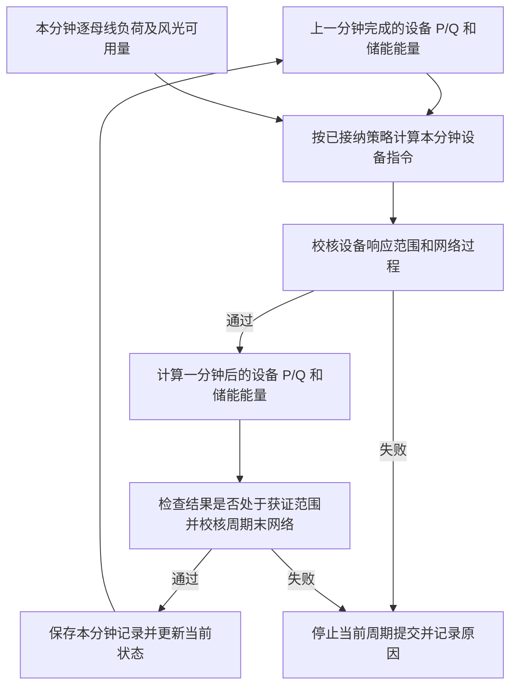

# 正式单微电网协同控制算法的设备响应模拟说明

本文依据当前源代码，说明“每分钟计算设备指令，再模拟设备响应、更新储能能量，并校核网络状态”的具体含义，以默认山城区域 `SC`、启用储能的正式单微电网流程为主。核对日期为 2026-10-15；算法版本为 `unified-single-v7`，本文所述执行设备模型为 `unified-device-v1`。

**模拟设备响应，就是根据本分钟开始时的设备状态和本分钟指令，使用设定的响应公式，计算一分钟后设备达到的 P/Q 和储能能量。**通过校核后，这些结果成为下一分钟的起始状态。

本文中的“实际出力”“完成状态”均指离线仿真中已经计算并提交的状态；当前流程尚未通过 D5000 获取现场设备执行反馈。这些结果应与经济规划的预期出力、设备指令及现场实测值分别理解。

## 1. 模拟在整体调度流程中的位置

默认每 15 分钟更新经济规划，每分钟执行一次控制。15 分钟是经济规划的更新间隔，1 分钟是设备状态的推进间隔；两者共同工作。



在经济更新点，程序还会使用当前完成状态提出新的规划，并校核能否接纳其目标和策略。在两个更新点之间，控制器仍根据每分钟负荷及设备状态计算指令，因此设备指令可以逐分钟变化。

程序按仿真时钟推进这一循环；“一分钟执行一次”描述模型时间步长，不表示已经实现现场每 60 秒按硬实时期限完成的控制系统。

## 2. 模拟需要哪些输入，输出什么

| 数据 | 内容与用途 | 主要代码类型或来源 |
| --- | --- | --- |
| 本分钟起始状态 | 每台设备上一分钟完成的 P、Q，以及储能当前能量 E | `TubeState` |
| 本分钟设备指令 | 分别下发给各设备的有功指令和无功指令 | `TubeCommand` |
| 设备响应参数 | 有功响应系数、统一无功响应系数、整定精度及一分钟步长 | `TubeDeviceModel`、`TubeResource` |
| 设备能力参数 | P/Q 范围、视在容量、适用的 Q/P 比例约束、功率变化额度、储能能量及效率 | 设备模型和山城配置 |
| 本分钟负荷与风光可用量 | 用于反馈指令计算、观测前提检查和网络校核 | `SingleForecastEnvelope`，当前由模拟运行输入提供 |
| 模拟输出 | 各设备一分钟后的 P、Q，以及储能一分钟后的 E | 新的 `TubeState` |

`execute_tube_command()` 的直接输入只有设备模型、起始状态和设备指令。负荷首先参与指令计算，然后与设备出力一起参与网络校核；它并非在设备响应函数内部直接生成新的出力。

单位与符号约定如下：

- 有功 P 和有功指令的单位为 MW；设备 P 为正表示向微电网注入有功。
- 无功 Q 和无功指令的单位为 Mvar，按项目内部注入方向统一计算。
- 储能 E 的单位为 MWh；储能 P 为正表示放电，P 为负表示充电。
- 时间步长为 1 分钟，计算电量时换算为 `1/60` 小时。
- PCC 有功正值表示从上级电网受电，其符号含义与设备注入有功不同。

## 3. 风机、光伏和无功调节怎样响应指令

### 3.1 基本响应公式

对某台设备的一项功率，先计算：

```text
x_raw = x_now + α × (u − x_now)
```

其中：

| 符号 | 含义 |
| --- | --- |
| `x_now` | 本分钟开始时，已经完成的设备功率 |
| `u` | 本分钟下发的设备功率指令 |
| `α` | 一分钟内完成指令与当前功率差额的比例 |
| `x_raw` | 应用整定精度规则前，一分钟后的功率 |

有功使用每台设备自己的 `alpha_p`，无功使用设备模型统一的 `alpha_q`。当系数小于 1 时，响应会逐步接近指令；系数等于 1 时，本步结果等于指令。

该计算位于 [application_tube.py](../../src/oilfield_energy/modules/control/application_tube.py) 的 `device_response()`。它是一个确定性公式：相同的起始状态、指令和参数会得到相同结果，函数内部没有额外抽取随机响应误差。

### 3.2 默认响应速度

风机、光伏及统一无功响应的系数由时间常数计算：

```text
α = 1 − exp(−Δt / τ)
```

当前正式装配固定 `Δt = 1` 分钟；`τ` 为以分钟为单位的时间常数。

| 对象 | 默认时间常数或系数 | 模拟含义 |
| --- | --- | --- |
| 风机有功 P | `τ = 2` 分钟，`α ≈ 0.393469` | 一分钟完成当前差额的约 39.35% |
| 光伏有功 P | `τ = 0.25` 分钟，`α ≈ 0.981684` | 一分钟完成当前差额的约 98.17% |
| 获准调节的无功 Q | `τ = 2` 分钟，`α ≈ 0.393469` | 各设备无功采用统一响应系数 |
| 储能有功 P | `α = 1` | 采用本分钟指令并保持，能量更新见第 5 节 |
| SVG 有功 P | P 范围固定为 0 | 不承担有功调节 |

默认山城配置关闭光伏和储能的无功控制，二者 Q 固定为零。统一无功响应系数并不赋予设备额外控制权限；在此配置下，主要由风机和 SVG 按该系数调整无功。

时间常数为 2 分钟，并不意味着“等待 2 分钟后才动作”或“恰好 2 分钟完全达到指令”。它控制每一步接近指令的速度。例如，在指令不变且尚未触发整定规则时，2 分钟后约完成初始差额的 63.21%。

这些参数属于项目设定的离线响应模型。代码将其标为软件仿真参数、非现场验收定值；不能据此认定山城真实设备具有相同速度，也不能据此判断真实 SVG 或变流器的内部调节速度。

### 3.3 一个风机有功响应示例

假设某台风机起始 P 为 1 MW，连续三分钟指令均为 1.5 MW，默认时间常数为 2 分钟。另假设可用风功率、无功和网络条件允许这些动作。

第一分钟计算为：

```text
P_next = 1 + 0.393469 × (1.5 − 1)
       ≈ 1.196735 MW
```

继续使用同一公式得到：

| 时刻 | 本分钟指令 | 完成后的模拟出力 |
| --- | --- | --- |
| 起始 | — | 1.000000 MW |
| 第 1 分钟末 | 1.500000 MW | 1.196735 MW |
| 第 2 分钟末 | 1.500000 MW | 1.316060 MW |
| 第 3 分钟末 | 1.500000 MW | 1.388435 MW |

每一步均从上一步完成的出力继续计算。正式反馈控制中的下一分钟指令可以改变；此例保持指令不变，仅用于展示响应公式。

### 3.4 指令值与期望达到的出力可以不同

控制器生成指令时已经考虑设备响应速度。`balance_policy_command()` 先根据当前状态及基础指令估计周期末出力，再计算需要补偿的功率差额，并按已接纳策略分配给参与调节的设备。

对参与设备，指令修正量包含“分配到的差额除以响应系数”。因此，为使周期末出力增加一定幅度，响应较慢的设备可能需要更大的指令修正量。这个修正仍须经过能力、变化额度和网络校核。

这也解释了为什么日志需要同时保存设备指令与模拟完成状态：二者表达的含义不同。

## 4. 接近指令时如何判断已经完成响应

纯粹按比例接近指令，可能需要无限多步才在数学上完全相等。当前执行模型增加了明确的有限精度整定规则：

```text
先计算 x_raw = (1 − α) × x_now + α × u

若 abs(x_raw − u) ≤ ε：x_next = u
否则：                 x_next = x_raw
```

默认 `ε = 0.0001`，对应有功的 0.0001 MW 或无功的 0.0001 Mvar，分别相当于 0.1 kW、0.1 kvar。该值来自 `SingleResearchPolicy.settling_resolution`，在构造执行域时写入设备模型。

例如，指令为零且按响应公式计算出的剩余出力已不超过这个精度，程序会把周期末出力设为零。这有助于表达有限步完成停发或归零的状态。

这个精度是设备响应模型中的整定参数，与 PCC 目标跟踪允许误差不是同一个概念。归整产生的最后一小段变化仍纳入功率变化额度校核。

数值实现中，响应及能量运算使用 `Fraction` 对已给定的数值进行有理运算，执行结果再转换为浮点数；区间校核使用向外舍入，以包住转换后的结果。这种处理控制数值计算边界，并不证明设备模型与现场真实响应完全一致。

## 5. 储能有功响应及能量更新

### 5.1 一分钟内保持给定功率

当前单微电网模型规定储能有功 `alpha_p = 1`，并假定储能变流器 PCS 在本分钟接受给定功率后，将其保持整个执行区间。这称为“零阶保持”。

因此，本分钟储能有功完成值等于本分钟指令，能量也按这个功率持续一分钟计算。下一分钟可以重新给定功率，不能将“一分钟内保持”理解为整个 15 分钟必须保持同一充放电功率。

这是当前分钟尺度模型的简化假设：没有进一步计算 PCS 在该分钟内部的毫秒级过渡或一阶有功滞后。模型同时要求储能相邻步功率变化不能超过允许额度，具体见第 6 节。

### 5.2 充放电能量公式

设 `P_cmd` 为本分钟储能有功指令，`E_now` 为起始能量，`η_dis` 和 `η_ch` 分别为放电、充电效率：

```text
放电，P_cmd ≥ 0：
E_next = E_now − P_cmd / η_dis × (1/60)

充电，P_cmd < 0：
E_next = E_now + (−P_cmd) × η_ch × (1/60)
```

放电时，为向电网交付相同电量，储能内部需要消耗更多能量，因此除以放电效率；充电时，进入储能内部的能量小于电网输入电量，因此乘以充电效率。

默认山城储能参数为：功率范围 −2.5～2.5 MW，能量范围 0.5～5 MWh，初始能量 2.5 MWh，充放电效率均为 0.95。它们的配置来源及资料属性见 [统一模拟数据配置](../../src/oilfield_energy/bootstrap/assets/unified_dataset.json)。

### 5.3 计算示例

放电示例：假设储能起始能量为 2.5 MWh，上一分钟完成的 P 为 0.5 MW，本分钟指令为 1 MW。功率变化为 0.5 MW，在默认储能一分钟变化额度 0.65 MW 内。其他条件通过校核时：

```text
P_next = 1 MW
E_next = 2.5 − 1 / 0.95 / 60
       ≈ 2.482456 MWh
```

充电示例：另取起始能量 2.5 MWh、上一分钟 P 为 −0.5 MW，本分钟指令为 −1 MW，则：

```text
P_next = −1 MW
E_next = 2.5 + 1 × 0.95 / 60
       ≈ 2.515833 MWh
```

这两个示例分别计算，不是连续的两个步骤。能量更新还必须通过能量上下限校核；程序不会先把储能充到越界，再直接把结果截成上限。

## 6. 响应速度与功率变化额度如何共同约束动作

响应系数决定“给定指令下，模型会变化多少”；功率变化额度决定“这种变化是否允许”。两者共同使用。

当前装配从 `DynamicTrackingPolicy` 读取有功变化基准 0.65 MW/分钟，并按设备类别分配；它不是整个微电网全部有功设备合用的总预算。

| 对象 | 默认一分钟有功变化额度 |
| --- | --- |
| 两台风机 | 均分风电类别的 0.65 MW，各为 0.325 MW |
| 两组光伏 | 按装机容量占比分配光伏类别的 0.65 MW；2.4 MW 组约 0.371429 MW，1.8 MW 组约 0.278571 MW |
| 储能 | 0.65 MW |
| SVG | 0 MW，因其 P 固定为零 |

此外，全部设备无功变化的绝对值之和不得超过默认的 0.90 Mvar/分钟。不同设备一增一减，不能相互抵消这一变化预算。

对于确定的起始状态，普通有功响应首先检查：

```text
αP × abs(P_cmd − P_now) ≤ 本设备一分钟有功变化额度
```

无功响应检查各设备 `αQ × abs(Q_cmd − Q_now)` 的总和。计算整定后的端点范围后，代码还会再次检查变化额度，计入整定和数值包络带来的变化。

例如，储能从 0 MW 直接给到 1 MW，即使 1 MW 在其额定功率范围内，也会超过默认 0.65 MW 的单步变化额度。当前执行模型会拒绝这一动作。它不会把指令自动裁剪成 0.65 MW 后，继续声称原指令或原跟踪保证已经完成。

同理，光伏的响应系数接近 1，只代表其模型响应较快，不代表任意幅度的指令变化都能通过校核。

## 7. 模拟前后怎样校核设备和电网

### 7.1 观测及设备能力检查

每分钟先检查输入观测与已声明的前提一致，包括逐母线负荷是否处于允许范围、风光可用量是否不低于声明下界，以及资源标识是否匹配。

本分钟设备模型通过 `device_model_at()` 构造。风光有功上限采用装机上限与该时刻保证可用量中的较小值。观察到额外可用功率，并不意味着当前策略自动取得使用全部额外功率的保证。

`certify_device_transition()` 进一步检查起始状态、设备指令、响应端点及适用的过程能力条件，主要包括：

- P/Q 是否处于设备允许范围。
- P、Q 组合是否满足视在容量约束 `P² + Q² ≤ S²`。
- 对具有 Q/P 比例限制的设备，是否满足相应的无功随有功变化的限制。
- 有功变化及无功公共变化预算是否满足。
- 储能能量是否保持在允许范围内。

### 7.2 响应范围与网络过程检查

校核函数除了给出一分钟后的端点范围，还构造包含起始状态与端点的过程包络 `transition.path`，用于覆盖模型描述的设备变化范围。网络校核将这些设备注入与逐母线负荷组合，检查交流网络约束。

对具有相同 P/Q 响应系数的设备，设备能力检查会利用两者同步变化的关联，避免把无法同时出现的 P、Q 极值组合误认为真实状态；对响应系数不同的情况，则保留较保守的矩形过程范围检查。网络过程校核仍使用生成的区间包络。

这些检查针对模型定义的范围，并不逐毫秒求解电气瞬态。当前研究配置的分钟内扰动假设为零阶保持，即以本分钟的输入值代表该执行区间，不描述一分钟内任意快速变化的负荷轨迹。

### 7.3 执行后检查及状态提交

通过执行前校核后，`execute_tube_command()` 计算新的 P/Q/E。控制器继续检查：

1. 新状态是否落入本次校核的响应端点范围。
2. 使用目标跟踪反馈时，是否落入该策略对应的跟踪状态范围。
3. 使用储能能量回归反馈时，是否落入相应的能量任务状态范围。
4. 周期末网络是否取得有效校核结果，并得到 PCC P/Q 的计算范围。

网络校核涉及节点电压、支路容量、PCC 受电范围和功率因数等。周期末 PCC P/Q 还会用于记录是否满足已接纳目标的跟踪误差带。安全校核通过与目标跟踪达标分别记录；在允许的响应过渡阶段，不能要求从第一分钟起就始终精确达到新目标。

检查通过后，`UnifiedStep` 保存本分钟的 `before`、`command`、`after`、观测及 PCC 结果，随后执行 `self.state = after`。下一分钟从这个完成状态继续计算。

若设备响应或网络检查失败，当前周期不会提交为已完成状态。外层流程保留此前执行记录和失败原因；控制器已建立时报告 `assumption_violated`。这表示离线执行前提或校核失败，不能解释为已经模拟完成现场保护跳闸、通信重试或紧急处置。

## 8. 当前模型包含哪些假设和边界

| 项目 | 当前处理方式 |
| --- | --- |
| 响应参数来源 | 使用配置的仿真时间常数和变化额度，尚不能视为已通过山城现场实测辨识的参数 |
| 时间尺度 | 每分钟推进一次功率与能量，未展开毫秒级内部动态 |
| 风机与光伏 | 模拟功率对指令的响应，不进一步计算风机机械转速、桨距、光伏直流侧等内部状态 |
| SVG 及其他无功调节 | 采用统一无功响应系数，未细化各厂商控制器差异 |
| 储能 | 单步有功保持、固定充放电效率；本响应函数未计算温度、效率随工况变化或电池内部电化学过程 |
| 负荷与风光输入 | 当前读取模拟分钟序列，并要求满足已声明边界；分钟内扰动采用保持假设 |
| 额外响应误差 | 响应函数内部不额外加入随机时延、测量噪声或设备参数漂移 |
| 通信与执行回执 | 本执行链直接计算模拟状态，未通过现场通信回执确认设备动作 |
| 电网校核 | 对固定径向网络进行稳态交流范围校核，不等同于电磁暂态或频率稳定性仿真 |
| 校核与执行关系 | 使用同一套声明的设备响应规则，因此模型内一致性检查不能替代独立的现场响应验证 |

本说明只针对当前正式单微电网链路。仓库中其他历史设备模型或集群执行模型可能采用不同的储能响应、限幅和能量积分方式，阅读时应按实际调用链区分。

## 9. 与 5 分钟、10 分钟及 15 分钟的关系

| 时间参数 | 含义 | 与设备响应的关系 |
| --- | --- | --- |
| 1 分钟 | 执行步长 | 每一步计算新的设备指令、响应和能量 |
| 2 分钟、0.25 分钟 | 默认响应时间常数 | 用于计算设备每分钟的响应系数，不是等待时间或硬性完成期限 |
| 5 分钟 | 名义规划的默认过渡构造长度 | 用于构造经济规划候选，不能直接当成正式执行的统一响应期限 |
| 10 分钟 | 默认新接纳 PCC 目标的响应期限 | 对获证策略在期限后的周期末跟踪作出要求 |
| 15 分钟 | 默认经济规划更新间隔 | 更新规划和目标请求，其间仍逐分钟执行反馈和设备响应计算 |

名义规划与正式执行采用相关联的设备参数，但正式执行仍须重新校核完整响应规则、目标跟踪、网络安全和储能任务。规划给出的名义轨迹不能直接代替已经完成的设备状态。

## 10. 主要代码与阅读依据

下表按“参数来源 → 指令 → 响应 → 校核 → 循环”的顺序列出主要位置。相对链接从本说明所在目录解析。

| 文件及主要入口 | 作用 |
| --- | --- |
| [modules/control/contracts.py](../../src/oilfield_energy/modules/control/contracts.py)：`DynamicTrackingPolicy` | 定义默认时间常数、有功变化基准和无功公共变化额度 |
| [bootstrap/adapters/single_planning.py](../../src/oilfield_energy/bootstrap/adapters/single_planning.py)：`single_execution_policy()` | 为正式单网入口创建默认执行策略 |
| [bootstrap/adapters/single_model.py](../../src/oilfield_energy/bootstrap/adapters/single_model.py)：`assemble_single_physical_model()` | 装配风、光、储、SVG 的响应系数、能力与额度 |
| [bootstrap/assets/unified_dataset.json](../../src/oilfield_energy/bootstrap/assets/unified_dataset.json) | 默认山城设备容量、储能效率与能量参数，以及参数资料属性 |
| [modules/control/contracts_tube.py](../../src/oilfield_energy/modules/control/contracts_tube.py) | 定义设备模型、指令、状态和响应区间；约束单网储能有功使用保持模型 |
| [workflows/single_execution/contracts_unified.py](../../src/oilfield_energy/workflows/single_execution/contracts_unified.py)：`SingleResearchPolicy` | 定义整定精度和分钟内扰动保持等研究设置 |
| [workflows/single_execution/forecast.py](../../src/oilfield_energy/workflows/single_execution/forecast.py) | 将研究整定精度写入执行设备模型，并构造带上下文标识的执行域 |
| [modules/control/application_policy.py](../../src/oilfield_energy/modules/control/application_policy.py)：`balance_policy_command()` | 利用当前状态、负荷和预计响应计算分钟反馈指令 |
| [modules/control/application_tube.py](../../src/oilfield_energy/modules/control/application_tube.py)：`device_response()`、`certify_device_transition()`、`execute_tube_command()` | 核心响应公式、整定规则、设备过程校核、P/Q 推进和储能能量更新 |
| [workflows/single_execution/network.py](../../src/oilfield_energy/workflows/single_execution/network.py)：`device_model_at()`、`unified_network_box()` | 构造时变风光能力上限，将设备响应范围映射到逐母线网络校核 |
| [workflows/single_execution/certificates.py](../../src/oilfield_energy/workflows/single_execution/certificates.py)：`validate_unified_observation()` | 检查本分钟负荷、资源标识和风光可用量是否符合声明前提 |
| [workflows/single_execution/unified.py](../../src/oilfield_energy/workflows/single_execution/unified.py)：`UnifiedSingleController.advance()` | 组织本分钟指令、响应及网络检查，保存记录并提交完成状态 |
| [workflows/single_execution/run_unified.py](../../src/oilfield_energy/workflows/single_execution/run_unified.py)：`run_unified_feedback()` | 组织经济更新、分钟循环和失败结果记录 |
| [bootstrap/adapters/single_unified.py](../../src/oilfield_energy/bootstrap/adapters/single_unified.py)：`observe()` | 从模拟运行序列读取本分钟逐母线负荷及风光可用量 |
| [tests/unit/control/test_device_tube.py](../../tests/unit/control/test_device_tube.py) | 现有测试覆盖储能能量积分、变化额度、有限精度整定和 P/Q 能力关联等行为 |

进一步阅读：[调度策略说明](新能源最优协同控制算法_调度策略说明.md)、[正式单微电网联合 P/Q 动态规划](../modeling/Single_PQ_Planning.md)。

本文中的风机连续三步响应及储能充、放电示例，已通过调用当前 `device_response()`、`execute_tube_command()` 复算。示例用于解释局部计算；它们不构成完整山城网络运行算例或现场设备验证报告。
